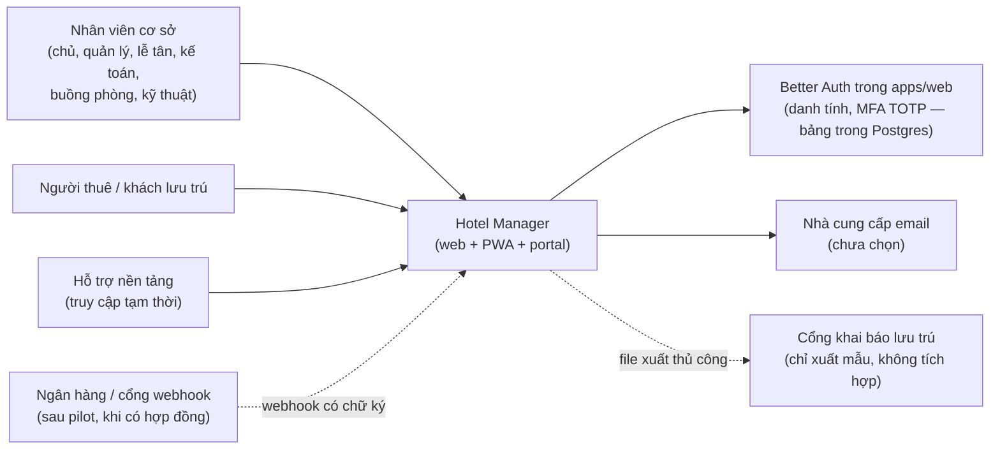
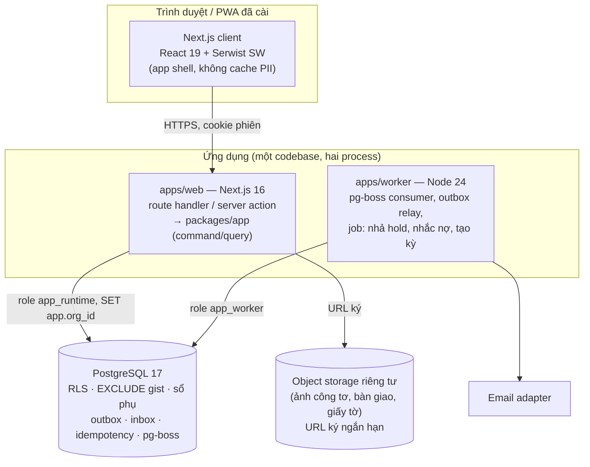

# ARCHITECTURE — sơ đồ C4 mức 1–2 và luồng giao dịch (G4)

> Phiên bản 1 · 2026-10-15 · Draft, chờ duyệt.
> Quyết định stack: [ADR-0001](../adr/0001-modular-monolith-typescript-postgres.md). Mô hình dữ liệu: [DOMAIN-MODEL](DOMAIN-MODEL.md).

## C4 mức 1 — Bối cảnh hệ thống



## C4 mức 2 — Container



## Lớp và quy tắc phụ thuộc

```text
apps/web (UI, HTTP)  ─┐
apps/worker (job)    ─┼─► packages/app (command/query: transaction, quyền, audit, outbox, idempotency)
                      │        └─► packages/domain (quy tắc thuần: giá, kỳ thu, prorata, làm tròn, state machine)
                      │        └─► packages/db (Kysely, SQL, migrations, RLS)
                      └─► (không được gọi thẳng packages/db từ UI)
```

- `packages/domain` không có I/O và không import `db`. Test bằng unit/property test (fast-check).
- `packages/app/<module>` chỉ export qua `index.ts`. Module này không ghi bảng tài chính của module khác. Ví dụ: Lease gọi `billing.createCharges`, không tự INSERT vào `charges`.
- Kiểm quyền hai lớp: `packages/app` dùng `authorize(actor, action, scope)` trước mọi command; RLS ở DB là lớp thứ hai.

## Luồng một command ghi (kế hoạch §11)

```text
1. HTTP POST + Idempotency-Key + phiên
2. Xác minh phiên Better Auth (cookie) → tra memberships → actor {person_id, org_id, roles, property_scopes, limits}
3. BEGIN; SET LOCAL app.org_id = actor.org_id; SET LOCAL app.actor_id = …
4. idempotency: INSERT … ON CONFLICT → nếu đã có kết quả: trả kết quả cũ; khác hash: 409 IDEMPOTENCY_CONFLICT
5. authorize(actor, action, scope) → domain rule → ghi nghiệp vụ (constraint DB là chốt cuối)
6. INSERT audit_events + outbox (cùng transaction)
7. COMMIT → 200/201 kèm command_id
8. worker: outbox → pg-boss → email/push/đối tác; thất bại → retry backoff → dead letter + cảnh báo
```

- Client timeout ở bước 7 → gọi `GET /api/v1/commands/{command_id}` để lấy kết quả, **không** gửi lệnh mới (kế hoạch §09, §13).
- Lỗi constraint (`23P01` chồng phòng, `23505` trùng) được dịch thành mã nghiệp vụ, không trả lỗi SQL thô.

## Môi trường

| Môi trường | CSDL | Auth | File | Email | Ghi chú |
|---|---|---|---|---|---|
| dev | Postgres 17 Docker | Better Auth (cùng DB) | SeaweedFS Docker | bản giả ghi file | dữ liệu giả, seed |
| CI | Testcontainers Postgres 17 | JWT ký bằng khoá test | bộ nhớ | bản giả | không mạng ngoài |
| staging | VPS tự host riêng (mua VPS = điểm dừng) | Better Auth | SeaweedFS | SMTP sandbox | dữ liệu giả/ẩn danh |
| production | VPS tự host tại VN + pgBackRest PITR ra kho ngoài máy | Better Auth | SeaweedFS + đồng bộ ngoài máy | SMTP relay đã chọn | chỉ mở sau GO-NO-GO |

## Quan sát tối thiểu (G5)
- Log JSON có `correlation_id`, lọc PII (che số điện thoại, CCCD, token).
- Metrics: p95 theo route, lỗi theo mã, độ trễ outbox, số dead letter, số `reconciliation_break`.
- Healthcheck `/api/health` (DB + hàng đợi). Cảnh báo cấu hình ở G8.
