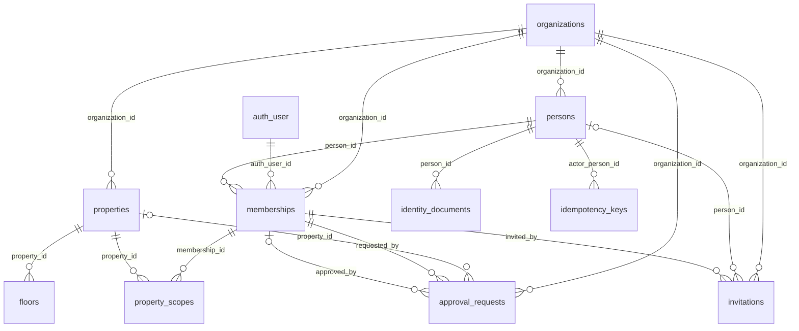
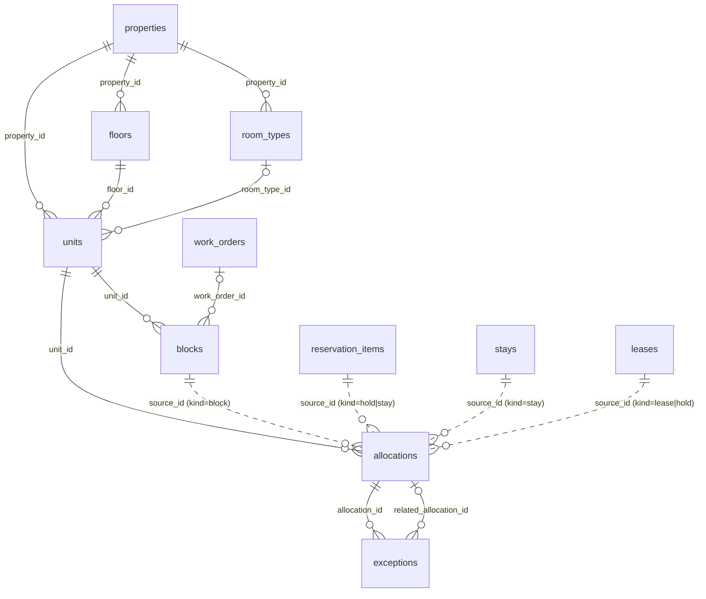
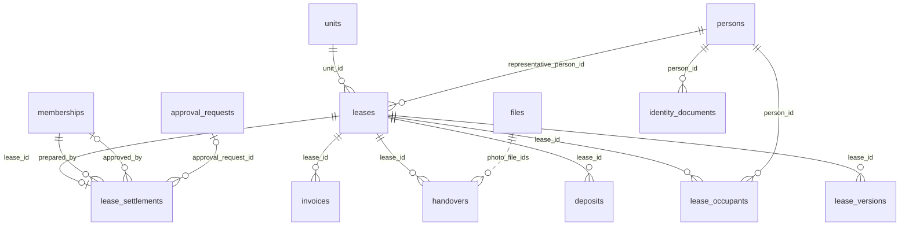
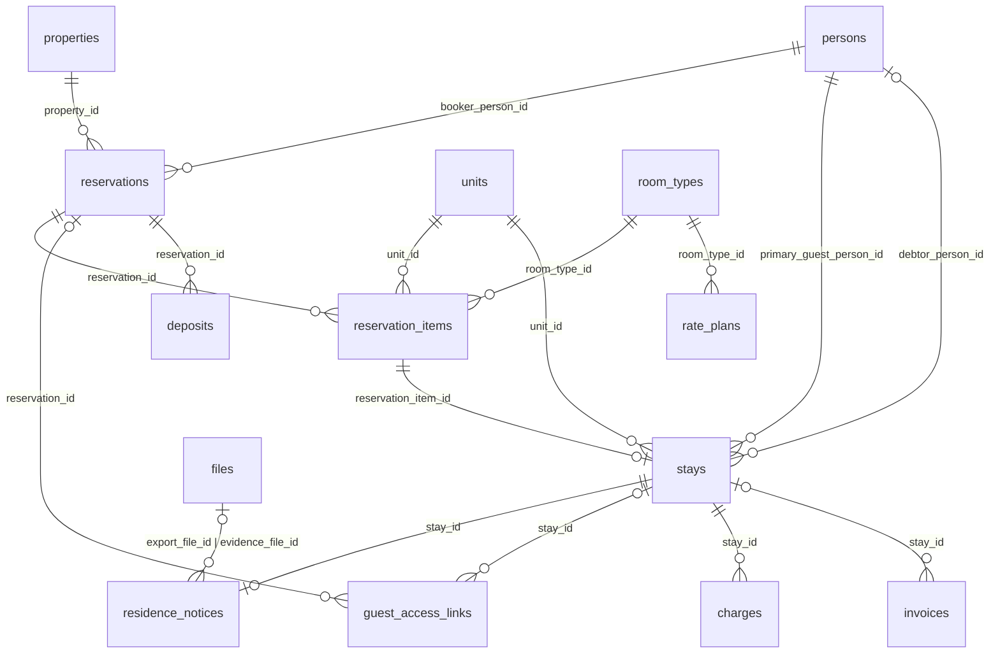
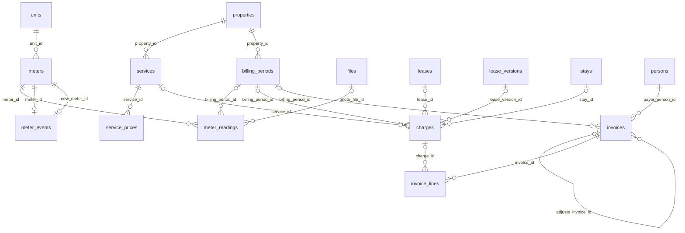
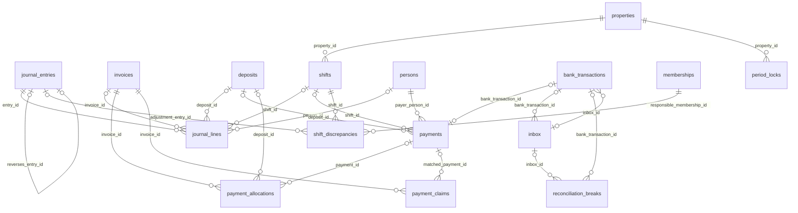
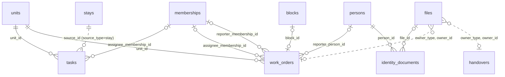
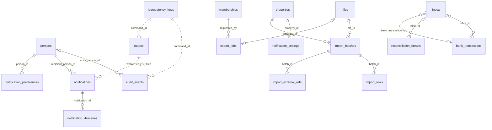

# ERD — sơ đồ quan hệ và từ điển dữ liệu (G4)

> Phiên bản 1 · 2026-10-15 · Trạng thái: Draft, chờ duyệt.
> Nguồn: [DOMAIN-MODEL](DOMAIN-MODEL.md) v1.2 (từ điển §1, bất biến INV-G/I/F §2–§5, vòng đời §4, sổ phụ §5, bảng bổ sung §7) · [ARCHITECTURE](ARCHITECTURE.md) (command pipeline) · [API-CONTRACT](API-CONTRACT.md) · [ADR-0001](../adr/0001-modular-monolith-typescript-postgres.md) (Postgres 17, Kysely, SQL-first) · [ADR-0002](../adr/0002-self-host-auth-storage-backup.md) (Better Auth tự quản bảng trong schema `auth`) · mục 4 "Dữ liệu" của mọi SPEC trong [docs/specs](../specs/).
> Đây là tiền đề cho migration đầu tiên (kế hoạch §12). Tên bảng chuẩn ở DOMAIN-MODEL; tên cột lấy từ SPEC. Thêm/đổi tên bảng = sửa DOMAIN-MODEL trước. Sau khi migration đã áp, migration là nguồn sự thật và ERD được cập nhật cùng migration kế tiếp.
> Máy kiểm: `bash scripts/check-erd.sh` đối chiếu 60 bảng DOMAIN-MODEL ↔ ERD (mỗi bảng đúng một tiêu đề `###`, có dòng `Chủ module:`).
> Mọi chỗ ghi "đề xuất" là quyết định thiết kế của ERD khi SPEC chưa nêu; chỗ SPEC mâu thuẫn hoặc thiếu nằm ở mục 7.

## 1. Quy ước chung

**Khoá và định danh**
- PK là `id uuid` (UUID v7 sinh ở app để index có thứ tự thời gian; DB không đặt `DEFAULT`, `pgcrypto` chỉ phục vụ seed/test). Mã hiển thị cho người (số phiếu, số hợp đồng, mã booking) là cột riêng `number`/`memo_ref`, cấp theo cơ sở.
- `organization_id uuid NOT NULL` ở **mọi** bảng nghiệp vụ và hạ tầng (INV-G1), trừ `organizations` (chính là tenant). Bảng thuộc cơ sở có thêm `property_id uuid NOT NULL`; bảng con chép `property_id` từ cha khi RLS/truy vấn cần lọc theo cơ sở.
- Bảng cha có `UNIQUE (organization_id, id)`; mọi FK từ bảng con là **FK ghép** `(organization_id, <fk>_id) REFERENCES <cha> (organization_id, id)`, nên con không thể trỏ sang tổ chức khác. Khi cả cha lẫn con đều có `property_id`, FK gồm cả cột đó: `(organization_id, property_id, <fk>_id) → (organization_id, property_id, id)`, cha có thêm `UNIQUE (organization_id, property_id, id)`, nên con không thể trỏ sang cơ sở khác.
- Tham chiếu "đa hình" (`allocations.source_id`, `journal_entries.source_doc_*`, `files.owner_*`, `approval_requests.subject_*`) và cột mảng id (`handovers.photo_file_ids`, `charges.reading_ids`) **không có FK**; tính đúng được giữ bằng command, constraint trigger hoặc test bất biến, và được ghi ở từng bảng.
- Quy ước tên ràng buộc: `pk_`, `fk_<con>_<cha>`, `uq_`, `ck_`, `ix_`, `ex_` (EXCLUDE), `trg_`.

**Cột chuẩn** (không lặp lại trong từng bảng cột bên dưới)
- Mọi bảng: `id`, `organization_id` (trừ `organizations`), `created_at timestamptz NOT NULL DEFAULT now()`.
- Loại **M** (có UPDATE): thêm `updated_at timestamptz NOT NULL DEFAULT now()` (trigger `set_updated_at`) và `version integer NOT NULL DEFAULT 1` (khoá lạc quan, `VERSION_CONFLICT`). Loại **C** (danh mục): như M, thêm `archived_at timestamptz` (soft delete, INV-G7). Loại **A** (append-only): không có `updated_at`, `version`; UPDATE/DELETE bị chặn (INV-G4). Loại **H** (hạ tầng): ghi chú riêng.

**Kiểu dữ liệu**
- Thời điểm `timestamptz` lưu UTC; ngày địa phương (`business_date`, ngày hợp đồng, kỳ thu) là `date`; khoảng thời gian `tstzrange` theo `[start, end)` (INV-I2); khoảng ngày hiệu lực dùng `daterange(from, to, '[]')` (ngày kết thúc **gồm** trong khoảng, vì hợp đồng ghi "đến hết ngày").
- Tiền: `bigint` đồng + `currency char(3) NOT NULL DEFAULT 'VND'` trên chứng từ (INV-G3); không dùng float. Lượng và đơn giá phân số: `numeric` (đơn giá `numeric(18,4)`, lượng `numeric(18,4)`, chỉ số công tơ `numeric(14,3)`). Chứng từ lưu `rounding_rule`, `formula_version`, `tax_profile_id`.
- Trạng thái và loại: `text` + `CHECK (… IN (…))` theo vòng đời DOMAIN-MODEL §4 (không dùng `enum` Postgres để migration thêm giá trị không cần `ALTER TYPE`). Chuyển trạng thái ngoài bảng bị `packages/domain` từ chối (`INVALID_TRANSITION`); DB giữ CHECK và trigger cho các bất biến tiền/tồn.
- JSON (`jsonb`) chỉ cho dữ liệu snapshot hoặc cấu hình; có `CHECK (jsonb_typeof(col) = 'object' | 'array')`. Mọi số tiền trong JSON là số nguyên đồng.
- "Người thao tác" (`*_by`, `assignee_*`) trỏ `memberships.id` (FK ghép). Riêng `audit_events.actor_person_id` và `idempotency_keys.actor_person_id` trỏ `persons.id` theo SPEC. Việc do worker làm: cột `*_by` để `NULL` và `audit_events.actor_type='worker'`.

**RLS (ba lớp)**
1. *Tenant — mọi bảng có `organization_id`:*

```sql
ALTER TABLE <bảng> ENABLE ROW LEVEL SECURITY;
ALTER TABLE <bảng> FORCE ROW LEVEL SECURITY;   -- áp cả với owner của bảng
CREATE POLICY tenant_isolation ON <bảng>
  USING      (organization_id = current_setting('app.org_id')::uuid)
  WITH CHECK (organization_id = current_setting('app.org_id')::uuid);
```

   Thiếu `app.org_id` thì `current_setting` báo lỗi (đóng an toàn, không trả hàng). Riêng `organizations`: điều kiện là `id = current_setting('app.org_id')::uuid`. Role `app_runtime` và `app_worker` không phải owner, không có `BYPASSRLS` (ADR-0002). Command đặt `SET LOCAL app.org_id` và `SET LOCAL app.actor_id` ngay sau `BEGIN` (ARCHITECTURE, bước 3).
2. *Phạm vi cơ sở (đề xuất, T-007):* với bảng có `property_id`, policy bổ sung chỉ cho cơ sở nằm trong `property_scopes` của actor (hoặc `memberships.all_properties`).
3. *Vai trò/chủ thể (đề xuất, T-007):* các bảng nhạy cảm (`identity_documents`, `persons`, `invoices`, `payments`, `shifts`, `notifications`, `export_jobs`, `audit_events`…) có policy theo vai trò hoặc theo chủ thể, qua hàm trợ giúp `SECURITY DEFINER STABLE` (`app.has_role(text[])`, `app.actor_person_id()`) đọc `memberships` theo `app.actor_id`. Quy ước API: không đọc được thì `404`, không đọc được tài nguyên thì không lộ sự tồn tại.
- Truy cập **trước khi có ngữ cảnh tổ chức** (đăng nhập, `org.listMine`, `org.create`, link khách) đi qua hàm `SECURITY DEFINER` có phạm vi hẹp (`app.list_my_organizations(auth_user_id)`, `app.create_organization(...)`, `app.resolve_guest_link(token_hash)`), không mở `BYPASSRLS`.

**Bảng append-only và chứng từ bất biến (INV-G4)**
- Hoàn toàn append-only (trigger `BEFORE UPDATE OR DELETE` ném lỗi, kèm trigger statement-level chặn `TRUNCATE`, và `REVOKE UPDATE, DELETE, TRUNCATE` khỏi `app_runtime`/`app_worker`): `journal_entries`, `journal_lines`, `audit_events`, `bank_transactions`, `invoice_lines`, `meter_events`, `import_external_refs`.
- Bất biến **nội dung tiền** sau một mốc (trigger chặn đổi các cột tiền, cho phép đúng các cột trạng thái được liệt kê): `payments` (sau `confirmed`), `invoices` (sau khi phát hành; chỉ `allocated_total` đổi được), `charges` (sau khi có dòng phiếu), `lease_versions` (sau ký), `handovers` (sau xác nhận), `lease_settlements` (sau duyệt), `shifts` (sau `closed`), `period_locks` (chỉ điền cột mở khoá), `import_batches` (sau `committed`), `inbox` (`raw`, `payload_hash`).
- Sửa sai bằng chứng từ **đảo/điều chỉnh** tham chiếu bản gốc, có lý do và người duyệt; sau `period_locks` hoặc chốt ca chỉ thêm được chứng từ ghi ngày trong kỳ đang mở (INV-F6).

**Vận hành**
- Mọi migration có `up` và `down` (ADR-0001). Extension: `btree_gist`, `pgcrypto`. Cấu hình phiên: `statement_timeout`, `idle_in_transaction_session_timeout` (DB-TX-003).
- Lỗi ràng buộc dịch sang mã nghiệp vụ: `23P01` → `ROOM_UNAVAILABLE` / `LEASE_VERSION_OVERLAP`; `23505` → mã trùng tương ứng (`UNIT_CODE_TAKEN`, `BANK_TRANSACTION_ALREADY_USED`…); trigger cân bằng sổ → `LEDGER_UNBALANCED` (500).
- Mọi `PRIMARY KEY`, khoá unique và FK có index đỡ phía con; index thêm chỉ ghi khi có truy vấn nóng đã biết trong SPEC.

## 2. Sơ đồ quan hệ

Chỉ vẽ quan hệ, không liệt kê cột (cột ở mục 3). Mọi bảng (trừ `organizations`) có `organization_id → organizations`; không vẽ lại ở từng sơ đồ trừ nhóm 1. Đường liền = FK thật; đường chấm = tham chiếu logic không FK (đa hình hoặc mảng id). `auth_user` đại diện bảng `auth.user` của Better Auth (mục 4).

### 2.1 Access và cơ sở



### 2.2 Phòng và lịch (Inventory)



### 2.3 Hợp đồng thuê (Lease)



### 2.4 Đặt phòng và lưu trú (Reservation và Stay)



### 2.5 Giá, công tơ và kỳ thu (Pricing, Meter, Billing)



### 2.6 Sổ phụ, thanh toán và đối soát (Ledger, Payment, Reconciliation)



### 2.7 Vận hành, buồng phòng và file (Ops, Housekeeping, Files)



### 2.8 Tích hợp, audit, thông báo, import và xuất (Integration, Audit, Notification, Import, Export)



## 3. Từ điển dữ liệu

Mỗi bảng: mục đích · `Chủ module` (theo ranh giới module ở ADR-0001/ARCHITECTURE: module chỉ ghi bảng của mình, module khác gọi qua `index.ts`) · loại bảng · cột (không lặp cột chuẩn của mục 1) · khoá/index/ràng buộc đặc biệt · RLS/quyền đặc biệt · bất biến liên quan. Cột `Null`: "không" = `NOT NULL`.

## 3.1. Nhóm Access

### `organizations`
Khách hàng SaaS (chủ kinh doanh), là ranh giới tenant.

Chủ module: Access

Loại: M · không có `organization_id` (chính là tenant).

| Cột | Kiểu | Null | Ràng buộc/mặc định | Ghi chú |
|---|---|---|---|---|
| name | text | không | `CHECK (length(btrim(name)) BETWEEN 1 AND 200)` | |
| status | text | không | `CHECK (status IN ('active','suspended'))`, mặc định `'active'` | `suspended`: tạm khoá toàn tổ chức (đề xuất) |
| settings | jsonb | không | `CHECK (jsonb_typeof(settings)='object')`, mặc định `'{}'` | Cờ tính năng (`mixed_template_enabled`, mặc định `false`) và hạn mức mặc định theo vai trò (`role_limits`) khi `memberships.limits` không đặt khoá; thay cho "bảng cấu hình theo tổ chức" của PLAN T-007 (mục 7) |
| created_by | uuid | không | | `auth.user.id` của người tạo; không FK, chỉ để truy vết |

- Khoá/index: `PK (id)`.
- RLS/quyền đặc biệt: policy `id = current_setting('app.org_id')::uuid`. Liệt kê tổ chức của một người (trước khi chọn ngữ cảnh) và tạo tổ chức đi qua hàm `SECURITY DEFINER` (`app.list_my_organizations`, `app.create_organization`); `org.create` tạo luôn `persons` + `memberships(role='owner')` trong cùng transaction.
- Bất biến: INV-G1, INV-G6 (sự kiện `organization.created` vào `audit_events` + `outbox`).

### `persons`
Người thật được ghi nhận trong tổ chức: người thuê, người ở, khách, người trả tiền, và cả nhân viên.

Chủ module: Access

Loại: M

| Cột | Kiểu | Null | Ràng buộc/mặc định | Ghi chú |
|---|---|---|---|---|
| full_name | text | không | `CHECK (length(btrim(full_name)) BETWEEN 1 AND 200)` | |
| phone | text | có | `CHECK (phone ~ '^\+?[0-9 .()-]{6,20}$')` | SPEC-lease: họ tên và SĐT bắt buộc với người thuê/khách; nhân viên được mời bằng email nên cột cho phép NULL, command tạo người thuê/khách bắt buộc (mục 7) |
| email | text | có | `CHECK (email = lower(btrim(email)))` | |
| address | text | có | | |
| nationality | char(2) | có | `CHECK (nationality = upper(nationality))` | ISO 3166-1 alpha-2; cần cho khách nước ngoài và `residence_notices.is_foreign` (SPEC-reservation-stay Q-08); đề xuất |
| anonymized_at | timestamptz | có | | Ẩn danh theo retention (INV-G7): xoá `full_name`/`phone`/`email`/`address`, giữ `id` làm tombstone |

- Khoá/index: `PK (id)`, `UNIQUE (organization_id, id)`; `ix (organization_id, phone)`, `ix (organization_id, lower(email))` phục vụ tìm kiếm.
- RLS/quyền đặc biệt: đọc/ghi cho `owner`, `manager`, `front_desk`; `accountant` chỉ đọc; `housekeeping`, `maintenance` không đọc người khác (chỉ hàng của chính mình); `tenant` chỉ đọc hàng của chính mình. Không bao giờ có thông tin này trong `outbox.payload` hay nội dung thông báo.
- Bất biến: INV-G1, INV-G7. Người dùng đăng nhập liên kết qua `memberships.auth_user_id`, không qua bảng này.

### `memberships`
Quan hệ người dùng ↔ tổ chức kèm vai trò, phạm vi cơ sở, hạn mức tiền và thời hạn.

Chủ module: Access

Loại: M

| Cột | Kiểu | Null | Ràng buộc/mặc định | Ghi chú |
|---|---|---|---|---|
| auth_user_id | uuid | có | FK → `auth.user(id)` (thêm ở migration T-006), `ON DELETE RESTRICT` | NULL khi lời mời tới người chưa có tài khoản (membership `invited`); kiểu uuid nếu Better Auth cấu hình sinh UUID (T-006 xác minh, mục 4) |
| person_id | uuid | không | FK ghép → `persons` | |
| role | text | không | `CHECK (role IN ('owner','manager','front_desk','accountant','housekeeping','maintenance','tenant','guest','platform_support'))` | 9 vai trò DOMAIN-MODEL §6; `guest` dùng cho ma trận quyền nhưng không tạo membership (khách dùng `guest_access_links`) |
| status | text | không | `CHECK (status IN ('invited','active','suspended','revoked'))`, mặc định `'active'` | |
| valid_from | timestamptz | không | mặc định `now()` | |
| valid_to | timestamptz | có | `CHECK (valid_to IS NULL OR valid_to > valid_from)`; `CHECK (role <> 'platform_support' OR valid_to IS NOT NULL)` | `platform_support` chỉ cấp tạm thời; SPEC-portal ghi `valid_until`, ERD dùng `valid_to` theo SPEC-access (mục 7) |
| limits | jsonb | không | `CHECK (jsonb_typeof(limits)='object')`, mặc định `'{}'` | Khoá `discount`, `refund`, `price_override`: số nguyên đồng ≥ 0 (`bigint`); 0 = mọi khoản cần duyệt; thiếu khoá thì lấy `organizations.settings.role_limits` |
| all_properties | boolean | không | mặc định `false`; `CHECK (NOT all_properties OR role IN ('owner','accountant'))` | "Mọi cơ sở" (SPEC-access ca biên rỗng; Q-09); đề xuất, SPEC chưa nêu cột |
| revoked_at | timestamptz | có | `CHECK ((status='revoked') = (revoked_at IS NOT NULL))` | |

- Khoá/index: `PK (id)`, `UNIQUE (organization_id, id)`; `UNIQUE (organization_id, auth_user_id) WHERE auth_user_id IS NOT NULL AND status IN ('invited','active','suspended')`; `UNIQUE (organization_id, person_id) WHERE status IN ('invited','active','suspended')`; `ix (auth_user_id)` cho tra cứu theo phiên.
- Ràng buộc đặc biệt: constraint trigger deferred "tổ chức còn ít nhất một `owner` `active`" (`LAST_OWNER`); khoá hàng `memberships` của tổ chức theo `id` tăng dần khi thu hồi/hạ vai trò (hai owner thu hồi nhau).
- RLS/quyền đặc biệt: policy `SELECT` bổ sung theo `auth_user_id = current_setting('app.auth_user_id', true)::uuid` (dạng `missing_ok`, thiếu thì không khớp hàng nào) cho bước chọn tổ chức; quyền không lấy từ token mà tra bảng này ở mỗi request (thu hồi có hiệu lực ngay). Chỉ `owner` ghi vai trò, phạm vi, hạn mức; `manager` chỉ mời/thu hồi `front_desk`/`housekeeping`/`maintenance` trong phạm vi (SPEC-access 5.3).
- Bất biến: INV-G1, INV-G6; không tự nâng quyền; MFA bắt buộc cho `owner`/`manager`/`accountant` và mọi membership có `limits.refund > 0` hoặc quyền xác nhận thanh toán (kiểm ở app qua Better Auth `twoFactor`).

### `property_scopes`
Phạm vi cơ sở của một membership (membership thấy được những cơ sở nào).

Chủ module: Access

Loại: H (bảng liên kết: INSERT/DELETE khi đổi phạm vi, không UPDATE; mỗi thay đổi có `audit_events`)

| Cột | Kiểu | Null | Ràng buộc/mặc định | Ghi chú |
|---|---|---|---|---|
| membership_id | uuid | không | FK ghép → `memberships` | |
| property_id | uuid | không | FK ghép → `properties` | |

- Khoá/index: `UNIQUE (organization_id, membership_id, property_id)`; `ix (organization_id, property_id)`.
- RLS/quyền đặc biệt: chỉ `owner` ghi. Là nguồn cho hàm `app.can_access_property(property_id)` (lớp RLS 2).
- Bất biến: INV-G1; vai trò cấp cơ sở mà không có dòng nào và `all_properties=false` bị từ chối ở command (`VALIDATION_FAILED`).

### `invitations`
Lời mời thành viên có hạn, dùng một lần, gắn email.

Chủ module: Access

Loại: M

| Cột | Kiểu | Null | Ràng buộc/mặc định | Ghi chú |
|---|---|---|---|---|
| email | text | không | `CHECK (email = lower(btrim(email)))` | |
| role | text | không | `CHECK (role IN ('owner','manager','front_desk','accountant','housekeeping','maintenance','tenant'))` | |
| property_ids | uuid[] | không | mặc định `'{}'` | Không FK (mảng); kiểm ở command và chuyển thành `property_scopes` (có FK) khi chấp nhận |
| limits | jsonb | không | `CHECK (jsonb_typeof(limits)='object')`, mặc định `'{}'` | Như `memberships.limits` |
| token_hash | bytea | không | `CHECK (octet_length(token_hash)=32)` | SHA-256 của token ngẫu nhiên ≥ 128 bit; không lưu token |
| expires_at | timestamptz | không | | Mặc định đề xuất 7 ngày (SPEC-access Q-05) |
| status | text | không | `CHECK (status IN ('pending','accepted','expired','revoked'))`, mặc định `'pending'` | |
| invited_by | uuid | không | FK ghép → `memberships` | |
| person_id | uuid | có | FK ghép → `persons` | Có khi mời người thuê (`portal.inviteTenant`) |
| membership_id | uuid | có | FK ghép → `memberships` | Điền khi chấp nhận (hoặc membership `invited` tạo sẵn cho người thuê) |
| accepted_at | timestamptz | có | `CHECK ((status='accepted') = (accepted_at IS NOT NULL))` | |

- Khoá/index: `UNIQUE (token_hash)` (toàn cục, vì token tra trước khi có ngữ cảnh tổ chức, qua hàm `SECURITY DEFINER`); `UNIQUE (organization_id, lower(email), role) WHERE status='pending'` (bấm "Mời" hai lần = một lời mời).
- RLS/quyền đặc biệt: `owner` mời mọi vai trò; `manager` chỉ mời `front_desk`/`housekeeping`/`maintenance`. Lời mời quá hạn/đã dùng/sai email → `INVITATION_INVALID` (410).
- Bất biến: INV-G1, INV-G5 (cùng `Idempotency-Key` ⇒ cùng `invitation_id`).

### `approval_requests`
Yêu cầu duyệt (hoàn, khấu trừ cọc, điều chỉnh, đảo, mở khoá kỳ…) có hạn mức, cấm tự duyệt.

Chủ module: Access

Loại: M

| Cột | Kiểu | Null | Ràng buộc/mặc định | Ghi chú |
|---|---|---|---|---|
| property_id | uuid | có | FK ghép → `properties` | NULL với yêu cầu cấp tổ chức |
| kind | text | không | `CHECK (kind IN ('deposit_deduction','deposit_refund','credit_refund','adjustment','reversal','discount','cancellation_fee','allow_balance','period_unlock','lease_settlement'))` | Năm giá trị đầu theo SPEC-ledger; còn lại từ SPEC-access S-017, SPEC-reservation S-009/S-019, DOMAIN-MODEL §7. SPEC-access đặt tên cột là `action` (mục 7) |
| amount | bigint | có | `CHECK (amount >= 0)` | NULL khi không có tiền (vd `period_unlock`) |
| reason | text | không | `CHECK (length(btrim(reason)) >= 1)` | |
| subject_type | text | có | | Loại chứng từ đích (`invoice`, `deposit`, `stay`, `lease`, `billing_period`, `shift_discrepancy`…); không FK |
| subject_id | uuid | có | | |
| payload | jsonb | không | `CHECK (jsonb_typeof(payload)='object')`, mặc định `'{}'` | Tham số của thao tác chờ duyệt, để thực hiện đúng một lần |
| requested_by | uuid | không | FK ghép → `memberships` | |
| approved_by | uuid | có | FK ghép → `memberships` | Người quyết định, cả khi từ chối |
| status | text | không | `CHECK (status IN ('pending','approved','rejected','executed','cancelled'))`, mặc định `'pending'` | |
| decided_at | timestamptz | có | | |
| decision_note | text | có | | |
| executed_at | timestamptz | có | | |

- Khoá/index: `ix (organization_id, status) WHERE status='pending'`; `ix (organization_id, subject_type, subject_id)`.
- Ràng buộc đặc biệt: `CHECK (approved_by IS NULL OR approved_by <> requested_by)` (người duyệt ≠ người đề xuất, `SELF_APPROVAL_FORBIDDEN`); `CHECK (status = 'pending' OR (approved_by IS NOT NULL AND decided_at IS NOT NULL))`; `CHECK ((status = 'executed') = (executed_at IS NOT NULL))`. Hạn mức vai trò so với `amount` do `authorize()` kiểm (`APPROVAL_LIMIT_EXCEEDED`).
- RLS/quyền đặc biệt: lễ tân thấy yêu cầu do mình lập; `owner`/`manager` thấy yêu cầu trong phạm vi cơ sở; `accountant` chỉ lập (đề nghị), không duyệt.
- Bất biến: INV-F5 (khấu trừ cọc cần người duyệt khác người lập), INV-F6 (điều chỉnh sau khoá cần quyền duyệt), INV-G6.

### `identity_documents`
Số/ảnh giấy tờ nhận dạng (CCCD, hộ chiếu) — dữ liệu nhạy cảm, có retention riêng.

Chủ module: Access

Loại: M

| Cột | Kiểu | Null | Ràng buộc/mặc định | Ghi chú |
|---|---|---|---|---|
| property_id | uuid | có | FK ghép → `properties` | SPEC-reservation ghi có `property_id`, SPEC-lease không (mục 7); NULL khi ghi ở cấp tổ chức |
| person_id | uuid | không | FK ghép → `persons` | |
| doc_type | text | không | `CHECK (doc_type IN ('cccd','passport','other'))` | Giá trị đề xuất; SPEC chỉ nêu "loại giấy tờ" |
| doc_number | text | không | `CHECK (length(btrim(doc_number)) BETWEEN 5 AND 30)` | Số đầy đủ; nhạy cảm; mã hoá cột hay không là quyết định ở T-011 (mục 7) |
| doc_number_masked | text | không | `GENERATED ALWAYS AS (repeat('*', greatest(length(doc_number)-4, 0)) \|\| right(doc_number, 4)) STORED` | Chỉ cột này được hiển thị/ghi audit (giữ 4 số cuối) |
| file_id | uuid | có | FK ghép → `files` | Ảnh giấy tờ tuỳ chọn, mặc định không lưu (Q-08); file riêng tư |
| retention_until | date | có | | Hạn giữ riêng; quá hạn thì worker ẩn danh |
| anonymized_at | timestamptz | có | | Xoá `doc_number` và `file_id`, giữ tombstone (INV-G7) |

- Khoá/index: `ix (organization_id, person_id)`; `UNIQUE (organization_id, person_id, doc_type, doc_number) WHERE doc_number IS NOT NULL` (T-205, migration 0026: ghi lại giấy tờ cũ thì tái dùng dòng, không nhân bản PII).
- RLS/quyền đặc biệt: **chỉ** `owner`, `manager`, `front_desk` (quyền `pii.read_sensitive`) và `tenant` đọc hàng của chính mình; `housekeeping`, `maintenance`, `accountant`, `guest` không thấy hàng nào (API trả `404`, truy cập bị từ chối được ghi audit; xin URL ký file của giấy tờ cũng `404`). Không cache offline; không vào `outbox.payload`, thông báo, xuất toàn bộ dữ liệu (SPEC-audit Q-05).
- Bất biến: INV-G1, INV-G7, kế hoạch §15–§16 (NĐ 356/2025 [T]).

### `idempotency_keys`
Mỗi thao tác ghi có một `command_id`; gửi lại cùng key trả cùng kết quả (command pipeline).

Chủ module: Access

Loại: H (hạ tầng pipeline dùng chung ở `packages/app`; xoá theo hạn, không phải append-only)

| Cột | Kiểu | Null | Ràng buộc/mặc định | Ghi chú |
|---|---|---|---|---|
| key | uuid | không | | Giá trị header `Idempotency-Key`; **chính là `command_id`** của `GET /api/v1/commands/{command_id}` |
| command | text | không | | Tên command, vd `inventory.createHold` |
| actor_person_id | uuid | không | FK ghép → `persons` | Chỉ người tạo (hoặc quản lý) xem được kết quả |
| request_hash | bytea | không | `CHECK (octet_length(request_hash)=32)` | SHA-256 của payload chuẩn hoá |
| status | text | không | `CHECK (status IN ('in_progress','committed','failed'))`, mặc định `'in_progress'` | Khớp trạng thái API |
| http_status | smallint | có | | |
| response | jsonb | có | `CHECK (status <> 'committed' OR response IS NOT NULL)` | `data` (committed) hoặc `problem` (failed); đã qua bộ che PII/secret |
| error_code | text | có | | Mã nghiệp vụ khi `failed` |
| correlation_id | text | không | | Khớp `X-Correlation-Id` |
| completed_at | timestamptz | có | | |
| expires_at | timestamptz | không | `CHECK (expires_at > created_at)` | `created_at + 7 ngày` (API-CONTRACT) |

- Khoá/index: **`UNIQUE (organization_id, key)`** (INV-G5); `ix (expires_at)` cho job dọn; `ix (organization_id, actor_person_id, created_at DESC)`.
- Ràng buộc đặc biệt: bước 4 pipeline `INSERT … ON CONFLICT (organization_id, key) DO NOTHING RETURNING`; nếu trùng thì so `request_hash`: cùng ⇒ trả kết quả cũ, khác ⇒ `409 IDEMPOTENCY_CONFLICT`. Hai request song song cùng key chờ nhau trên unique index. Dòng `failed` do lỗi ràng buộc được ghi ở transaction riêng sau rollback (kể cả `exceptions` loại `EXTENSION_CONFLICT`).
- RLS/quyền đặc biệt: `app_worker` được `DELETE` chỉ khi `expires_at < now()`; `GET /api/v1/commands/{id}` lọc theo `organization_id` và người gửi (không tồn tại hoặc không phải của người hỏi ⇒ `404 COMMAND_NOT_FOUND`).
- Bất biến: INV-G5.

## 3.2. Nhóm Property và Inventory

### `properties`
Một địa điểm kinh doanh, có múi giờ, giờ chốt ngày và mẫu (Trọ/Khách sạn/Hỗn hợp).

Chủ module: Property & Inventory

Loại: C

| Cột | Kiểu | Null | Ràng buộc/mặc định | Ghi chú |
|---|---|---|---|---|
| name | text | không | `CHECK (length(btrim(name)) BETWEEN 1 AND 200)` | |
| template | text | không | `CHECK (template IN ('rental','hotel','mixed'))` | `mixed` chỉ tạo được khi cờ `organizations.settings.feature_flags.mixed_template_enabled` bật (`FEATURE_DISABLED`) |
| timezone | text | không | mặc định `'Asia/Ho_Chi_Minh'`; trigger kiểm có trong `pg_timezone_names` | IANA (INV-G2); `'GMT+7'` bị từ chối |
| business_day_cutoff | time | không | mặc định `'00:00'` | Giờ chốt ngày kinh doanh theo giờ địa phương; cột cấu hình, đổi không cần migration (PLAN: access Q-01) |
| currency | char(3) | không | mặc định `'VND'`; `CHECK (currency = upper(currency))` | |
| check_in_time | time | có | | Giờ nhận phòng mặc định (khách sạn); NULL với `rental` |
| check_out_time | time | có | | Giờ trả phòng mặc định |
| lease_hold_ttl_hours | integer | không | mặc định `48`; `CHECK (lease_hold_ttl_hours > 0)` | TTL giữ chỗ hợp đồng (SPEC-lease, chờ PO); đề xuất đặt thành cột |
| hold_ttl_minutes | integer | không | mặc định `15`; `CHECK (hold_ttl_minutes > 0)` | TTL hold mặc định tại quầy (SPEC-inventory Q-01, chờ PO) |
| overstay_grace_minutes | integer | không | mặc định `60`; `CHECK (overstay_grace_minutes >= 0)` | Ngưỡng tạo `STAY_OVERSTAY` (SPEC-inventory Q-03) |
| require_inspected | boolean | không | mặc định `false` | Bắt buộc `inspected` trước khi nhận khách (SPEC-inventory Q-07) |
| settings | jsonb | không | `CHECK (jsonb_typeof(settings)='object')`, mặc định `'{}'` | Cấu hình còn lại theo cơ sở: tách quyền nghiệm thu, đêm cuối tuần, cho phép xác nhận booking không tiền, danh sách tài khoản nhận (mục 7) |
| counters | jsonb | không | `CHECK (jsonb_typeof(counters)='object')`, mặc định `'{}'` | Bộ đếm mã hiển thị theo cơ sở (`invoice`, `lease`, `reservation`); tăng bằng `UPDATE … RETURNING` trong cùng transaction, giữ khoá hàng |
| archived_at | timestamptz | có | | |

- Khoá/index: `PK (id)`, `UNIQUE (organization_id, id)` (đích của FK ghép `(organization_id, property_id)` ở mọi bảng thuộc cơ sở); `ix (organization_id, archived_at)`.
- Ràng buộc đặc biệt: trigger `BEFORE UPDATE OF timezone, business_day_cutoff` từ chối khi cơ sở đã có `allocations` hoặc chứng từ (`PROPERTY_IN_USE`); dấu thời gian đã lưu (UTC) không đổi.
- RLS/quyền đặc biệt: ghi chỉ `owner`; đọc theo phạm vi cơ sở (lớp RLS 2).
- Bất biến: INV-G1, INV-G2.

### `floors`
Tầng của một cơ sở, dùng để sắp lịch và tuyến đọc công tơ.

Chủ module: Property & Inventory

Loại: C

| Cột | Kiểu | Null | Ràng buộc/mặc định | Ghi chú |
|---|---|---|---|---|
| property_id | uuid | không | FK ghép → `properties` | |
| name | text | không | `CHECK (length(btrim(name)) BETWEEN 1 AND 100)` | |
| sort_order | integer | không | mặc định `0` | |

- Khoá/index: `UNIQUE (organization_id, property_id, id)`; `UNIQUE (organization_id, property_id, name) WHERE archived_at IS NULL` (SPEC: unique (property_id, name)).
- RLS/quyền đặc biệt: `owner`/`manager` ghi.
- Bất biến: INV-G1, INV-G7.

### `room_types`
Nhóm phòng cùng sức chứa và bảng giá (khách sạn).

Chủ module: Property & Inventory

Loại: C

| Cột | Kiểu | Null | Ràng buộc/mặc định | Ghi chú |
|---|---|---|---|---|
| property_id | uuid | không | FK ghép → `properties` | |
| code | text | không | `CHECK (length(btrim(code)) BETWEEN 1 AND 20)` | |
| name | text | không | `CHECK (length(btrim(name)) BETWEEN 1 AND 100)` | |
| capacity | integer | không | `CHECK (capacity >= 1)` | Vượt sức chứa ⇒ `CAPACITY_EXCEEDED` (kiểm ở command) |

- Khoá/index: `UNIQUE (organization_id, property_id, id)`; `UNIQUE (organization_id, property_id, code) WHERE archived_at IS NULL`.
- RLS/quyền đặc biệt: `owner` ghi (ma trận SPEC-access 5.3); mọi vai trò trong phạm vi đọc.
- Bất biến: INV-G1.

### `units`
Đơn vị bán/cho thuê nguyên căn (phòng); V1 không bán theo giường.

Chủ module: Property & Inventory

Loại: C

| Cột | Kiểu | Null | Ràng buộc/mặc định | Ghi chú |
|---|---|---|---|---|
| property_id | uuid | không | FK ghép → `properties` | |
| floor_id | uuid | không | FK ghép ba cột → `floors` | |
| room_type_id | uuid | có | FK ghép ba cột → `room_types` | Bắt buộc ở cơ sở khách sạn (kiểm ở command) |
| code | text | không | `CHECK (length(btrim(code)) BETWEEN 1 AND 20)` | |
| kind | text | không | mặc định `'whole'`; `CHECK (kind = 'whole')` | Giữ cột để mở rộng sau V1 (SPEC-access S-005) |
| parent_unit_id | uuid | có | FK ghép → `units`; `CHECK (parent_unit_id IS NULL)` | Giữ cột cho bán theo giường sau V1; V1 luôn NULL |
| housekeeping_status | text | không | mặc định `'clean'`; `CHECK (housekeeping_status IN ('dirty','assigned','cleaning','clean','inspected'))` | Chiều vệ sinh; chỉ đổi qua command F-007, check-out hoặc chuyển phòng |
| availability | text | không | mặc định `'active'`; `CHECK (availability IN ('active','out_of_service'))` | Chiều khả dụng; giá trị `blocked` **suy ra** từ `blocks` đang hiệu lực, không ghi tay (SPEC-inventory §4), nên cột chỉ có hai giá trị (mục 7) |
| availability_reason | text | có | `CHECK (availability = 'active' OR availability_reason IS NOT NULL)` | |
| archived_at | timestamptz | có | | Lưu trữ chỉ khi hết allocation tương lai (`UNIT_IN_USE`) |

- Khoá/index: `UNIQUE (organization_id, property_id, id)`; `UNIQUE (organization_id, property_id, lower(btrim(code))) WHERE archived_at IS NULL` (`UNIT_CODE_TAKEN`); `ix (organization_id, property_id, floor_id)`.
- Ràng buộc đặc biệt: khoá hàng `units` (`SELECT … FOR UPDATE`, theo `id` tăng dần khi chạm hai phòng) để tuần tự hoá dọn hold hết hạn trước khi insert (INV-I3).
- RLS/quyền đặc biệt: mọi vai trò trong phạm vi đọc; `housekeeping` đọc nhưng không thấy khách/tiền (không có cột nào chứa).
- Bất biến: INV-G1, INV-G7; ba chiều trạng thái độc lập (DOMAIN-MODEL §3).

### `allocations`
Khoảng `[start,end)` một phòng bị chiếm bởi hold, hợp đồng, lượt ở hoặc block.

Chủ module: Property & Inventory

Loại: M (chỉ đổi qua command `inventory.*`)

| Cột | Kiểu | Null | Ràng buộc/mặc định | Ghi chú |
|---|---|---|---|---|
| property_id | uuid | không | FK ghép ba cột → `units` | |
| unit_id | uuid | không | FK ghép ba cột → `units` | |
| kind | text | không | `CHECK (kind IN ('hold','lease','stay','block'))` | |
| source_type | text | có | `CHECK (source_type IN ('reservation_item','lease','stay','block'))` | Cần vì `hold` có thể từ `reservation_items` hoặc `leases` (đề xuất; DOMAIN-MODEL §3 chỉ có `source_id`, mục 7) |
| source_id | uuid | có | | Nguồn đa hình theo `kind`/`source_type`, không FK (kiểm bằng command và test M-04) |
| during | tstzrange | không | `CHECK (NOT isempty(during) AND NOT lower_inf(during) AND lower_inc(during) AND NOT upper_inc(during))`; `CHECK (NOT upper_inf(during) OR kind = 'lease')` | `[start,end)`; `end` NULL (khoảng mở) chỉ cho `lease` (INV-I2) |
| active | boolean | không | mặc định `true` | |
| expires_at | timestamptz | có | `CHECK ((kind = 'hold') = (expires_at IS NOT NULL))` | NOT NULL ⇔ `kind='hold'`; khi hold thành `stay`/`lease` thì cùng UPDATE đặt `NULL` (không có khe hở) |
| deactivated_at | timestamptz | có | `CHECK (active OR deactivated_at IS NOT NULL)` | Thời điểm nhả/huỷ (đề xuất) |
| deactivated_reason | text | có | `CHECK (deactivated_reason IN ('released','expired','cancelled','moved','ended'))` | Đề xuất; audit giữ lý do chi tiết |
| created_by | uuid | có | FK ghép → `memberships` | |

- Khoá/index: **`ex_allocations_no_overlap EXCLUDE USING gist (organization_id WITH =, unit_id WITH =, during WITH &&) WHERE (active)`** (INV-I1; cần `btree_gist`; `23P01` → `ROOM_UNAVAILABLE`). Không dùng `now()` hay `current_timestamp` trong bất kỳ vị từ index/constraint nào (INV-I3, SPEC-inventory S-010). `ix (expires_at) WHERE active AND kind = 'hold'` cho job nhả hold; `ix (organization_id, property_id, unit_id)` + GiST theo `during` cho lịch.
- Ràng buộc đặc biệt: trigger `BEFORE UPDATE` từ chối `active: false → true` (mỗi hold nhả đúng **một** lần; cập nhật dạng `UPDATE … SET active=false WHERE id=$1 AND active RETURNING` và chỉ ghi audit khi trả về dòng); `during` chỉ được **thu hẹp/kéo dài** qua `resize`/`move`, và kéo dài đụng allocation `active` khác bị EXCLUDE từ chối (INV-I4 — không bỏ/hoãn constraint). Chuyển phòng nguyên tử: thu hẹp allocation cũ và insert allocation mới cùng `source_id` trong một transaction.
- RLS/quyền đặc biệt: ghi chỉ qua command `inventory.*`; lịch trả cho `housekeeping` đã lọc tên khách/tiền ở `packages/app`.
- Bất biến: INV-I1, INV-I2, INV-I3, INV-I4, INV-G1.

### `blocks`
Khoá phòng vì bảo trì/ngừng khai thác, có lý do và người duyệt.

Chủ module: Property & Inventory

Loại: M

| Cột | Kiểu | Null | Ràng buộc/mặc định | Ghi chú |
|---|---|---|---|---|
| property_id | uuid | không | FK ghép ba cột → `units` | |
| unit_id | uuid | không | FK ghép ba cột → `units` | |
| period | tstzrange | không | `CHECK (NOT isempty(period) AND NOT lower_inf(period) AND NOT upper_inf(period))` | `[start,end)`; block luôn có điểm kết thúc |
| reason | text | không | `CHECK (length(btrim(reason)) >= 1)` | |
| requested_by | uuid | không | FK ghép → `memberships` | |
| approved_by | uuid | có | FK ghép → `memberships` | |
| status | text | không | `CHECK (status IN ('requested','approved','ended','rejected'))`, mặc định `'requested'` | `requested → approved → ended`; `rejected` |
| work_order_id | uuid | có | FK ghép → `work_orders`, `DEFERRABLE INITIALLY DEFERRED` | Tham chiếu vòng với `work_orders.block_id` |
| approved_at | timestamptz | có | | |
| ended_at | timestamptz | có | `CHECK ((status = 'ended') = (ended_at IS NOT NULL))` | |

- Khoá/index: `ix (organization_id, property_id, unit_id, status)`.
- Ràng buộc đặc biệt: `CHECK (status NOT IN ('approved','ended') OR approved_by IS NOT NULL)`; constraint trigger deferred: khi `approved` phải có allocation `kind='block'`, `source_id = blocks.id`, `active`; `ended` thì allocation đó `active=false`. Duyệt block chồng khách đã xác nhận ⇒ EXCLUDE từ chối ⇒ `BLOCK_CONFLICT`, block vẫn `requested`.
- RLS/quyền đặc biệt: `maintenance`/`front_desk` đề xuất; chỉ `owner`/`manager` duyệt/kết thúc (kỹ thuật tự duyệt ⇒ `403 FORBIDDEN`).
- Bất biến: INV-I1 (qua allocation), INV-G6.

### `exceptions`
Ngoại lệ lịch cần quản lý xử lý: `LEASE_OVERSTAY`, `STAY_OVERSTAY`, `RELOCATION_REQUIRED`, `EXTENSION_CONFLICT`.

Chủ module: Property & Inventory

Loại: M

| Cột | Kiểu | Null | Ràng buộc/mặc định | Ghi chú |
|---|---|---|---|---|
| property_id | uuid | không | FK ghép ba cột → `properties` | |
| type | text | không | `CHECK (type IN ('LEASE_OVERSTAY','STAY_OVERSTAY','RELOCATION_REQUIRED','EXTENSION_CONFLICT'))` | Giá trị dữ liệu, không phải mã lỗi API |
| allocation_id | uuid | không | FK ghép → `allocations` | Allocation bị ảnh hưởng |
| related_allocation_id | uuid | có | FK ghép → `allocations` | Allocation đụng nhau (vd khách quá hạn vs booking kế tiếp); đề xuất |
| status | text | không | `CHECK (status IN ('open','resolved'))`, mặc định `'open'` | `open → resolved` |
| resolution | text | có | | |
| resolved_by | uuid | có | FK ghép → `memberships` | |
| resolved_at | timestamptz | có | `CHECK (status = 'open' OR (resolution IS NOT NULL AND resolved_by IS NOT NULL AND resolved_at IS NOT NULL))` | |

- Khoá/index: `UNIQUE (organization_id, allocation_id, type) WHERE status = 'open'` (job chạy lại không tạo thêm); `ix (organization_id, property_id, status)`.
- RLS/quyền đặc biệt: `owner`/`manager` đọc/xử lý.
- Bất biến: INV-I4 (không tự kết thúc allocation quá hạn; tạo exception để tái bố trí).

## 3.3. Nhóm Lease

### `leases`
Cam kết thuê dài hạn; điều khoản, giá, dịch vụ nằm ở phiên bản có hiệu lực (`lease_versions`).

Chủ module: Lease

Loại: M

| Cột | Kiểu | Null | Ràng buộc/mặc định | Ghi chú |
|---|---|---|---|---|
| property_id | uuid | không | FK ghép ba cột → `units` | |
| unit_id | uuid | không | FK ghép ba cột → `units` | |
| number | text | không | | Mã hiển thị cấp theo cơ sở từ `properties.counters` |
| status | text | không | `CHECK (status IN ('draft','pending_signature','signed_awaiting_handover','active','notice_given','settling','closed','cancelled'))`, mặc định `'draft'` | Vòng đời DOMAIN-MODEL §4; `cancelled` từ `draft`/`pending_signature`/`signed_awaiting_handover` |
| signed_on | date | có | `CHECK (status NOT IN ('signed_awaiting_handover','active','notice_given','settling','closed') OR signed_on IS NOT NULL)` | Bốn mốc ngày tách biệt (SPEC-lease S-001): `signed_on`, `billing_start_on`, ngày bàn giao (`handovers`), `moved_out_on` |
| billing_start_on | date | không | | Ngày bắt đầu tính tiền (kỳ thu dùng cột này, không dùng ngày ký) |
| planned_move_out_on | date | có | | Từ `lease.giveNotice` |
| moved_out_on | date | có | `CHECK (moved_out_on IS NULL OR status IN ('settling','closed'))` | Ngày thực trả phòng |
| representative_person_id | uuid | không | FK ghép → `persons` | Người thuê ký/đứng hợp đồng; trùng với `lease_occupants.is_representative` |
| cancel_reason | text | có | `CHECK ((status = 'cancelled') = (cancel_reason IS NOT NULL))` | |

- Khoá/index: `UNIQUE (organization_id, property_id, id)`; `UNIQUE (organization_id, property_id, number)`; `ix (organization_id, unit_id, status)`.
- Ràng buộc đặc biệt: constraint trigger deferred "người đại diện = đúng một `lease_occupants.is_representative` đang hiệu lực" khi `active`; trigger chặn `active` khi chưa có `handovers(kind='move_in')` đã xác nhận (`HANDOVER_REQUIRED`) và chặn `closed` khi `lease_settlements` chưa duyệt (`SETTLEMENT_REQUIRED`). Chống chồng phòng nằm ở `allocations` (ký thất bại ⇒ `ROOM_UNAVAILABLE`), không ở bảng này.
- RLS/quyền đặc biệt: `owner`/`manager` ghi; `front_desk`/`accountant` đọc trong phạm vi; `tenant` chỉ đọc hợp đồng có `representative_person_id` = chính mình (`app.actor_person_id()`); `housekeeping`/`maintenance` không đọc. Vòng đời kiểm cả ở trigger (`INVALID_TRANSITION`); người đại diện/mốc ngày bất biến sau ký (`DOCUMENT_IMMUTABLE`). `persons` (T-109): đọc theo vai trò (owner/manager/front_desk/accountant, chính mình, hoặc ngữ cảnh hệ thống không actor). `services` tạo ở T-109 (điều khoản tham chiếu); `allocations.ck_allocations_open_end` cho phép `hold` nguồn `lease` mở cuối.
- Bất biến: INV-G1, INV-G4 (điều khoản qua `lease_versions`), INV-I1.

### `lease_versions`
Phiên bản điều khoản có hiệu lực của hợp đồng (bản gốc, phụ lục gia hạn/đổi giá).

Chủ module: Lease

Loại: M cho đến khi ký, sau đó bất biến

| Cột | Kiểu | Null | Ràng buộc/mặc định | Ghi chú |
|---|---|---|---|---|
| property_id | uuid | không | FK ghép ba cột → `leases` | |
| lease_id | uuid | không | FK ghép ba cột → `leases` | |
| version_no | integer | không | `CHECK (version_no >= 1)` | |
| kind | text | không | `CHECK (kind IN ('original','appendix'))` | |
| source | text | không | mặc định `'manual'`; `CHECK (source IN ('manual','import'))` | `import`: bản gốc từ batch import (SPEC-import S-007) |
| effective_from | date | không | | |
| effective_to | date | có | `CHECK (effective_to IS NULL OR effective_to >= effective_from)` | NULL = không thời hạn; ngày này **gồm** trong hiệu lực |
| rent_amount | bigint | không | `CHECK (rent_amount >= 0)` | Tiền thuê một kỳ (đồng) |
| billing_cycle | text | không | mặc định `'monthly'`; `CHECK (billing_cycle IN ('monthly'))` | V1 chỉ theo tháng |
| deposit_amount | bigint | không | mặc định `0`; `CHECK (deposit_amount >= 0)` | Cọc theo điều khoản; số tiền thực nhận ở `deposits` |
| services | jsonb | không | `CHECK (jsonb_typeof(services)='array')`, mặc định `'[]'` | Mảng `{service_id, quantity, unit_price?}` tham chiếu `services`; không FK, kiểm ở command |
| terms_snapshot | jsonb | có | | Điều khoản đóng băng lúc ký |
| terms_hash | text | có | `CHECK (terms_hash ~ '^[0-9a-f]{64}$')` | SHA-256 của `terms_snapshot` |
| signed_at | timestamptz | có | `CHECK ((signed_at IS NULL) = (terms_hash IS NULL))` | Đặt khi ký (bản gốc) hoặc khi phụ lục có hiệu lực |

- Khoá/index: `UNIQUE (organization_id, property_id, id)`; `UNIQUE (organization_id, lease_id, version_no)`; **`ex_lease_versions_no_overlap EXCLUDE USING gist (organization_id WITH =, lease_id WITH =, daterange(effective_from, effective_to, '[]') WITH &&)`** (`23P01` → `LEASE_VERSION_OVERLAP`).
- Ràng buộc đặc biệt: trigger chặn UPDATE/DELETE khi `signed_at IS NOT NULL` (INV-G4, `DOCUMENT_IMMUTABLE`); sửa điều khoản = phụ lục mới (`lease.renew`). Mỗi kỳ thu tính theo phiên bản hiệu lực từng ngày, đổi giá giữa kỳ tách hai đoạn (SPEC-metering S-021).
- RLS/quyền đặc biệt: như `leases`.
- Bất biến: INV-G4, INV-G3 (tiền `bigint`).

### `lease_occupants`
Người ở thực tế của hợp đồng (khác người ký/người trả).

Chủ module: Lease

Loại: M

| Cột | Kiểu | Null | Ràng buộc/mặc định | Ghi chú |
|---|---|---|---|---|
| property_id | uuid | không | FK ghép ba cột → `leases` | |
| lease_id | uuid | không | FK ghép ba cột → `leases` | |
| person_id | uuid | không | FK ghép → `persons` | |
| role | text | không | `CHECK (role IN ('primary','co_tenant','occupant'))` | |
| is_representative | boolean | không | mặc định `false` | |
| from_on | date | không | | |
| to_on | date | có | `CHECK (to_on IS NULL OR to_on >= from_on)` | Người ở rời đi thì đặt `to_on`, không xoá |

- Khoá/index: `UNIQUE (organization_id, lease_id) WHERE is_representative AND to_on IS NULL` (không quá một người đại diện); `UNIQUE (organization_id, lease_id, person_id) WHERE to_on IS NULL`.
- Ràng buộc đặc biệt: "đúng một" đại diện được đảm bảo bởi constraint trigger deferred ở `leases` (xem trên). Số người ở tại ngày cuối kỳ là đầu vào của dịch vụ `per_person`.
- RLS/quyền đặc biệt: như `leases`; `person` của người ở là PII, `housekeeping` không đọc.
- Bất biến: INV-G1.

### `handovers`
Biên bản nhận/trả phòng: chỉ số công tơ, tài sản, chìa khoá, ảnh, xác nhận.

Chủ module: Lease

Loại: M cho đến khi xác nhận, sau đó bất biến

| Cột | Kiểu | Null | Ràng buộc/mặc định | Ghi chú |
|---|---|---|---|---|
| property_id | uuid | không | FK ghép ba cột → `leases` | |
| lease_id | uuid | không | FK ghép ba cột → `leases` | |
| kind | text | không | `CHECK (kind IN ('move_in','move_out'))` | |
| handed_over_on | date | không | | |
| assets | jsonb | không | `CHECK (jsonb_typeof(assets)='array')`, mặc định `'[]'` | Mảng `{name, quantity, condition, file_ids}`; phí hư hỏng ghi ở `lease_settlements.fees` |
| keys_count | integer | không | mặc định `0`; `CHECK (keys_count >= 0)` | |
| photo_file_ids | uuid[] | không | mặc định `'{}'` | Mảng `files.id`, không FK; đồng thời `files.owner_type='handover'` |
| staff_confirmed_by | uuid | có | FK ghép → `memberships` | Với bàn giao import: người xác nhận batch |
| confirmed_at | timestamptz | có | `CHECK ((staff_confirmed_by IS NULL) = (confirmed_at IS NULL))` | Mốc xác nhận của nhân viên |
| confirmed_by_tenant_at | timestamptz | có | | |
| confirmation_method | text | có | `CHECK (confirmation_method IN ('in_person','portal','import'))` | Giá trị đề xuất |
| source | text | không | mặc định `'manual'`; `CHECK (source IN ('manual','import'))` | |
| readings_pending | boolean | không | mặc định `false`; `CHECK (NOT readings_pending OR source = 'import')` | `true` chỉ khi từ import và chưa có chỉ số đầu |

- Khoá/index: `UNIQUE (organization_id, lease_id, kind)`.
- Ràng buộc đặc biệt: trigger chặn UPDATE/DELETE sau `confirmed_at`, **trừ** việc đổi `readings_pending` từ `true` sang `false` khi đủ `meter_readings` `import` đã duyệt (INV-G4). Bàn giao `manual` bắt buộc đủ chỉ số (kiểm ở command; tạo `meter_readings` nguồn `handover`).
- RLS/quyền đặc biệt: `front_desk`/`manager` ghi; `tenant` đọc và xác nhận phần mình. T-110: thêm `note` (≤ 2.000 ký tự); `meter_readings.handover_id` (FK, bắt buộc khi `source='handover'`) nối chỉ số với biên bản; `meters`/`meter_readings` tạo sớm ở T-110 (thay công tơ, bất thường, tuyến chốt ở T-112). Kích hoạt hợp đồng có trigger `HANDOVER_REQUIRED`.
- Bất biến: INV-G4; hợp đồng không `active` khi thiếu bàn giao (DOMAIN-MODEL §4).

### `lease_settlements`
Quyết toán khi thanh lý: nợ, phí hư hỏng, khấu trừ cọc, hoàn.

Chủ module: Lease

Loại: M cho đến khi duyệt, sau đó bất biến

| Cột | Kiểu | Null | Ràng buộc/mặc định | Ghi chú |
|---|---|---|---|---|
| property_id | uuid | không | FK ghép ba cột → `leases` | |
| lease_id | uuid | không | FK ghép ba cột → `leases` | |
| status | text | không | mặc định `'prepared'`; `CHECK (status IN ('prepared','approved'))` | Đề xuất; SPEC suy ra từ `approved_by` |
| outstanding_ar | bigint | không | `CHECK (outstanding_ar >= 0)` | AR còn mở của các phiếu liên kết **trước** khi thêm phiếu phí |
| deposit_balance | bigint | không | `CHECK (deposit_balance >= 0)` | Snapshot cọc còn giữ lúc lập (đề xuất, để kiểm hoàn = cọc − Σ khấu trừ) |
| fees | jsonb | không | `CHECK (jsonb_typeof(fees)='array')`, mặc định `'[]'` | Mảng `{amount, reason, file_ids}`: phí hư hỏng/vệ sinh/phạt đã thoả thuận |
| deductions | jsonb | không | `CHECK (jsonb_typeof(deductions)='array')`, mặc định `'[]'` | Mảng `{invoice_id, amount, reason}` |
| refund_amount | bigint | không | `CHECK (refund_amount >= 0)` | = `deposit_balance` − Σ `deductions` |
| prepared_by | uuid | không | FK ghép → `memberships` | |
| approved_by | uuid | có | FK ghép → `memberships` | |
| approved_at | timestamptz | có | `CHECK ((status = 'approved') = (approved_by IS NOT NULL AND approved_at IS NOT NULL))` | |
| approval_request_id | uuid | có | FK ghép → `approval_requests` | Khi số hoàn/khấu trừ vượt hạn mức |

- Khoá/index: `UNIQUE (organization_id, lease_id)` (một quyết toán mỗi hợp đồng).
- Ràng buộc đặc biệt: `CHECK (approved_by IS NULL OR approved_by <> prepared_by)` (`SELF_APPROVAL_FORBIDDEN`). Σ `deductions` ≤ min(`deposit_balance`, AR còn mở của các phiếu liên kết kể cả phiếu phí) và `refund_amount` = cọc − Σ khấu trừ do command kiểm (JSON không CHECK được) trong transaction khoá hàng. Khi duyệt, **một** transaction ghi theo thứ tự: (1) phiếu phí `invoices(kind='fee')` + bút toán `AR`/`REV_FEE`, (2) khấu trừ `DEPOSIT_LIAB`/`AR`, (3) hoàn `DEPOSIT_LIAB`/`CASH|BANK` (mục 5 ví dụ 4). Trigger chặn sửa sau duyệt.
- RLS/quyền đặc biệt: `manager` lập; `owner` hoặc `manager` (trong hạn mức) duyệt; `accountant` chỉ đề nghị.
- Bất biến: INV-F5, INV-F1, INV-G4.

## 3.4. Nhóm Reservation và Stay

### `rate_plans`
Bảng giá theo loại phòng: giá ngày thường, giá cuối tuần, có hiệu lực.

Chủ module: Reservation & Stay

Loại: M

| Cột | Kiểu | Null | Ràng buộc/mặc định | Ghi chú |
|---|---|---|---|---|
| property_id | uuid | không | FK ghép ba cột → `room_types` | Bổ sung để lọc theo cơ sở |
| room_type_id | uuid | không | FK ghép ba cột → `room_types` | |
| weekday_price | bigint | không | `CHECK (weekday_price > 0 AND weekday_price <= 9007199254740991)` | Giá một đêm ngày thường (đồng); trần 2^53−1 để đọc ra số JS không mất chính xác |
| weekend_price | bigint | không | `CHECK (weekend_price > 0 AND weekend_price <= 9007199254740991)` | Giá một đêm cuối tuần (đồng) |
| weekend_nights | smallint[] | không | mặc định `'{5,6}'`; `CHECK (app.valid_weekend_nights(weekend_nights))` | Đêm nào là cuối tuần theo `business_date` của đêm: 0 = Chủ nhật … 6 = thứ Bảy (khớp `weekdayOf` của engine báo giá). Mảng 1 chiều, 1–7 phần tử, không NULL, mỗi phần tử 0..6, không trùng. Mặc định T6 + T7 (SPEC-reservation Q-03, D-006) — cấu hình theo bản giá, **không** ở `properties.settings` |
| currency | char(3) | không | mặc định `'VND'` | |
| effective_from | date | không | | DOMAIN-MODEL §7 có "hiệu lực"; SPEC-reservation không có cột (mục 7) |
| effective_to | date | có | `CHECK (effective_to IS NULL OR effective_to >= effective_from)` | |

- Khoá/index: `EXCLUDE USING gist (organization_id WITH =, room_type_id WITH =, daterange(effective_from, effective_to, '[]') WITH &&)`; `UNIQUE (organization_id, room_type_id) WHERE effective_to IS NULL` (pilot: một bản ghi đang hiệu lực mỗi loại phòng; `rate.set` đóng bản cũ rồi thêm bản mới để giữ lịch sử). FK ghép `(organization_id, property_id, room_type_id)` → `room_types`; `UNIQUE (organization_id, id)`.
- Ràng buộc đặc biệt: trigger `BEFORE UPDATE` chỉ cho **đóng** bản đang mở (`effective_to` từ NULL sang ngày); sửa giá/ngày bắt đầu/tập cuối tuần hoặc mở lại → `55000` + `DOCUMENT_IMMUTABLE`. `app_runtime` không có quyền DELETE. Quy tắc `rate.set` (kiểm ở command): ngày hiệu lực X phải sau ngày bắt đầu của bản gần nhất và không trước ngày kinh doanh hiện tại của cơ sở khi đã có bản giá; bản đang mở bị đóng tại X − 1; tập cuối tuần bỏ trống thì kế thừa bản gần nhất.
- RLS/quyền đặc biệt: chỉ `owner` ghi (SPEC-access 5.3 `pricing.manage`); đọc: `owner`/`manager`/`front_desk` trong phạm vi cơ sở (worker không có actor đọc theo tổ chức).
- Bất biến: INV-G3; booking đã giữ không đổi giá khi đổi bảng (snapshot ở `reservation_items.nightly_prices`).

### `reservations`
Đặt phòng ngắn hạn (booking), có thể nhiều dòng phòng (pilot: một dòng).

Chủ module: Reservation & Stay

Loại: M

| Cột | Kiểu | Null | Ràng buộc/mặc định | Ghi chú |
|---|---|---|---|---|
| property_id | uuid | không | FK ghép ba cột → `properties` | |
| number | text | không | | Mã hiển thị (vd `R-778`) cấp theo cơ sở |
| status | text | không | `CHECK (status IN ('draft','held','confirmed','in_house','checked_out','cancelled','no_show','expired'))`, mặc định `'draft'` | Vòng đời DOMAIN-MODEL §4; walk-in khởi tạo thẳng `in_house` (một command) |
| source | text | không | `CHECK (source IN ('direct','walk_in'))` | |
| booker_person_id | uuid | không | FK ghép → `persons` | |
| policy_snapshot | jsonb | không | `CHECK (jsonb_typeof(policy_snapshot)='object')`, mặc định `'{}'` | Điều kiện huỷ đang áp dụng lúc đặt |
| cancel_reason | text | có | `CHECK (status NOT IN ('cancelled','no_show') OR (cancel_reason IS NOT NULL AND length(btrim(cancel_reason)) >= 1 AND cancelled_at IS NOT NULL))` | Lý do huỷ hoặc đánh dấu no-show (bắt buộc, không rỗng) |
| cancelled_at | timestamptz | có | | Thời điểm huỷ hoặc đánh dấu no-show (T-204) |
| confirmed_at | timestamptz | có | | T-204: thời điểm `held → confirmed` |
| confirmation_payment_id | uuid | có | FK ghép ba cột → `payments` | T-204: khoản ứng trước/cọc đã `confirmed` làm chứng cứ xác nhận (INV-F3) |
| confirmed_without_payment | boolean | không | mặc định `false`; `CHECK (NOT (confirmed_without_payment AND confirmation_payment_id IS NOT NULL))` | T-204: xác nhận không tiền khi cơ sở bật `properties.settings.reservation.confirm_without_payment` (Q-05; mặc định tắt) |

- Khoá/index: `UNIQUE (organization_id, property_id, id)`; `UNIQUE (organization_id, property_id, number)`; `ix (organization_id, property_id, status)`.
- Ràng buộc đặc biệt: chuyển trạng thái chỉ qua bảng chuyển; `held → expired` đúng một lần khi hold hết hạn (INV-I3). Khoá hàng booking/stay khi huỷ, no-show, check-in cạnh tranh. T-204 (migration 0025): trigger `BEFORE INSERT OR UPDATE` `app.reservation_guard` (SECURITY DEFINER) — INSERT chỉ `draft` (`direct`) hoặc `in_house` (`walk_in`); UPDATE theo bảng chuyển khớp `bookingMachine` (ngoài bảng → `23514` + HINT `INVALID_TRANSITION`), trạng thái cuối (`checked_out`, `cancelled`, `no_show`, `expired`) bất biến, định danh/người đặt/nguồn bất biến (`55000` `DOCUMENT_IMMUTABLE`); `held → confirmed` đòi `confirmed_at` và (`confirmation_payment_id` trỏ `payments.status='confirmed'` **hoặc** `confirmed_without_payment`) — thiếu → `23514` + HINT `EVIDENCE_REQUIRED`; chứng cứ xác nhận chỉ ghi lúc `held → confirmed`. Trigger `app.expire_reservation_on_hold_expiry` trên `allocations` (`active: true → false`, `kind='hold'`, `source_type='reservation_item'`, `deactivated_reason='expired'`) đưa booking `held → expired` (`WHERE status = 'held'` nên đúng một lần, mọi đường nhả). `DELETE`/`TRUNCATE` bị chặn.
- RLS/quyền đặc biệt: `front_desk`/`manager`/`owner` ghi; `accountant` chỉ đọc (đối soát); `housekeeping` không đọc; ngữ cảnh hệ thống (worker, không actor) đọc theo tổ chức. Phạm vi cơ sở theo membership (T-204).
- Bất biến: INV-I3, INV-G6, INV-F3.

### `reservation_items`
Dòng phòng của booking: phòng cụ thể, ngày đến/đi, giá từng đêm (snapshot).

Chủ module: Reservation & Stay

Loại: M

| Cột | Kiểu | Null | Ràng buộc/mặc định | Ghi chú |
|---|---|---|---|---|
| property_id | uuid | không | FK ghép ba cột → `reservations` | |
| reservation_id | uuid | không | FK ghép ba cột → `reservations` | |
| unit_id | uuid | không | FK ghép ba cột → `units` | Phòng gán cụ thể ngay khi giữ |
| room_type_id | uuid | không | FK ghép ba cột → `room_types` | |
| arrival_date | date | không | | **Ngày kinh doanh** của đêm đầu (walk-in: `business_date` lúc check-in, không phải ngày lịch) |
| departure_date | date | không | `CHECK (departure_date > arrival_date)` | |
| nights | integer | không | `GENERATED ALWAYS AS (departure_date - arrival_date) STORED` | |
| guests | integer | không | mặc định `1`; `CHECK (guests >= 1)` | Vượt sức chứa ⇒ `CAPACITY_EXCEEDED` (kiểm ở command) |
| nightly_prices | jsonb | không | `CHECK (app.valid_nightly_prices(nightly_prices, arrival_date, departure_date, room_total))` | Snapshot `{business_date, amount, day_kind?, rate_plan_id?}` từng đêm (đồng). T-204: hàm kiểm ở CSDL — mảng đúng `departure_date − arrival_date` phần tử, phần tử i có `business_date = arrival_date + i`, `amount` số nguyên 0..2^53−1, Σ `amount` = `room_total`; sai cấu trúc → `false` (CHECK vi phạm), không ném lỗi |
| room_total | bigint | không | `CHECK (room_total >= 0 AND room_total <= 9007199254740991)` | = Σ `nightly_prices` (T-204: ép ở CSDL bằng CHECK trên, không chỉ ở command) |

- Khoá/index: `UNIQUE (organization_id, property_id, id)`; `ix (organization_id, unit_id, arrival_date)`.
- Ràng buộc đặc biệt: pilot chỉ một dòng mỗi booking (giữ ở command, không hard-code trong schema để mở rộng nhóm/đoàn ở F-013; T-204 cho phép tới 10 phòng chung ngày đến/đi). Allocation `hold` trỏ về bảng này bằng `source_type='reservation_item'`; sau xác nhận allocation `stay` trỏ về `stays`. Trigger `app.reservation_item_guard` (T-204, INV-G3): `room_type_id`/định danh bất biến; booking ở trạng thái cuối đóng băng cả dòng; đêm có ở cả `nightly_prices` cũ và mới phải GIỮ NGUYÊN `amount` (đổi ngày chỉ thêm đêm theo giá hiện hành hoặc bớt đêm) — vi phạm → `55000` + `DOCUMENT_IMMUTABLE`. `DELETE` bị chặn.
- RLS/quyền đặc biệt: như `reservations`.
- Bất biến: INV-G2 (ngày địa phương), INV-G3.

### `stays`
Lượt ở: khách thực ở một phòng cụ thể từ check-in đến check-out.

Chủ module: Reservation & Stay

Loại: M

| Cột | Kiểu | Null | Ràng buộc/mặc định | Ghi chú |
|---|---|---|---|---|
| property_id | uuid | không | FK ghép ba cột → `reservation_items` | |
| reservation_item_id | uuid | không | FK ghép ba cột → `reservation_items` | |
| unit_id | uuid | không | FK ghép ba cột → `units` | Đổi khi chuyển phòng |
| status | text | không | `CHECK (status IN ('expected','in_house','checked_out','cancelled','no_show'))`, mặc định `'expected'` | `expected → in_house → checked_out`; `expected → cancelled`; `expected → no_show` (khi booking no-show); walk-in khởi tạo `in_house` |
| primary_guest_person_id | uuid | không | FK ghép → `persons` | Khách đại diện lưu trú (mặc định = người đặt, cập nhật lúc check-in); đề xuất (mục 7) |
| additional_guest_person_ids | uuid[] | không | mặc định `'{}'` | Khách còn lại, không FK; đề xuất, chờ quyết định có cần bảng `stay_guests` hay không (mục 7) |
| checked_in_at | timestamptz | có | | UTC |
| checked_out_at | timestamptz | có | `CHECK (checked_out_at IS NULL OR checked_in_at IS NULL OR checked_out_at >= checked_in_at)` | |
| debtor_person_id | uuid | có | FK ghép → `persons` | Người nợ khi check-out còn dư nợ có duyệt |
| debt_due_date | date | có | `CHECK ((debtor_person_id IS NULL) = (debt_due_date IS NULL))` | Thiếu một trong hai ⇒ `VALIDATION_FAILED` |

- Khoá/index: `UNIQUE (organization_id, property_id, id)`; `UNIQUE (organization_id, reservation_item_id)` (pilot một stay mỗi dòng phòng); `ix (organization_id, unit_id, status)`.
- Ràng buộc đặc biệt: `CHECK (status NOT IN ('in_house','checked_out') OR checked_in_at IS NOT NULL)`; `CHECK (status <> 'checked_out' OR checked_out_at IS NOT NULL)`. Stay `no_show`/`cancelled` không được đếm là khách sắp đến. Check-out trong **một** transaction: stay, booking, allocation (`end`), `units.housekeeping_status='dirty'` và một `tasks` dọn phòng.
- RLS/quyền đặc biệt: `housekeeping` không đọc (folio/khách); như `reservations` (T-204: bảng tạo ở migration 0025 vì `reservation.confirm` tạo lượt ở `expected`; hủy/no-show đổi trạng thái; check-in/out ở T-205/T-206). Trigger `app.stay_guard`: INSERT chỉ `expected`/`in_house`; UPDATE theo bảng chuyển khớp `stayMachine` (`no_show`/`cancelled`/`checked_out` không đi tiếp → `23514` + HINT `INVALID_TRANSITION`). FK ghép `charges.stay_id`, `invoices.stay_id` → `stays` thêm ở 0025. T-205 (migration 0026): chỉ mục duy nhất một phần `uq_stays_unit_in_house (organization_id, unit_id) WHERE status='in_house'` (một lượt đang ở mỗi phòng); check-in (`stay.checkIn`) đặt `checked_in_at`, `primary_guest_person_id`, `additional_guest_person_ids`; walk-in tạo thẳng `in_house` cùng booking `walk_in`.
- Bất biến: INV-I1/I4 (qua allocation), INV-F5 (cọc không tự trừ vào nợ).

### `residence_notices`
Dấu vết thông báo lưu trú: xuất file theo mẫu và đánh dấu đã thông báo (hệ thống không tự nộp cho cơ quan nhà nước).

Chủ module: Reservation & Stay

Loại: M (chỉ đi tiến)

| Cột | Kiểu | Null | Ràng buộc/mặc định | Ghi chú |
|---|---|---|---|---|
| property_id | uuid | không | FK ghép ba cột → `stays` | |
| stay_id | uuid | không | FK ghép ba cột → `stays` | |
| status | text | không | `CHECK (status IN ('pending','exported','submitted'))`, mặc định `'pending'` | Chỉ tiến `pending → exported → submitted` (xuất lại không đổi `exported`; `submitted` có thể đi thẳng từ `pending`) |
| is_foreign | boolean | không | mặc định `false` | Từ `persons.nationality` lúc check-in |
| due_at | timestamptz | có | | UTC; NULL khi cơ sở chưa cấu hình hạn (không có mặc định cứng) |
| exported_at | timestamptz | có | | |
| exported_by | uuid | có | FK ghép → `memberships` | |
| export_file_id | uuid | có | FK ghép → `files` | File xuất riêng tư, link ký ngắn hạn |
| submitted_at | timestamptz | có | | `submitted_at` ở tương lai bị từ chối ở command |
| submitted_by | uuid | có | FK ghép → `memberships` | |
| channel | text | có | `CHECK (channel IN ('in_person','online','other'))` | |
| evidence_file_id | uuid | có | FK ghép → `files` | |

- Khoá/index: `UNIQUE (organization_id, stay_id)` (V1 một thông báo mỗi stay); `ix (organization_id, property_id, status, due_at)` cho job nhắc.
- Ràng buộc đặc biệt: `CHECK (status <> 'submitted' OR (submitted_at IS NOT NULL AND submitted_by IS NOT NULL AND channel IS NOT NULL))`; trigger từ chối lùi trạng thái. Tạo cùng transaction khi stay thành `in_house` (không tạo cho stay `no_show`).
- RLS/quyền đặc biệt: `front_desk`/`manager`/`owner` ghi; `housekeeping` không đọc; job `reminder.scanStayNotice` (worker) chỉ đọc theo `organization_id`.
- Bất biến: INV-G2 (`due_at` tính theo `properties.timezone`, lưu UTC), INV-G6.

### `guest_access_links`
Link khách có token băm, hạn, thu hồi, phạm vi một lượt ở hoặc một booking.

Chủ module: Reservation & Stay

Loại: M (chỉ `revoked_*`, `last_used_at` đổi)

| Cột | Kiểu | Null | Ràng buộc/mặc định | Ghi chú |
|---|---|---|---|---|
| property_id | uuid | không | FK ghép ba cột → `properties` | |
| stay_id | uuid | có | FK ghép ba cột → `stays` | |
| reservation_id | uuid | có | FK ghép ba cột → `reservations` | |
| token_hash | bytea | không | `CHECK (octet_length(token_hash)=32)` | SHA-256 của token ngẫu nhiên ≥ 128 bit; không lưu token |
| expires_at | timestamptz | không | `CHECK (expires_at > created_at)` | |
| revoked_at | timestamptz | có | | |
| revoked_by | uuid | có | FK ghép → `memberships` | |
| created_by | uuid | không | FK ghép → `memberships` | |
| last_used_at | timestamptz | có | | |

- Khoá/index: **`UNIQUE (token_hash)`** (toàn cục; tra trước khi có ngữ cảnh tổ chức qua hàm `SECURITY DEFINER app.resolve_guest_link`); `CHECK (num_nonnulls(stay_id, reservation_id) = 1)`.
- RLS/quyền đặc biệt: lễ tân/manager/owner tạo và thu hồi; khách chỉ thấy đúng stay/booking của link (id khác ⇒ `404`); link hết hạn ⇒ `410 LINK_EXPIRED`, thu hồi ⇒ `410 LINK_REVOKED`; rate limit theo IP.
- Bất biến: INV-G1, kế hoạch §16.

## 3.5. Nhóm Pricing và Meter

### `services`
Danh mục dịch vụ theo cơ sở (điện, nước, rác, wifi, phí khác…).

Chủ module: Pricing & Meter

Loại: C

| Cột | Kiểu | Null | Ràng buộc/mặc định | Ghi chú |
|---|---|---|---|---|
| property_id | uuid | không | FK ghép ba cột → `properties` | |
| code | text | không | `CHECK (length(btrim(code)) BETWEEN 1 AND 30)` | |
| name | text | không | `CHECK (length(btrim(name)) BETWEEN 1 AND 100)` | |
| kind | text | không | `CHECK (kind IN ('fixed_per_unit','per_person','metered','one_time'))` | |
| revenue_account | text | không | `CHECK (revenue_account IN ('REV_ROOM','REV_UTIL','REV_SERVICE','REV_FEE'))` | Tài khoản doanh thu khi phát hành |
| meter_kind | text | có | `CHECK (meter_kind IN ('electric','water'))`; `CHECK ((kind = 'metered') = (meter_kind IS NOT NULL))` | Chỉ dịch vụ `metered` |

- Khoá/index: `UNIQUE (organization_id, property_id, id)`; `UNIQUE (organization_id, property_id, lower(code)) WHERE archived_at IS NULL`.
- RLS/quyền đặc biệt: `owner`/`manager` ghi.
- Bất biến: INV-G7 (soft delete), INV-G3.

### `service_prices`
Đơn giá có hiệu lực của dịch vụ (biểu giá do cơ sở nhập, kèm căn cứ).

Chủ module: Pricing & Meter

Loại: M

| Cột | Kiểu | Null | Ràng buộc/mặc định | Ghi chú |
|---|---|---|---|---|
| property_id | uuid | không | FK ghép ba cột → `services` | |
| service_id | uuid | không | FK ghép ba cột → `services` | |
| unit_price | numeric(18,4) | không | `CHECK (unit_price >= 0)` | Đơn giá phân số (vd 3.000,5) |
| effective_from | date | không | | |
| effective_to | date | có | `CHECK (effective_to IS NULL OR effective_to >= effective_from)` | |
| basis_note | text | có | | Ô "căn cứ" — sản phẩm không khẳng định "mức đúng luật" |

- Khoá/index: `EXCLUDE USING gist (organization_id WITH =, service_id WITH =, daterange(effective_from, effective_to, '[]') WITH &&)`.
- RLS/quyền đặc biệt: `owner`/`manager` ghi.
- Bất biến: INV-G3; đổi giá không đổi chứng từ đã phát hành (snapshot ở `charges`/`invoice_lines`).

### `meters`
Đồng hồ điện/nước gắn với phòng.

Chủ module: Pricing & Meter

Loại: M

| Cột | Kiểu | Null | Ràng buộc/mặc định | Ghi chú |
|---|---|---|---|---|
| property_id | uuid | không | FK ghép ba cột → `units` | |
| unit_id | uuid | không | FK ghép ba cột → `units` | |
| kind | text | không | `CHECK (kind IN ('electric','water'))` | |
| serial | text | có | | |
| installed_on | date | không | | |
| removed_on | date | có | `CHECK (removed_on IS NULL OR removed_on >= installed_on)` | |
| initial_value | numeric(14,3) | không | mặc định `0`; `CHECK (initial_value >= 0)` | Chỉ số lúc lắp (công tơ thay thế bắt đầu từ `new_initial_value`) |

- Khoá/index: `UNIQUE (organization_id, property_id, id)`; `UNIQUE (organization_id, unit_id, kind) WHERE removed_on IS NULL` (một công tơ đang dùng mỗi phòng/loại).
- RLS/quyền đặc biệt: `manager` ghi; `tenant` không đọc bảng này (chỉ chỉ số đã duyệt của phòng mình).
- Bất biến: INV-G1.

### `meter_readings`
Giá trị đọc công tơ tại một thời điểm, có ảnh và trạng thái nháp/đã duyệt.

Chủ module: Pricing & Meter

Loại: M cho đến khi duyệt

| Cột | Kiểu | Null | Ràng buộc/mặc định | Ghi chú |
|---|---|---|---|---|
| property_id | uuid | không | FK ghép ba cột → `meters` | |
| meter_id | uuid | không | FK ghép ba cột → `meters` | |
| billing_period_id | uuid | có | FK ghép ba cột → `billing_periods` | Kỳ mà chỉ số thuộc về; NULL với nguồn `handover`/`import` (đề xuất) |
| read_on | date | không | | Ngày đọc (ngày địa phương) |
| value | numeric(14,3) | không | `CHECK (value >= 0)` | Phải ≥ chỉ số đã duyệt trước, trừ nguồn `replacement` (`METER_READING_DECREASED`, kiểm ở command) |
| photo_file_id | uuid | có | FK ghép → `files` | |
| status | text | không | `CHECK (status IN ('draft','approved'))`, mặc định `'draft'` | Người thuê chỉ thấy `approved` |
| source | text | không | `CHECK (source IN ('handover','period','replacement','import'))` | |
| entered_by | uuid | có | FK ghép → `memberships` | |
| approved_by | uuid | có | FK ghép → `memberships` | |
| anomaly_note | text | có | | Ghi chú khi `meter.acknowledgeAnomaly` (> 2 × trung bình, đề xuất ngưỡng) |
| anomaly_acknowledged_by | uuid | có | FK ghép → `memberships` | |

- Khoá/index: `UNIQUE (organization_id, meter_id, billing_period_id) WHERE billing_period_id IS NOT NULL AND source = 'period'` (nhập lại cùng kỳ là cập nhật bản nháp); `ix (organization_id, meter_id, read_on)`.
- Ràng buộc đặc biệt: `CHECK (status <> 'approved' OR (approved_by IS NOT NULL))`. Trigger chặn đổi/xoá chỉ số `approved` thuộc kỳ đã `issued`/`locked` (`PERIOD_ISSUED`); sửa sau phát hành đi qua điều chỉnh. Khoá lạc quan `version` (hai người nhập cùng phòng ⇒ `409 VERSION_CONFLICT`).
- RLS/quyền đặc biệt: `manager`/`front_desk` ghi; `maintenance` ghi khi được giao; `tenant` chỉ đọc chỉ số `approved` của phòng trong thời gian hợp đồng của mình. Kế toán (phát hành kỳ — `billing.issue`) chỉ được `UPDATE` sang `approved` (policy `meter_readings_approve` + trigger chặn đổi cột khác ⇒ `403`); phát hành khoá (`FOR UPDATE`) các chỉ số nháp của kỳ trước khi chụp số liệu và chỉ duyệt đúng các chỉ số đó (T-114).
- Bất biến: INV-G4 (sau phát hành), INV-G3.

### `meter_events`
Sự kiện lắp/thay/reset công tơ (chỉ `replacement` ở V1).

Chủ module: Pricing & Meter

Loại: A

| Cột | Kiểu | Null | Ràng buộc/mặc định | Ghi chú |
|---|---|---|---|---|
| property_id | uuid | không | FK ghép ba cột → `meters` | |
| meter_id | uuid | không | FK ghép ba cột → `meters` | Công tơ cũ |
| kind | text | không | `CHECK (kind IN ('replacement'))` | |
| occurred_on | date | không | | |
| old_final_value | numeric(14,3) | không | `CHECK (old_final_value >= 0)` | Chỉ số cuối công tơ cũ |
| new_meter_id | uuid | không | FK ghép ba cột → `meters`; `CHECK (new_meter_id <> meter_id)` | |
| new_initial_value | numeric(14,3) | không | `CHECK (new_initial_value >= 0)` | |
| old_photo_file_id | uuid | có | FK ghép → `files` | |
| new_photo_file_id | uuid | có | FK ghép → `files` | |
| approved_by | uuid | không | FK ghép → `memberships` | Quyền `meter.replace` |

- Khoá/index: `UNIQUE (organization_id, meter_id)` (một lần thay mỗi công tơ cũ).
- Ràng buộc đặc biệt: lượng điện của kỳ = (cuối công tơ cũ − đầu kỳ) + (cuối kỳ công tơ mới − đầu công tơ mới); công tơ quay vòng được xử lý như thay công tơ (luồng có quyền), không tự đoán.
- RLS/quyền đặc biệt: `owner`/`manager` ghi; `front_desk` bị `403`.
- Bất biến: INV-G4.

## 3.6. Nhóm Billing và Ledger

### `billing_periods`
Một đợt tính tiền của cơ sở (thường theo tháng): Nháp → Duyệt → Phát hành → Khoá.

Chủ module: Billing & Ledger

Loại: M

| Cột | Kiểu | Null | Ràng buộc/mặc định | Ghi chú |
|---|---|---|---|---|
| property_id | uuid | không | FK ghép ba cột → `properties` | |
| period_start | date | không | | Ngày địa phương |
| period_end | date | không | `CHECK (period_end >= period_start)` | Ngày cuối **gồm** trong kỳ |
| status | text | không | `CHECK (status IN ('draft','reviewing','issued','locked'))`, mặc định `'draft'` | `reviewing → draft` (trả lại sửa chỉ số); `locked → issued` chỉ owner, có lý do (DOMAIN-MODEL §4) |
| preview_hash | text | có | `CHECK (preview_hash ~ '^[0-9a-f]{64}$')` | Phát hành phải gửi đúng hash của bản xem trước (`BILLING_PREVIEW_STALE`) |
| issued_at | timestamptz | có | `CHECK ((status IN ('issued','locked')) = (issued_at IS NOT NULL))` | |
| issued_by | uuid | có | FK ghép → `memberships` | |

- Khoá/index: `UNIQUE (organization_id, property_id, id)`; **`UNIQUE (organization_id, property_id, period_start)`** (job tạo kỳ chạy lại không trùng); `EXCLUDE USING gist (organization_id WITH =, property_id WITH =, daterange(period_start, period_end, '[]') WITH &&)`.
- Ràng buộc đặc biệt: một cơ chế duy nhất cho khoá kỳ — constraint trigger deferred bảo đảm `status='locked'` ⇔ có `period_locks` hiệu lực phủ `period_end` (INV-F6); chuyển `locked → issued` chỉ cùng transaction với điền cột mở khoá của `period_locks`. Tạo kỳ theo ngày địa phương của `properties.timezone` (job 00:05 giờ VN = 17:05Z hôm trước).
- RLS/quyền đặc biệt: `manager`/`owner`/`accountant` ghi; người thuê chỉ thấy kỳ `issued`/`locked` qua phiếu của mình.
- Thực thi (T-114, migration 0020): trigger chặn đổi khoảng ngày (`DOCUMENT_IMMUTABLE`), chuyển trạng thái ngoài bảng (`INVALID_TRANSITION`), sửa `issued_at`/`issued_by`/`preview_hash` sau phát hành (`PERIOD_ISSUED`), không xoá; `ledger.lockPeriod` từ chối khi còn kỳ `draft`/`reviewing` có `period_end` ≤ ngày khoá. Kỳ gửi duyệt/phát hành theo thứ tự tháng (trigger chặn `issued` khi còn kỳ trước `draft`/`reviewing` — lượng tiêu thụ lùi về chỉ số đã duyệt gần nhất); chỉ số kỳ chỉ đọc trong [period_start, period_end] và không vượt chỉ số đã duyệt đọc sau; thay công tơ không lùi vào kỳ đã phát hành; hợp đồng trả phòng giữa kỳ tính lượng đến chỉ số bàn giao trả (review lát 3). Bút toán `invoice_issued` ghi Có REV_* theo từng dòng phiếu (`invoice_line_id`) để truy vết; tổng theo tài khoản khớp SPEC S-002.
- Bất biến: INV-G2, INV-G4, INV-F6.

### `charges`
Một dòng phải thu, có snapshot giá, lượng, đơn giá, quy tắc làm tròn, nguồn (kỳ thu hoặc folio).

Chủ module: Billing & Ledger

Loại: M cho đến khi có dòng phiếu, sau đó bất biến (ghi qua `billing.createCharges`; module khác không INSERT trực tiếp)

| Cột | Kiểu | Null | Ràng buộc/mặc định | Ghi chú |
|---|---|---|---|---|
| property_id | uuid | không | FK ghép ba cột → `properties` | |
| source_type | text | không | `CHECK (source_type IN ('billing_period','stay','lease'))` | Kỳ thu / folio / phí gắn hợp đồng (vd phí hư hỏng khi thanh lý) |
| billing_period_id | uuid | có | FK ghép ba cột → `billing_periods` | |
| stay_id | uuid | có | FK ghép ba cột → `stays` | |
| lease_id | uuid | có | FK ghép ba cột → `leases` | |
| lease_version_id | uuid | có | FK ghép ba cột → `lease_versions` | Mỗi đoạn giá khi đổi giá giữa kỳ có một charge |
| service_id | uuid | có | FK ghép ba cột → `services` | NULL với tiền phòng và khoản nhập tay (minibar, phụ thu) |
| kind | text | không | `CHECK (kind IN ('room','utility','service','fee','discount'))` | `room` gồm tiền thuê tháng lẫn đêm khách sạn |
| revenue_account | text | không | `CHECK (revenue_account IN ('REV_ROOM','REV_UTIL','REV_SERVICE','REV_FEE','DISCOUNT'))` | Snapshot tài khoản ghi sổ |
| description | text | không | | |
| business_date | date | không | | Ngày kinh doanh địa phương (đêm; kỳ thu dùng `period_end`) |
| period_from | date | có | | Đoạn tính tiền (prorata) |
| period_to | date | có | `CHECK (period_to IS NULL OR period_from IS NULL OR period_to >= period_from)` | |
| quantity | numeric(18,4) | không | mặc định `1` | |
| unit_price | numeric(18,4) | không | | Snapshot, không đọc lại từ `service_prices` |
| amount | bigint | không | `CHECK ((kind = 'discount' AND amount <= 0) OR (kind <> 'discount' AND amount >= 0))` | Đã làm tròn qua `packages/domain/money`; giảm giá mang dấu âm (đề xuất, mục 7) |
| currency | char(3) | không | mặc định `'VND'` | |
| rounding_rule | text | không | mặc định `'HALF_UP_1'` | INV-G3 |
| formula_version | integer | không | mặc định `1`; `CHECK (formula_version >= 1)` | |
| tax_profile_id | uuid | có | | Không có bảng `tax_profiles` trong DOMAIN-MODEL; chưa FK (mục 7). Pilot coi giá niêm yết là giá cuối (SPEC-reservation Q-12) |
| reading_ids | uuid[] | có | | `meter_readings.id` dùng để tính; không FK |
| voided_at | timestamptz | có | `CHECK ((voided_at IS NULL) = (voided_by IS NULL))` | Huỷ có lý do trước khi phát hành |
| voided_by | uuid | có | FK ghép → `memberships` | |
| void_reason | text | có | | |

- Khoá/index: `UNIQUE (organization_id, property_id, id)`; **`UNIQUE (organization_id, stay_id, business_date) WHERE kind = 'room' AND voided_at IS NULL AND stay_id IS NOT NULL`** (một phí phòng mỗi đêm); `ix (organization_id, billing_period_id)`; `ix (organization_id, stay_id)`.
- Ràng buộc đặc biệt: `CHECK (num_nonnulls(billing_period_id, stay_id, lease_id) >= 1)`; `source_type='billing_period'` ⇒ `billing_period_id` và `lease_id` NOT NULL; `'stay'` ⇒ `stay_id` NOT NULL; `'lease'` ⇒ `lease_id` NOT NULL (CHECK ghép). Trigger chặn UPDATE nội dung khi đã có `invoice_lines.charge_id` trỏ tới (INV-G4); `PERIOD_LOCKED` khi `business_date ≤ locked_through` (INV-F6).
- RLS/quyền đặc biệt: không trả cho `housekeeping`/`maintenance` (không có quyền xem số tiền).
- Bất biến: INV-G3, INV-G4, INV-F6.

### `invoices`
Phiếu tính tiền: chứng từ nghiệp vụ gom các khoản phí gửi cho người trả (không phải hoá đơn điện tử).

Chủ module: Billing & Ledger

Loại: M chỉ ở `allocated_total`; mọi cột khác bất biến từ khi tạo (phiếu chỉ sinh khi phát hành)

| Cột | Kiểu | Null | Ràng buộc/mặc định | Ghi chú |
|---|---|---|---|---|
| property_id | uuid | không | FK ghép ba cột → `properties` | |
| kind | text | không | `CHECK (kind IN ('periodic','folio','fee','opening_balance','adjustment'))` | `periodic`: kỳ thu; `folio`: check-out; `fee`: phí phát sinh khi thanh lý/huỷ; `opening_balance`: số dư đầu kỳ (SPEC-import S-011); `adjustment`: điều chỉnh/đảo |
| billing_period_id | uuid | có | FK ghép ba cột → `billing_periods` | |
| lease_id | uuid | có | FK ghép ba cột → `leases` | |
| stay_id | uuid | có | FK ghép ba cột → `stays` | |
| adjusts_invoice_id | uuid | có | FK ghép → `invoices` | Phiếu gốc mà điều chỉnh tham chiếu (INV-G4) |
| number | text | không | | Số phiếu tăng dần theo cơ sở (`properties.counters`) |
| memo_ref | text | không | `CHECK (memo_ref ~ '^[A-Z0-9]{6,16}$')` | Mã tham chiếu chuyển khoản (vd `HM7Q4K2P`): ngẫu nhiên, duy nhất theo tổ chức, không chứa thông tin cá nhân |
| payer_person_id | uuid | không | FK ghép → `persons` | Người trả; người thuê đọc phiếu theo cột này |
| business_date | date | không | | Ngày phát hành theo giờ chốt ngày |
| due_on | date | có | | Hạn thanh toán; job nhắc quá hạn đọc cột này |
| total | bigint | không | `CHECK (total >= 0 OR kind = 'adjustment')` | Tổng = Σ `invoice_lines.amount` |
| adjusted_total | bigint | không | mặc định `0`; `CHECK (adjusted_total <= 0)`; chỉ cộng dồn giảm | Σ phiếu `adjustment` tham chiếu phiếu này (T-108) |
| open_amount | bigint | — | `GENERATED ALWAYS AS (greatest(total + adjusted_total, 0) - allocated_total) STORED` | Số còn phải thu — một công thức cho phân bổ, khấu trừ cọc, đối soát, QR |
| allocated_total | bigint | không | mặc định `0`; `CHECK (allocated_total >= 0 AND allocated_total <= greatest(total, 0))` | Σ phân bổ còn hiệu lực (từ thanh toán hoặc khấu trừ cọc); chỉ đổi cùng transaction phân bổ (INV-F2) |
| currency | char(3) | không | mặc định `'VND'` | |
| tax_profile_id | uuid | có | | Như `charges` |
| rounding_rule | text | không | mặc định `'HALF_UP_1'` | |
| formula_version | integer | không | mặc định `1` | |
| issued_at | timestamptz | không | mặc định `now()` | |

- Khoá/index: `UNIQUE (organization_id, property_id, id)`; **`UNIQUE (organization_id, memo_ref)`**; `UNIQUE (organization_id, property_id, number)`; **`UNIQUE (organization_id, billing_period_id, lease_id) WHERE kind = 'periodic'`** (phát hành lặp không tạo phiếu thứ hai); `ix (organization_id, payer_person_id)`; `ix (organization_id, due_on) WHERE allocated_total < total`.
- Ràng buộc đặc biệt: `CHECK (kind <> 'adjustment' OR adjusts_invoice_id IS NOT NULL)`; `kind='periodic'` ⇒ `billing_period_id` và `lease_id` NOT NULL; `kind='folio'` ⇒ `stay_id` NOT NULL (CHECK ghép). Constraint trigger deferred: `total = Σ invoice_lines.amount` và có ít nhất một dòng. Trigger chặn UPDATE mọi cột trừ `allocated_total`, chặn DELETE; `app_runtime` chỉ có `GRANT UPDATE (allocated_total)`. Điều chỉnh sau phát hành là phiếu `adjustment` tham chiếu bản gốc (số còn phải thu = `total` + Σ điều chỉnh − `allocated_total`; cách tính này cần chốt trước khi viết INV-F2 ở đợt 2, mục 7.3).
- RLS/quyền đặc biệt: `accountant`/`manager`/`owner`/`front_desk` đọc; `tenant` chỉ đọc phiếu có `payer_person_id` = chính mình và thuộc kỳ `issued`/`locked`; `housekeeping`/`maintenance` không đọc.
- Bất biến: INV-G4, INV-F2, INV-G3.

### `invoice_lines`
Dòng của phiếu: snapshot của charge tại lúc phát hành.

Chủ module: Billing & Ledger

Loại: A

| Cột | Kiểu | Null | Ràng buộc/mặc định | Ghi chú |
|---|---|---|---|---|
| property_id | uuid | không | FK ghép ba cột → `invoices` | |
| invoice_id | uuid | không | FK ghép ba cột → `invoices` | |
| line_no | integer | không | `CHECK (line_no >= 1)` | |
| charge_id | uuid | có | FK ghép ba cột → `charges` | NULL với dòng "Số dư đầu kỳ" |
| kind | text | không | `CHECK (kind IN ('room','utility','service','fee','discount','opening_balance','adjustment'))` | |
| description | text | không | | |
| revenue_account | text | không | `CHECK (revenue_account IN ('REV_ROOM','REV_UTIL','REV_SERVICE','REV_FEE','DISCOUNT','OPENING_BALANCE'))` | |
| quantity | numeric(18,4) | không | | |
| unit_price | numeric(18,4) | không | | |
| amount | bigint | không | | Mang dấu như `charges.amount`; dòng 0 đ vẫn hiển thị |
| rounding_rule | text | không | | |
| formula_version | integer | không | | |
| lease_version_id | uuid | có | FK ghép ba cột → `lease_versions` | |
| period_from | date | có | | |
| period_to | date | có | | |

- Khoá/index: `UNIQUE (organization_id, invoice_id, line_no)`; `ix (organization_id, charge_id)`.
- Ràng buộc đặc biệt: append-only (trigger + không cấp UPDATE/DELETE); sửa dòng ⇒ phiếu điều chỉnh. Một dòng phát sinh đúng một dòng `journal_lines` có `invoice_line_id` tương ứng khi ghi sổ (mục 5).
- RLS/quyền đặc biệt: như `invoices`.
- Bất biến: INV-G4, INV-G3 (`Σ dòng = total`).

### `journal_entries`
Bút toán sổ phụ cân bằng (Σ Nợ = Σ Có), append-only.

Chủ module: Billing & Ledger

Loại: A

| Cột | Kiểu | Null | Ràng buộc/mặc định | Ghi chú |
|---|---|---|---|---|
| property_id | uuid | không | FK ghép ba cột → `properties` | |
| entry_type | text | không | `CHECK (entry_type IN ('invoice_issued','payment_confirmed','payment_allocated','deposit_received','deposit_deducted','deposit_refunded','credit_refunded','adjustment','reversal','opening_balance'))` | Khớp bảng sự kiện DOMAIN-MODEL §5 |
| business_date | date | không | | Ngày kinh doanh địa phương; kiểm khoá kỳ theo cột này |
| source_doc_type | text | không | `CHECK (source_doc_type IN ('invoice','payment','payment_allocation','deposit','lease_settlement','approval_request','shift_discrepancy','import_batch'))` | |
| source_doc_id | uuid | không | | Chứng từ nguồn; không FK (đa hình) |
| reverses_entry_id | uuid | có | FK ghép → `journal_entries` | Bút toán bị đảo |
| memo | text | có | | Không chứa PII |
| created_by | uuid | có | FK ghép → `memberships` | NULL khi worker/webhook |
| command_id | uuid | có | | `idempotency_keys.key` của command sinh ra bút toán |
| currency | char(3) | không | mặc định `'VND'` | |

- Khoá/index: `UNIQUE (organization_id, property_id, id)`; **`UNIQUE (organization_id, reverses_entry_id) WHERE reverses_entry_id IS NOT NULL`** (mỗi bút toán chỉ đảo một lần, `INVALID_TRANSITION` lần hai); `ix (organization_id, property_id, business_date)`; `ix (organization_id, source_doc_type, source_doc_id)`.
- Ràng buộc đặc biệt: `CHECK ((entry_type = 'reversal') = (reverses_entry_id IS NOT NULL))`. **Constraint trigger deferred** (INV-F1) trên `journal_lines` kiểm, theo từng `entry_id`, `Σ debit = Σ credit` và có ≥ 2 dòng; lệch ⇒ rollback ⇒ `LEDGER_UNBALANCED` (500) + cảnh báo. Trigger append-only (chặn UPDATE/DELETE/TRUNCATE). Trigger `BEFORE INSERT` từ chối `business_date ≤ locked_through` của `period_locks` hiệu lực (INV-F6; điều chỉnh/đảo phải ghi ngày trong kỳ đang mở) — thêm khi có `period_locks` (đợt 2).
- RLS/quyền đặc biệt: `accountant`/`owner` đọc; `manager` theo phạm vi; không có quyền ghi trực tiếp, chỉ qua module Billing & Ledger.
- Bất biến: INV-F1, INV-G4, INV-F6.

### `journal_lines`
Dòng bút toán: tài khoản, Nợ/Có và các chiều phân tích.

Chủ module: Billing & Ledger

Loại: A

| Cột | Kiểu | Null | Ràng buộc/mặc định | Ghi chú |
|---|---|---|---|---|
| property_id | uuid | không | FK ghép ba cột → `journal_entries` | |
| entry_id | uuid | không | FK ghép ba cột → `journal_entries` | |
| line_no | integer | không | `CHECK (line_no >= 1)` | |
| account | text | không | `CHECK (account IN ('CASH','BANK','AR','DEPOSIT_LIAB','CUSTOMER_CREDIT','REV_ROOM','REV_UTIL','REV_SERVICE','REV_FEE','DISCOUNT','OPENING_BALANCE'))` | Sổ phụ DOMAIN-MODEL §5 (đủ 11 mã, gồm bốn `REV_*`) |
| debit | bigint | không | mặc định `0`; `CHECK (debit >= 0)` | Đồng |
| credit | bigint | không | mặc định `0`; `CHECK (credit >= 0)` | Đồng |
| person_id | uuid | có | FK ghép → `persons` | Chiều người trả/người nợ; `CUSTOMER_CREDIT` tính số dư theo cột này |
| receiving_account_id | uuid | có | FK `receiving_accounts` (T-010) | Chiều tài khoản nhận cho `BANK` |
| shift_id | uuid | có | FK ghép → `shifts` (thêm ở đợt 2) | Chiều ca cho `CASH` |
| invoice_id | uuid | có | FK ghép → `invoices` (thêm ở đợt 2) | Chiều phiếu cho `AR` |
| invoice_line_id | uuid | có | Không FK (`invoice_lines` đợt 2; kiểm bằng test đối soát) | Dòng phiếu nguồn của dòng `REV_*` |
| deposit_id | uuid | có | FK ghép → `deposits` (thêm ở đợt 2) | Chiều cọc cho `DEPOSIT_LIAB` |

- Khoá/index: `UNIQUE (organization_id, entry_id, line_no)`; `ix (organization_id, account, property_id)`; `ix (organization_id, invoice_id) WHERE invoice_id IS NOT NULL`.
- Ràng buộc đặc biệt: `CHECK ((debit > 0) <> (credit > 0))` (mỗi dòng đúng một phía > 0; không có dòng 0 đ); `CHECK (account <> 'CUSTOMER_CREDIT' OR person_id IS NOT NULL)`; `CHECK (account <> 'BANK' OR receiving_account_id IS NOT NULL)`; `CHECK (account <> 'CASH' OR shift_id IS NOT NULL)`; `CHECK (account <> 'DEPOSIT_LIAB' OR deposit_id IS NOT NULL)`; `CHECK (account <> 'AR' OR invoice_id IS NOT NULL)`. Các FK tới bảng tạo sau được thêm bằng migration mới (không sửa migration đã áp). Số dư tài khoản = `Σ debit − Σ credit` (tài sản) hoặc ngược lại, tính bằng SQL, không cộng ở client.
- RLS/quyền đặc biệt: như `journal_entries`; `app_runtime` chỉ `INSERT` + `SELECT`.
- Bất biến: INV-F1, INV-G4.

### `period_locks`
Chốt kỳ theo cơ sở: sau khoá chỉ thêm điều chỉnh/đảo có duyệt; mở khoá không xoá dòng.

Chủ module: Billing & Ledger

Loại: M chỉ ở cột mở khoá (mỗi dòng mở khoá đúng một lần)

| Cột | Kiểu | Null | Ràng buộc/mặc định | Ghi chú |
|---|---|---|---|---|
| property_id | uuid | không | FK ghép ba cột → `properties` | |
| locked_through | date | không | | Khoá mọi `business_date` ≤ ngày này |
| locked_by | uuid | không | FK ghép → `memberships` | `owner`/`manager`/`accountant` |
| reason | text | không | | |
| released_by | uuid | có | FK ghép → `memberships` | Chỉ `owner` |
| released_at | timestamptz | có | | |
| release_reason | text | có | `CHECK ((released_at IS NULL) = (released_by IS NULL) AND (released_at IS NULL) = (release_reason IS NULL))` | Bắt buộc lý do khi mở khoá |

- Khoá/index: `ix (organization_id, property_id, locked_through) WHERE released_at IS NULL` (khoá hiệu lực). Hiệu lực = chưa có `released_at`; khoá hiệu lực của cơ sở = `max(locked_through)`.
- Ràng buộc đặc biệt: trigger chặn DELETE và chặn UPDATE ngoài ba cột `released_*`/`release_reason` điền một lần; trigger `BEFORE INSERT` trên `journal_entries`, `payments`, `charges` đọc bảng này để từ chối ghi vào kỳ đã khoá (`PERIOD_LOCKED`). Mở khoá kỳ `locked → issued` chỉ cho thêm điều chỉnh/đảo ghi ngày trong kỳ, không cho sửa chứng từ đã phát hành (`DOCUMENT_IMMUTABLE`).
- RLS/quyền đặc biệt: chốt: `owner`/`manager`/`accountant`; mở khoá: chỉ `owner`; lễ tân không chốt kỳ (chỉ chốt ca của mình). ĐỌC mở cho mọi vai trò trong tổ chức (ngày khoá không nhạy cảm) để trigger `PERIOD_LOCKED` áp cả với lễ tân/worker (T-108). Chốt chỉ ngày đã qua, chỉ tiến; `ledger.unlockPeriod(property_id, from, reason)` mở mọi khoá hiệu lực có `locked_through ≥ from`.
- Bất biến: INV-F6, INV-G4.

## 3.7. Nhóm Payment và Reconciliation

### `payments`
Tiền thực nhận hoặc chi ra (tiền mặt, chuyển khoản), có chứng cứ: Chờ xác nhận → Đã xác nhận.

Chủ module: Payment & Reconciliation

Loại: M cho đến `confirmed`; sau đó chỉ `confirmed → reversed` (bất biến nội dung tiền, INV-G4)

| Cột | Kiểu | Null | Ràng buộc/mặc định | Ghi chú |
|---|---|---|---|---|
| property_id | uuid | không | FK ghép ba cột → `properties` | |
| method | text | không | `CHECK (method IN ('cash','bank_transfer'))` | |
| purpose | text | không | `CHECK (purpose IN ('receivable','deposit'))` | `receivable`: ghi `CUSTOMER_CREDIT`; `deposit`: gắn `deposit_id`, ghi `DEPOSIT_LIAB` |
| status | text | không | `CHECK (status IN ('pending','confirmed','reversed'))`, mặc định `'pending'` | `pending → confirmed → reversed`; `pending → reversed` và xác nhận hai lần bị từ chối |
| amount | bigint | không | `CHECK (amount > 0)` | Đồng |
| currency | char(3) | không | mặc định `'VND'` | |
| ledger_account | text | không | `GENERATED ALWAYS AS (CASE method WHEN 'cash' THEN 'CASH' ELSE 'BANK' END) STORED` | SPEC-ledger gọi là `account` (`CASH`/`BANK` + tài khoản nhận); tách thành cột sinh + `receiving_account_id` |
| receiving_account_id | uuid | có | FK `receiving_accounts` (T-010) | NOT NULL khi `bank_transfer` |
| payer_person_id | uuid | không | FK ghép → `persons` | Người trả (ghi theo sao kê nếu người khác trả hộ); `CUSTOMER_CREDIT` tính theo cột này |
| deposit_id | uuid | có | FK ghép → `deposits` | |
| shift_id | uuid | có | FK ghép → `shifts` | Ca ghi nhận tiền mặt |
| bank_transaction_id | uuid | có | FK ghép → `bank_transactions` | |
| evidence_kind | text | có | `CHECK (evidence_kind IN ('bank_transaction','inbox','file','cash_receipt'))` | |
| evidence_id | uuid | có | | Id của chứng cứ theo `evidence_kind` (đa hình, không FK) |
| receipt_no | text | có | | Biên nhận do hệ thống sinh (tiền mặt, INV-F3b) |
| business_date | date | không | | Ngày kinh doanh địa phương của khoản thu (giờ chốt ngày) |
| allocated_total | bigint | không | mặc định `0`; `CHECK (allocated_total >= 0 AND allocated_total <= amount)` | Σ phân bổ còn hiệu lực; chỉ đổi cùng transaction phân bổ (INV-F2); đề xuất, SPEC chưa nêu cột |
| recorded_by | uuid | có | FK ghép → `memberships` | NULL **chỉ** khi `source = 'bank_auto'` (hệ thống ghi từ webhook đã xác minh, như `files.uploaded_by` NULL khi hệ thống sinh) |
| confirmed_by | uuid | có | FK ghép → `memberships` | |
| source | text | không | `CHECK (source IN ('manual','bank_auto'))`, mặc định `'manual'`; bất biến | `bank_auto`: worker tự ghi khi webhook đã xác minh khớp đúng một phiếu (SPEC-ledger S-016; T-107) |
| confirmed_at | timestamptz | có | | |
| reversed_by | uuid | có | FK ghép → `memberships` | |
| reversed_at | timestamptz | có | | |
| reverse_reason | text | có | | |

- Khoá/index: `UNIQUE (organization_id, property_id, id)`; **`UNIQUE (organization_id, bank_transaction_id) WHERE bank_transaction_id IS NOT NULL`** (INV-F4b: webhook + sao kê + nhập tay cùng một giao dịch ⇒ **một** payment; `23505` ⇒ `BANK_TRANSACTION_ALREADY_USED`); `UNIQUE (organization_id, property_id, receipt_no) WHERE receipt_no IS NOT NULL`; `ix (organization_id, property_id, status, method)`; `ix (organization_id, shift_id)`.
- Ràng buộc đặc biệt:
  - `CHECK ((purpose = 'deposit') = (deposit_id IS NOT NULL))`.
  - Tiền mặt: `CHECK (method <> 'cash' OR (shift_id IS NOT NULL AND bank_transaction_id IS NULL AND receiving_account_id IS NULL))` (INV-F3b: tiền mặt kể cả cọc luôn qua `payments` và có ca).
  - Chuyển khoản: `CHECK (method <> 'bank_transfer' OR (shift_id IS NULL AND receiving_account_id IS NOT NULL))`; **`CHECK (NOT (method = 'bank_transfer' AND status IN ('confirmed','reversed')) OR bank_transaction_id IS NOT NULL)`** — `pending` từ `payment_claims` được để trống `bank_transaction_id`, ràng buộc áp từ lúc `confirmed` (INV-F4b).
  - `CHECK ((source = 'bank_auto') = (recorded_by IS NULL) AND (source <> 'bank_auto' OR (method = 'bank_transfer' AND purpose = 'receivable' AND bank_transaction_id IS NOT NULL AND confirmed_by IS NULL)))`; trigger `BEFORE INSERT`: `bank_auto` phải có `inbox` webhook `signature_verified` trỏ cùng giao dịch (`EVIDENCE_REQUIRED`). Chỉ role `app_worker` ghi được `bank_auto` (policy riêng).
  - `CHECK (status = 'pending' OR ((confirmed_by IS NOT NULL OR source = 'bank_auto') AND confirmed_at IS NOT NULL AND evidence_kind IS NOT NULL AND evidence_id IS NOT NULL))` (INV-F3: không xác nhận khi thiếu chứng cứ — màn "khách bấm đã chuyển" hay ảnh chụp không đủ); `CHECK ((status = 'reversed') = (reversed_at IS NOT NULL))`.
  - Trigger: sau `confirmed` chỉ cho phép đổi `status → reversed` và điền `reversed_*`, `allocated_total`; trigger `BEFORE INSERT` kiểm khoá kỳ (`PERIOD_LOCKED`).
  - Lễ tân chỉ xác nhận tiền mặt do chính mình nhận trong ca đang mở (`recorded_by = confirmed_by`, `shifts.status='open'`) — kiểm ở command (`FORBIDDEN`/`SHIFT_NOT_OPEN`).
- RLS/quyền đặc biệt: `front_desk` thấy khoản do mình ghi; `accountant`/`manager`/`owner` theo phạm vi; `housekeeping`/`maintenance`/`tenant` không đọc (tenant chỉ thấy phân bổ vào phiếu của mình qua phiếu).
- Bất biến: INV-F2, INV-F3, INV-F3b, INV-F4b, INV-G4, INV-F6.

### `payment_allocations`
Nối một thanh toán (hoặc một khoản khấu trừ cọc đã duyệt) với một hay nhiều phiếu.

Chủ module: Payment & Reconciliation

Loại: M chỉ ở cột đảo (`reversed_*`)

| Cột | Kiểu | Null | Ràng buộc/mặc định | Ghi chú |
|---|---|---|---|---|
| property_id | uuid | không | FK ghép ba cột → `invoices` | |
| payment_id | uuid | có | FK ghép ba cột → `payments` | Nguồn là thanh toán |
| deposit_id | uuid | có | FK ghép ba cột → `deposits` | Nguồn là khấu trừ cọc đã duyệt (Nợ `DEPOSIT_LIAB` / Có `AR`); đề xuất, mục 7.3 |
| invoice_id | uuid | không | FK ghép ba cột → `invoices` | |
| amount | bigint | không | `CHECK (amount > 0)` | Đồng; phân bổ 0 đ bị từ chối (`VALIDATION_FAILED`) |
| allocated_by | uuid | có | FK ghép → `memberships` | NULL chỉ khi phân bổ của thanh toán `bank_auto` (trigger kiểm) |
| reversed_at | timestamptz | có | | Đặt khi đảo thanh toán đã phân bổ (SPEC-ledger S-010) |
| reversal_entry_id | uuid | có | FK ghép → `journal_entries` | `CHECK ((reversed_at IS NULL) = (reversal_entry_id IS NULL))` |

- Khoá/index: `CHECK (num_nonnulls(payment_id, deposit_id) = 1)`; `ix (organization_id, payment_id) WHERE payment_id IS NOT NULL`; `ix (organization_id, deposit_id) WHERE deposit_id IS NOT NULL`; `ix (organization_id, invoice_id)`.
- Ràng buộc đặc biệt: **INV-F2** — Σ `amount` (chưa đảo) của một payment ≤ `payments.amount` và của một phiếu ≤ `invoices.total`; được giữ bằng các CHECK trên bộ đếm `payments.allocated_total`, `invoices.allocated_total` và `deposits.deducted_total` (cập nhật cùng transaction, khoá hàng `payments`/`deposits` rồi `invoices` theo `id` tăng dần, `OVER_ALLOCATION` khi vi phạm) cộng constraint trigger deferred so bộ đếm với Σ dòng. Khấu trừ cọc chỉ tới số AR còn mở của các phiếu liên kết (INV-F5).
- RLS/quyền đặc biệt: `accountant`/`manager`/`owner` ghi (`manager` trong hạn mức); `front_desk` không phân bổ (ngoại lệ check-out tiền mặt do command thực hiện).
- Bất biến: INV-F2, INV-F5, INV-G4.

### `deposits`
Nghĩa vụ cọc phải hoàn cho khách (không phải doanh thu); số dư tính từ khoản đã nhận trừ khấu trừ và hoàn.

Chủ module: Payment & Reconciliation

Loại: M (bộ đếm), mọi thay đổi số dư có `journal_entries`

| Cột | Kiểu | Null | Ràng buộc/mặc định | Ghi chú |
|---|---|---|---|---|
| property_id | uuid | không | FK ghép ba cột → `properties` | |
| lease_id | uuid | có | FK ghép ba cột → `leases` | Cọc hợp đồng (kể cả cọc giữ chỗ gắn hợp đồng nháp) |
| reservation_id | uuid | có | FK ghép ba cột → `reservations` | Cọc bảo đảm khách sạn (FK `fk_deposits_reservation` thêm ở migration 0025, T-204) |
| payer_person_id | uuid | không | FK ghép → `persons` | Người đặt cọc |
| amount | bigint | không | mặc định `0`; `CHECK (amount >= 0)` | Σ khoản cọc đã `confirmed` (tăng khi nhận thêm) |
| deducted_total | bigint | không | mặc định `0`; `CHECK (deducted_total >= 0)` | Đã khấu trừ vào nợ = Σ `payment_allocations.amount` có `deposit_id` này (chưa đảo) |
| refunded_total | bigint | không | mặc định `0`; `CHECK (refunded_total >= 0)` | Đã hoàn |
| balance | bigint | không | `GENERATED ALWAYS AS (amount - deducted_total - refunded_total) STORED`; `CHECK (balance >= 0)` | Số còn giữ; vượt ⇒ `REFUND_EXCEEDS_BALANCE` |

- Khoá/index: `UNIQUE (organization_id, property_id, id)`; `CHECK (num_nonnulls(lease_id, reservation_id) = 1)`; `UNIQUE (organization_id, lease_id) WHERE lease_id IS NOT NULL` và `UNIQUE (organization_id, reservation_id) WHERE reservation_id IS NOT NULL` (một khoản cọc theo đối tượng; nhận thêm = tăng `amount`).
- Ràng buộc đặc biệt: cọc **không tự trừ vào nợ** (INV-F5): khấu trừ cần `approval_requests`/`lease_settlements` có người duyệt khác người lập, chứng từ liên kết, và chỉ tới số AR còn mở của các phiếu liên kết. Khoá hàng `deposits` khi hai lệnh duyệt đồng thời (đúng một có hiệu lực). Không bao giờ ghi `REV_*` từ cọc.
- RLS/quyền đặc biệt: `tenant` đọc cọc của hợp đồng mình đứng tên (nhãn "không phải tiền đã trả cho phiếu"); `housekeeping` không đọc.
- Bất biến: INV-F5, INV-F1, DOMAIN-MODEL §1 (Cọc ≠ Ứng trước).

### `receiving_accounts`
Tài khoản ngân hàng nhận tiền của cơ sở (hiện trên QR, là chiều `BANK` của sổ phụ và khoá chống trùng xuyên nguồn INV-F4b).
Chủ module: Payment & Reconciliation

| Cột | Kiểu | Null | Ràng buộc/mặc định | Ghi chú |
|---|---|---|---|---|
| id | uuid | không | PK | Duy nhất toàn cục — dùng trong URL webhook `{account}` |
| organization_id | uuid | không | FK `organizations` | |
| property_id | uuid | có | FK ghép `(organization_id, property_id)` | Null = dùng chung cho mọi cơ sở của tổ chức |
| bank_code | text | không | | Mã ngân hàng (BIN VietQR) |
| account_number_masked | text | không | | Chỉ 4 số cuối để hiển thị; số đầy đủ ở cột dưới |
| account_number | text | không | | Cần cho QR; chỉ owner/manager/accountant đọc (RLS + quyền cột) |
| account_name | text | không | | Tên chủ tài khoản in trên QR |
| active | boolean | không | `true` | Tắt thì không sinh QR mới; giữ lịch sử |
| created_at / updated_at | timestamptz | không | `now()` | |

- Khoá/index: `UNIQUE (organization_id, id)`; `UNIQUE (organization_id, bank_code, account_number)`.
- RLS: theo `organization_id`; lễ tân/buồng phòng không đọc `account_number` đầy đủ.
- Bất biến: INV-F4b — `bank_transactions.receiving_account_id`, `payments.receiving_account_id`, `journal_lines.receiving_account_id` tham chiếu bảng này (FK thêm khi bảng được tạo ở T-010).

### `bank_transactions`
Một khoản tiền vào tài khoản nhận; mọi nguồn (webhook, sao kê, nhập tay kèm sao kê) quy về đây.

Chủ module: Payment & Reconciliation

Loại: A

| Cột | Kiểu | Null | Ràng buộc/mặc định | Ghi chú |
|---|---|---|---|---|
| property_id | uuid | không | FK ghép ba cột → `properties` | |
| receiving_account_id | uuid | không | FK `receiving_accounts` (T-010) | Tài khoản nhận (vd B1) |
| bank_txn_ref | text | không | `CHECK (length(bank_txn_ref) BETWEEN 1 AND 100)` | Mã giao dịch ngân hàng; nếu không có mã thì hash của (ngày + số tiền + nội dung + số dư) |
| ref_derived | boolean | không | mặc định `false` | `true` khi `bank_txn_ref` là hash (đề xuất) |
| amount | bigint | không | `CHECK (amount > 0)` | Đồng |
| currency | char(3) | không | mặc định `'VND'` | |
| occurred_at | timestamptz | không | | |
| description | text | có | | Nội dung chuyển khoản; không đưa vào log đầy đủ |
| balance_after | bigint | có | | Số dư sau giao dịch nếu sao kê có |
| first_source | text | không | `CHECK (first_source IN ('webhook','statement','manual'))` | Nguồn đầu tiên ghi nhận |
| raw_hash | text | không | `CHECK (raw_hash ~ '^[0-9a-f]{64}$')` | Cùng khoá khác `raw_hash` ⇒ break `HASH_MISMATCH`, không ghi tiền |
| inbox_id | uuid | có | FK ghép → `inbox` | |

- Khoá/index: **`UNIQUE (receiving_account_id, bank_txn_ref)`** (INV-F4b; `receiving_account_id` là uuid duy nhất toàn cục nên khoá không cần `organization_id`); `UNIQUE (organization_id, id)`; `ix (organization_id, property_id, occurred_at)`.
- Ràng buộc đặc biệt: append-only (bất biến). Giao dịch đến từ nguồn thứ hai (webhook sau sao kê hoặc ngược lại) chỉ thêm một dòng `inbox` rồi gắn vào hàng có sẵn qua `inbox.bank_transaction_id`; không tạo hàng mới ở bảng này và không tạo payment thứ hai. Cùng `(receiving_account_id, bank_txn_ref)` mà khác `raw_hash` (vd số tiền khác) ⇒ `reconciliation_breaks` lý do `HASH_MISMATCH`, không ghi tiền.
- RLS/quyền đặc biệt: `accountant`/`owner` đọc; hệ thống ghi.
- Bất biến: INV-F4b, INV-G4.

### `reconciliation_breaks`
Chênh lệch đối soát có người chịu trách nhiệm; không tự đóng.

Chủ module: Payment & Reconciliation

Loại: M

| Cột | Kiểu | Null | Ràng buộc/mặc định | Ghi chú |
|---|---|---|---|---|
| property_id | uuid | không | FK ghép ba cột → `properties` | |
| inbox_id | uuid | có | FK ghép → `inbox` | |
| bank_transaction_id | uuid | có | FK ghép → `bank_transactions` | `CHECK (num_nonnulls(inbox_id, bank_transaction_id) >= 1)` |
| reason | text | không | `CHECK (reason IN ('WRONG_REFERENCE','COMBINED','OVERPAID','THIRD_PARTY_PAYER','UNMATCHED','HASH_MISMATCH'))` | Lý do break là giá trị dữ liệu, không phải mã lỗi API |
| assignee | uuid | không | FK ghép → `memberships` | Người chịu trách nhiệm (NOT NULL: không break vô chủ) |
| status | text | không | `CHECK (status IN ('open','resolved'))`, mặc định `'open'` | |
| detail | jsonb | có | | Số tiền/ghi chú kỹ thuật (không PII) |
| resolution | text | có | | |
| resolved_by | uuid | có | FK ghép → `memberships` | |
| resolved_at | timestamptz | có | | |
| resolved_payment_id | uuid | có | FK ghép → `payments` | Payment sinh ra khi xử lý (vd `THIRD_PARTY_PAYER`) |

- Khoá/index: `UNIQUE (organization_id, bank_transaction_id, reason) WHERE status = 'open' AND bank_transaction_id IS NOT NULL`; `ix (organization_id, property_id, status)`.
- Ràng buộc đặc biệt: `CHECK (status = 'open' OR (resolution IS NOT NULL AND resolved_by IS NOT NULL AND resolved_at IS NOT NULL))`; không dòng nào ghi tiền trước khi người có quyền bấm xác nhận.
- Khoá bổ sung (T-107): `UNIQUE (organization_id, inbox_id, reason) WHERE status = 'open' AND inbox_id IS NOT NULL AND bank_transaction_id IS NULL` (sự kiện trùng mã khác nội dung gửi lại nhiều lần → một báo động). Trigger: chỉ một lần `open → resolved`; lý do chỉ được đổi lúc đóng và chỉ thành `THIRD_PARTY_PAYER` (lý do gốc lưu `detail.original_reason`).
- RLS/quyền đặc biệt: vai trò được xác nhận chuyển khoản (`owner`/`manager`/`accountant`, ma trận `payment.confirm_transfer`) đọc và xử lý trong phạm vi cơ sở; worker mở break khi tự ghép thất bại; webhook (không actor) chỉ mở/đọc `HASH_MISMATCH`.
- Bất biến: INV-F3, INV-F4, INV-F4b.

### `shifts`
Ca quầy tối thiểu: mở ca (tiền đầu ca), đóng ca (đếm tiền, chênh lệch), bàn giao.

Chủ module: Payment & Reconciliation

Loại: M cho đến `closed`, sau đó chỉ cột bàn giao

| Cột | Kiểu | Null | Ràng buộc/mặc định | Ghi chú |
|---|---|---|---|---|
| property_id | uuid | không | FK ghép ba cột → `properties` | |
| opened_by | uuid | không | FK ghép → `memberships` | Chủ ca |
| opened_at | timestamptz | không | | |
| opening_cash | bigint | không | `CHECK (opening_cash >= 0)` | Đầu ca 0 đ hợp lệ |
| status | text | không | `CHECK (status IN ('open','closed','handed_over'))`, mặc định `'open'` | |
| expected_cash | bigint | có | | Hệ thống tính = đầu ca + thu tiền mặt đã xác nhận (trừ khoản đảo) − chi/hoàn tiền mặt; **không nhập tay** |
| counted_cash | bigint | có | `CHECK (counted_cash >= 0)` | Tiền đếm thực tế |
| closed_by | uuid | có | FK ghép → `memberships` | |
| closed_at | timestamptz | có | | |
| handed_to | uuid | có | FK ghép → `memberships` | Người nhận ca |
| received_cash | bigint | có | `CHECK (received_cash >= 0)` | |
| received_at | timestamptz | có | | |
| previous_shift_id | uuid | có | FK ghép → `shifts` | Ca được bàn giao sang ca này (đề xuất) |

- Khoá/index: `UNIQUE (organization_id, property_id, id)`; **`UNIQUE (organization_id, opened_by) WHERE status = 'open'`** (tối đa một ca `open` mỗi nhân viên, `SHIFT_ALREADY_OPEN`); `ix (organization_id, property_id, status)`.
- Ràng buộc đặc biệt: `CHECK (status = 'open' OR (closed_by IS NOT NULL AND closed_at IS NOT NULL AND counted_cash IS NOT NULL AND expected_cash IS NOT NULL))`; `CHECK (handed_to IS NULL OR handed_to <> opened_by)` (người nhận ≠ người giao); trigger chặn sửa sau `closed` ngoại trừ các cột bàn giao và `status → handed_over` (INV-F6); đóng ca khi còn `payments` tiền mặt `pending` của ca bị từ chối (`SHIFT_HAS_PENDING_PAYMENTS`).
- RLS/quyền đặc biệt: `front_desk` chỉ thấy/đóng ca của mình; `owner`/`manager` mọi ca; `accountant` đóng/đối chiếu (không nhận tiền).
- Bất biến: INV-F6, INV-F3b.

### `shift_discrepancies`
Chênh lệch ca (thiếu/thừa tiền mặt) có người chịu trách nhiệm; không tự sửa số dư.

Chủ module: Payment & Reconciliation

Loại: M

| Cột | Kiểu | Null | Ràng buộc/mặc định | Ghi chú |
|---|---|---|---|---|
| property_id | uuid | không | FK ghép ba cột → `shifts` | |
| shift_id | uuid | không | FK ghép ba cột → `shifts` | |
| kind | text | không | `CHECK (kind IN ('close','handover'))` | |
| amount | bigint | không | `CHECK (amount <> 0)` | Có dấu: thiếu < 0, thừa > 0 |
| responsible_membership_id | uuid | không | FK ghép → `memberships` | NOT NULL: mặc định chủ ca (đóng ca) hoặc người giao (bàn giao); quản lý gán lại có audit |
| status | text | không | `CHECK (status IN ('open','resolved'))`, mặc định `'open'` | |
| resolved_by | uuid | có | FK ghép → `memberships` | |
| resolved_at | timestamptz | có | | |
| adjustment_entry_id | uuid | có | FK ghép → `journal_entries` | Bút toán từ `ledger.issueAdjustment` |
| resolution_note | text | có | | |

- Khoá/index: `UNIQUE (organization_id, shift_id, kind)`.
- Ràng buộc đặc biệt: `CHECK (status = 'open' OR (resolved_by IS NOT NULL AND resolved_at IS NOT NULL))`; **`CHECK (resolved_by IS NULL OR resolved_by <> responsible_membership_id)`** (xử lý bởi người ≠ người chịu trách nhiệm); không tự đóng.
- RLS/quyền đặc biệt: `manager`/`owner` xử lý; `accountant` đọc.
- Bất biến: INV-F6; DOMAIN-MODEL §5 ("chênh lệch ca").

### `payment_claims`
Người thuê báo "đã chuyển"; **không** sinh `payments` hay bút toán.

Chủ module: Payment & Reconciliation

Loại: M

| Cột | Kiểu | Null | Ràng buộc/mặc định | Ghi chú |
|---|---|---|---|---|
| property_id | uuid | không | FK ghép ba cột → `invoices` | |
| invoice_id | uuid | không | FK ghép ba cột → `invoices` | |
| person_id | uuid | không | FK ghép → `persons` | Người báo |
| amount | bigint | không | `CHECK (amount > 0)` | Khác số dư vẫn ghi nhận để nhân viên xử lý |
| reference_code | text | không | | Mã tham chiếu chuyển khoản người thuê nhập/hiển thị |
| proof_file_id | uuid | có | FK ghép → `files` | Ảnh bằng chứng tuỳ chọn |
| status | text | không | `CHECK (status IN ('submitted','matched','rejected'))`, mặc định `'submitted'` | `submitted → matched` hoặc `rejected` |
| command_id | uuid | không | | `Idempotency-Key` của lần báo (gửi lại cùng key không tạo bản thứ hai) |
| matched_payment_id | uuid | có | FK ghép → `payments` | |
| handled_by | uuid | có | FK ghép → `memberships` | |
| handled_at | timestamptz | có | | |

- Khoá/index: `UNIQUE (organization_id, command_id)`; `ix (organization_id, property_id, status)` cho hàng chờ thu.
- Ràng buộc đặc biệt: `CHECK (status <> 'matched' OR matched_payment_id IS NOT NULL)`; số dư phiếu **không đổi** khi có claim (INV-F3).
- RLS/quyền đặc biệt: `tenant` ghi và đọc claim của chính mình; nhân viên có quyền thu đọc/xử lý.
- Bất biến: INV-F3, INV-G5.

## 3.8. Nhóm Housekeeping, Maintenance và File

### `tasks`
Việc buồng phòng (dọn, kiểm tra) theo phòng, có vòng đời giao việc → nghiệm thu.

Chủ module: Housekeeping & Maintenance

Loại: M

| Cột | Kiểu | Null | Ràng buộc/mặc định | Ghi chú |
|---|---|---|---|---|
| property_id | uuid | không | FK ghép ba cột → `units` | |
| unit_id | uuid | không | FK ghép ba cột → `units` | |
| kind | text | không | `CHECK (kind IN ('cleaning','inspection'))` | |
| status | text | không | `CHECK (status IN ('open','assigned','in_progress','done','verified','cancelled'))`, mặc định `'open'` | Ánh xạ sang `units.housekeeping_status`: `dirty`, `assigned`, `cleaning`, `clean`, `inspected`, `cancelled` giữ trạng thái trước |
| priority | text | không | `CHECK (priority IN ('normal','high','urgent'))`, mặc định `'normal'` | Ưu tiên hiển thị: có khách đến hôm nay, rồi theo thời gian tạo (tính khi truy vấn) |
| assignee_membership_id | uuid | có | FK ghép → `memberships` | |
| source_type | text | không | `CHECK (source_type IN ('stay','move','work_order','lease','manual'))` | |
| source_id | uuid | có | | Nguồn đa hình, không FK |
| extra_sources | jsonb | không | `CHECK (jsonb_typeof(extra_sources)='array')`, mặc định `'[]'` | Nguồn thêm khi sự kiện dọn trùng một việc đang mở (SPEC-housekeeping S-002); đề xuất |
| note | text | có | `CHECK (note IS NULL OR length(note) <= 2000)` | Ghi chú vận hành, không chứa tên/SĐT khách |
| due_at | timestamptz | có | | |
| done_by | uuid | có | FK ghép → `memberships` | |
| done_at | timestamptz | có | | |
| verified_by | uuid | có | FK ghép → `memberships` | |
| verified_at | timestamptz | có | | |
| cancel_reason | text | có | | |

- Khoá/index: **`UNIQUE (organization_id, unit_id) WHERE kind = 'cleaning' AND status IN ('open','assigned','in_progress')`** (không tạo việc dọn trùng cho một phòng); `ix (organization_id, property_id, status)`.
- Ràng buộc đặc biệt: `CHECK (status <> 'verified' OR (verified_by IS NOT NULL AND verified_at IS NOT NULL))`. Khi cơ sở bật tách quyền (`properties.settings`), `verified_by <> done_by` được kiểm ở command (`SELF_APPROVAL_FORBIDDEN`, không dùng `INVALID_TRANSITION`). Tự nhận việc song song: khoá hàng, người sau `409 INVALID_TRANSITION`.
- RLS/quyền đặc biệt: `housekeeping` đọc việc của cơ sở được giao, chỉ cập nhật việc được giao cho mình; không có cột tiền/khách trong bảng này.
- Bất biến: INV-G1, DOMAIN-MODEL §4 (vòng đời phiếu việc).

### `work_orders`
Phiếu sự cố/sửa chữa, do nhân viên hoặc người thuê báo, có thể dẫn tới block phòng.

Chủ module: Housekeeping & Maintenance

Loại: M

| Cột | Kiểu | Null | Ràng buộc/mặc định | Ghi chú |
|---|---|---|---|---|
| property_id | uuid | không | FK ghép ba cột → `units` | |
| unit_id | uuid | không | FK ghép ba cột → `units` | |
| title | text | không | `CHECK (length(btrim(title)) BETWEEN 1 AND 200)` | |
| description | text | không | `CHECK (length(btrim(description)) BETWEEN 1 AND 2000)` | Mô tả rỗng ⇒ `422` |
| severity | text | không | `CHECK (severity IN ('low','medium','high','critical'))` | Giá trị đề xuất; SPEC chỉ nêu `severity` |
| status | text | không | `CHECK (status IN ('open','assigned','in_progress','done','verified','cancelled'))`, mặc định `'open'` | Cùng vòng đời phiếu việc |
| source | text | không | `CHECK (source IN ('staff','tenant'))` | Người thuê gửi qua portal ⇒ `tenant` (SPEC-portal ghi `portal`, mục 7) |
| reporter_membership_id | uuid | có | FK ghép → `memberships` | Người báo là nhân viên |
| reporter_person_id | uuid | có | FK ghép → `persons` | Người báo là người thuê (portal); `CHECK (num_nonnulls(reporter_membership_id, reporter_person_id) = 1)` |
| assignee_membership_id | uuid | có | FK ghép → `memberships` | |
| block_id | uuid | có | FK ghép → `blocks`, `DEFERRABLE INITIALLY DEFERRED` | Tham chiếu vòng với `blocks.work_order_id` |
| done_by | uuid | có | FK ghép → `memberships` | |
| verified_by | uuid | có | FK ghép → `memberships` | |

- Khoá/index: `UNIQUE (organization_id, id)`; `ix (organization_id, property_id, status)`; `ix (organization_id, reporter_person_id) WHERE reporter_person_id IS NOT NULL`.
- Ràng buộc đặc biệt: `CHECK (status <> 'verified' OR verified_by IS NOT NULL)`; người làm không tự nghiệm thu khi bật tách quyền (`SELF_APPROVAL_FORBIDDEN`). Ảnh đính kèm là `files` với `owner_type='work_order'`, chỉ hiển thị khi `ready`.
- RLS/quyền đặc biệt: `tenant` tạo và chỉ đọc phiếu do mình báo (phòng khác ⇒ `404`); `maintenance` xử lý phiếu được giao; `housekeeping` tạo; chi tiết phiếu không chứa tiền, tên khách, SĐT, giấy tờ.
- Bất biến: INV-G1, DOMAIN-MODEL §4.

### `files`
Metadata file riêng tư (ảnh công tơ, bàn giao, sự cố, file xuất, file import); nội dung nằm ở object storage.

Chủ module: Housekeeping & Maintenance

Loại: M (chỉ `status`, `owner_*`, các cột quét/xử lý)

| Cột | Kiểu | Null | Ràng buộc/mặc định | Ghi chú |
|---|---|---|---|---|
| property_id | uuid | có | FK ghép → `properties` | |
| owner_type | text | không | `CHECK (owner_type IN ('work_order','handover','meter_reading','identity_document','residence_notice','payment_claim','lease_settlement','import_batch','export_job','task'))` | Chủ sở hữu đa hình; quyền đọc theo quyền của đối tượng chủ |
| owner_id | uuid | có | | NULL giữa lúc tải lên và lúc gắn vào đối tượng; không FK |
| mime | text | không | `CHECK (mime <> 'image/svg+xml')` | Allowlist theo loại chủ ở command (kiểm bằng magic bytes, không tin `Content-Type`/đuôi file; `FILE_TYPE_NOT_ALLOWED`) |
| size_bytes | bigint | không | `CHECK (size_bytes > 0)` | Vượt giới hạn ⇒ `FILE_TOO_LARGE` |
| sha256 | text | không | `CHECK (sha256 ~ '^[0-9a-f]{64}$')` | |
| status | text | không | `CHECK (status IN ('pending_scan','ready','rejected'))`, mặc định `'pending_scan'` | Chỉ `ready` được cấp URL |
| storage_key | text | không | `CHECK (starts_with(storage_key, organization_id::text \|\| '/'))` | Khoá object có tiền tố `organization_id` (IND-SAAS-003) |
| exif_stripped | boolean | không | mặc định `false`; `CHECK (status <> 'ready' OR mime NOT LIKE 'image/%' OR exif_stripped)` | Ảnh `ready` đã bỏ EXIF/GPS |
| uploaded_by | uuid | có | FK ghép → `memberships` | NULL khi hệ thống sinh (file xuất) |
| scanned_at | timestamptz | có | | |
| reject_reason | text | có | `CHECK (status <> 'rejected' OR reject_reason IS NOT NULL)` | Nhiễm mã độc ⇒ `rejected`, không bao giờ cấp URL |
| delete_after | date | có | | Hạn xoá (file import nguồn, file xuất hết hạn) |
| deleted_at | timestamptz | có | `CHECK (deleted_at IS NULL OR delete_after IS NOT NULL)`; `ix (delete_after) WHERE deleted_at IS NULL AND delete_after IS NOT NULL` | Đã xoá object ở storage theo hạn giữ (job `retention.sweep`, T-219); hàng giữ làm dấu vết, không cấp URL nữa. Worker đi qua hàm SECURITY DEFINER hẹp `app.retention_claim_files`/`retention_mark_file_deleted`/`retention_scrub_import_rows` |

- Khoá/index: `UNIQUE (organization_id, id)`; **`UNIQUE (storage_key)`** và `UNIQUE (organization_id, storage_key)` (đích FK của `export_jobs.file_key`); `ix (organization_id, owner_type, owner_id)`.
- Ràng buộc đặc biệt: bucket riêng tư (không đọc công khai), URL ký ≤ 5 phút cấp **sau** kiểm quyền (ADR-0002); worker quét mã độc và bỏ EXIF trước khi `ready`.
- RLS/quyền đặc biệt: file có `owner_type='identity_document'` chỉ đọc được bởi vai trò đọc `identity_documents` (`housekeeping` xin URL ⇒ `404`); tổ chức khác ⇒ `404`.
- Bất biến: INV-G1, INV-G7, kế hoạch §16 (file riêng tư).

## 3.9. Nhóm Notification, Integration, Import và Audit

### `inbox`
Sự kiện nhận từ mỗi nguồn (webhook, sao kê CSV…), chống xử lý trùng.

Chủ module: Notification & Integration

Loại: H (nội dung bất biến; chỉ cột xử lý đổi)

| Cột | Kiểu | Null | Ràng buộc/mặc định | Ghi chú |
|---|---|---|---|---|
| provider | text | không | `CHECK (provider ~ '^[a-z][a-z0-9_]{1,31}$')` | `sim` (V1), `statement_csv`, sau này mã nhà cung cấp |
| account | text | không | | `receiving_account_id::text` của tham số `{account}` trong URL webhook, nên duy nhất toàn cục (tránh va chạm giữa hai tổ chức) |
| provider_event_id | text | không | | |
| payload_hash | text | không | `CHECK (payload_hash ~ '^[0-9a-f]{64}$')` | |
| raw | jsonb | không | | Payload gốc (có thể chứa PII); không ghi vào log; có hạn giữ |
| signature_verified | boolean | không | | `true` với webhook đã xác minh chữ ký/timestamp; chữ ký sai ⇒ **không ghi** `inbox` (401) |
| received_at | timestamptz | không | mặc định `now()` | |
| process_status | text | không | `CHECK (process_status IN ('pending','processed','broken','ignored'))`, mặc định `'pending'` | Worker xử lý sau khi trả 2xx |
| processed_at | timestamptz | có | | |
| process_error | text | có | | |
| bank_transaction_id | uuid | có | FK ghép → `bank_transactions` | Giao dịch ngân hàng mà sự kiện này thuộc về, đặt khi worker xử lý (cột xử lý, đổi được một lần; đề xuất) |

- Khoá/index: **`UNIQUE (provider, account, provider_event_id)`** (INV-F4); `UNIQUE (organization_id, id)`; `ix (process_status, received_at) WHERE process_status = 'pending'`.
- Ràng buộc đặc biệt: `INSERT … ON CONFLICT (provider, account, provider_event_id) DO NOTHING`; trùng key mà `payload_hash` khác ⇒ `409 INBOX_HASH_MISMATCH` + `reconciliation_breaks(reason='HASH_MISMATCH')` + báo động, **không** ghi tiền. 100 lần cùng payload ⇒ 1 `inbox`, 1 `bank_transactions`. Trigger chặn đổi `raw`, `payload_hash`, `provider*`.
- RLS/quyền đặc biệt: tổ chức xác định từ `account` đã cấu hình trước khi ghi; `app_worker` xử lý theo `organization_id` của hàng.
- Bất biến: INV-F4, INV-F3 (webhook đã xác minh chữ ký là chứng cứ).

### `outbox`
Sự kiện chờ phát ra ngoài, ghi cùng transaction nghiệp vụ (transactional outbox).

Chủ module: Notification & Integration

Loại: H (chỉ cột phát/thử lại đổi; worker xoá theo hạn)

| Cột | Kiểu | Null | Ràng buộc/mặc định | Ghi chú |
|---|---|---|---|---|
| property_id | uuid | có | FK ghép → `properties` | |
| event_type | text | không | `CHECK (event_type ~ '^[a-z_]+(\.[a-z_]+)+$')` | Dạng `invoice.issued`, `organization.created` |
| aggregate_type | text | có | | |
| aggregate_id | uuid | có | | |
| payload | jsonb | không | `CHECK (jsonb_typeof(payload)='object')` | **Chỉ id**, không PII; job pg-boss mang `organization_id` lấy từ hàng này (IND-SAAS-003) |
| correlation_id | text | không | | |
| command_id | uuid | có | | `idempotency_keys.key` |
| dedupe_key | text | có | | Khoá chống tạo trùng của job định kỳ (vd `(lease_id, version_no, 30)`); SPEC-notifications chưa liệt kê cột, mục 7 |
| published_at | timestamptz | có | | NULL = chưa chuyển cho pg-boss |
| attempts | integer | không | mặc định `0` | |
| last_error | text | có | | |

- Khoá/index: `UNIQUE (organization_id, dedupe_key) WHERE dedupe_key IS NOT NULL`; `ix (id) WHERE published_at IS NULL` cho relay (`FOR UPDATE SKIP LOCKED`).
- Ràng buộc đặc biệt: INSERT chung transaction với nghiệp vụ và `audit_events` (INV-G6); gửi ra ngoài làm sau COMMIT; transaction rollback ⇒ không có hàng. `app_worker` có policy riêng đọc các hàng `published_at IS NULL` mọi tổ chức để relay, và đặt `app.org_id` theo hàng trước khi làm việc tiếp (đề xuất, T-008).
- RLS/quyền đặc biệt: `app_runtime` chỉ `INSERT`; `app_worker` `SELECT` + `UPDATE (published_at, attempts, last_error)` + `DELETE` hàng cũ đã phát.
- Bất biến: INV-G6.

### `notifications`
Thông báo trong app cho một người nhận.

Chủ module: Notification & Integration

Loại: M (chỉ `read_at`)

| Cột | Kiểu | Null | Ràng buộc/mặc định | Ghi chú |
|---|---|---|---|---|
| property_id | uuid | có | FK ghép → `properties` | |
| recipient_person_id | uuid | không | FK ghép → `persons` | |
| type | text | không | `CHECK (type IN ('account_security','invoice_issued','invoice_overdue','lease_expiring','stay_notice_due','maintenance_status','export_ready'))` | |
| severity | text | không | `CHECK (severity IN ('normal','urgent','overdue'))`, mặc định `'normal'` | Mức "Khẩn", "Quá hạn" của nhắc lưu trú; đề xuất |
| title | text | không | | Không chứa PII nhạy cảm (CCCD, SĐT đầy đủ, nội dung hợp đồng) |
| body | text | không | | |
| link | text | có | `CHECK (link IS NULL OR link ~ '^/[^/\\]')` | Đường dẫn tương đối trong app (không URL ngoài) |
| params | jsonb | không | mặc định `'{}'`, `CHECK (jsonb_typeof(params)='object')` | Tham số **không PII** (id phiếu, nhãn kỳ, hạn…) để dựng email tối thiểu; T-211 |
| dedupe_key | text | không | | Vd `invoice_overdue:{invoice_id}:2026-10-11` |
| read_at | timestamptz | có | | |

- Khoá/index: **`UNIQUE (organization_id, dedupe_key, recipient_person_id)`**; `ix (organization_id, recipient_person_id, read_at)`.
- RLS/quyền đặc biệt: người nhận chỉ đọc và đánh dấu đã đọc thông báo của mình (của người khác ⇒ `404`); worker ghi.
- Bất biến: INV-G6 (sinh từ `outbox` sau commit), INV-G1.

### `notification_deliveries`
Lần gửi của một thông báo theo kênh (V1: email), có retry, backoff, dead letter.

Chủ module: Notification & Integration

Loại: M

| Cột | Kiểu | Null | Ràng buộc/mặc định | Ghi chú |
|---|---|---|---|---|
| property_id | uuid | có | FK ghép → `properties` | Chép từ thông báo để `manager` chỉ thấy cơ sở trong phạm vi |
| notification_id | uuid | không | FK ghép → `notifications` | |
| channel | text | không | `CHECK (channel IN ('email'))` | |
| status | text | không | `CHECK (status IN ('queued','sending','sent','retrying','failed','dead','suppressed'))`, mặc định `'queued'` | `queued → sending → sent`; `retrying`; lỗi vĩnh viễn ⇒ `failed`; hết 5 lần ⇒ `dead`; `sent` nghĩa là "đã chuyển cho nhà cung cấp", không phải "đã nhận" |
| suppressed_reason | text | có | `CHECK (suppressed_reason IN ('NO_ADDRESS','OPTED_OUT','SETTLED'))`; `CHECK ((status = 'suppressed') = (suppressed_reason IS NOT NULL))` | |
| attempts | integer | không | mặc định `0`; `CHECK (attempts >= 0)` | |
| next_attempt_at | timestamptz | có | | Backoff đề xuất 1 phút, 5 phút, 30 phút, 2 giờ, 6 giờ |
| locked_until | timestamptz | có | | `sending` quá hạn khoá trả về `retrying` (đề xuất) |
| provider_message_id | text | có | | |
| last_error_code | text | có | `CHECK (last_error_code IN ('RECIPIENT_INVALID','PROVIDER_TEMPORARY','TEMPLATE_ERROR'))` | Giá trị dữ liệu, không phải mã lỗi API |
| sent_at | timestamptz | có | | |

- Khoá/index: **`UNIQUE (organization_id, notification_id, channel)`**; `ix (next_attempt_at) WHERE status IN ('queued','retrying')`.
- Ràng buộc đặc biệt: adapter truyền `idempotency_key = delivery_id` để gửi lại không trùng email; worker đọc lại số dư phiếu trong transaction trước khi gửi nhắc quá hạn (`suppressed` `SETTLED`).
- RLS/quyền đặc biệt: `owner` thấy toàn tổ chức; `manager` theo cơ sở; `housekeeping` bị `403`.
- Bất biến: INV-G6.

### `notification_preferences`
Lựa chọn nhận thông báo theo người, loại và kênh (opt-in/out).

Chủ module: Notification & Integration

Loại: M

| Cột | Kiểu | Null | Ràng buộc/mặc định | Ghi chú |
|---|---|---|---|---|
| person_id | uuid | không | FK ghép → `persons` | |
| type | text | không | Như `notifications.type` | |
| channel | text | không | `CHECK (channel IN ('email'))` | |
| state | text | không | `CHECK (state IN ('opted_in','opted_out'))` | |
| changed_at | timestamptz | không | mặc định `now()` | |
| source | text | không | `CHECK (source IN ('user','email_link','system'))` | `email_link`: huỷ đăng ký bằng liên kết ký số |

- Khoá/index: `UNIQUE (organization_id, person_id, type, channel)`.
- Ràng buộc đặc biệt: **`CHECK (NOT (state = 'opted_out' AND type = 'account_security'))`** (loại bắt buộc không tắt được, `PREFERENCE_REQUIRED`); mỗi thay đổi có `audit_events` `notification.preference_changed`.
- RLS/quyền đặc biệt: người dùng chỉ ghi lựa chọn của chính mình.
- Bất biến: INV-G6.

### `notification_settings`
Cấu hình thông báo theo cơ sở: lịch nhắc, hạn thông báo lưu trú, khung giờ gửi.

Chủ module: Notification & Integration

Loại: M

| Cột | Kiểu | Null | Ràng buộc/mặc định | Ghi chú |
|---|---|---|---|---|
| property_id | uuid | không | FK ghép → `properties` | |
| overdue_reminder_offsets_days | integer[] | không | mặc định `'{1}'` | Lịch nhắc quá hạn (ngày sau hạn) |
| lease_expiry_offsets_days | integer[] | không | mặc định `'{30,7,0}'` | Mốc nhắc hợp đồng sắp hết hạn |
| stay_notice_deadline | jsonb | có | `CHECK (stay_notice_deadline IS NULL OR jsonb_typeof(stay_notice_deadline)='object')` | Hạn thông báo lưu trú (giờ; riêng khách nước ngoài); **NULL = chưa cấu hình, không có mặc định cứng** (SPEC-notifications Q-08) |
| residence_notice_template | jsonb | có | `CHECK (residence_notice_template IS NULL OR jsonb_typeof(residence_notice_template)='object')` | Mẫu file thông báo lưu trú (cột/trường); thiếu ⇒ `NOTICE_TEMPLATE_MISSING` |
| send_window_start | time | không | mặc định `'08:00'` | Khung giờ gửi nhắc nợ (giờ địa phương) |
| send_window_end | time | không | mặc định `'20:00'` | `CHECK (send_window_end > send_window_start)` |
| updated_by | uuid | không | FK ghép → `memberships` | |

- Khoá/index: `UNIQUE (organization_id, property_id)` (một dòng cấu hình mỗi cơ sở).
- Ràng buộc đặc biệt: mỗi thay đổi có `audit_events`; chưa cấu hình hạn ⇒ không nhắc, có cảnh báo cấu hình cho `owner`/`manager`.
- RLS/quyền đặc biệt: `owner`/`manager` ghi (`manager` đề xuất, chờ PO).
- Bất biến: INV-G2 (giờ theo `properties.timezone`).

### `import_batches`
Lô import dữ liệu chuyển đổi (phòng, hợp đồng, chỉ số, số dư đầu kỳ, booking).

Chủ module: Notification & Integration

Loại: M cho đến `committed`, sau đó bất biến

| Cột | Kiểu | Null | Ràng buộc/mặc định | Ghi chú |
|---|---|---|---|---|
| property_id | uuid | không | FK ghép ba cột → `properties` | |
| kind | text | không | `CHECK (kind IN ('units','leases','meter_readings','opening_balances','reservations'))` | |
| status | text | không | `CHECK (status IN ('uploaded','validated','confirmed','committed','cancelled'))`, mặc định `'uploaded'` | `uploaded → validated → confirmed → committed`; `cancelled`; `committed` bất biến |
| file_id | uuid | không | FK ghép → `files` | File nguồn riêng tư, có hạn xoá |
| file_sha256 | text | không | `CHECK (file_sha256 ~ '^[0-9a-f]{64}$')` | |
| expected_totals | jsonb | có | | Tổng nguồn do người phụ trách nhập (`{debt, deposit}`) |
| actual_totals | jsonb | có | | Tổng tính từ file |
| cutoff_on | date | có | `CHECK (kind NOT IN ('opening_balances','meter_readings') OR cutoff_on IS NOT NULL)` | Ngày mốc chuyển đổi; số dư đầu kỳ ghi `business_date = cutoff_on` |
| uploaded_by | uuid | không | FK ghép → `memberships` | |
| confirmed_by | uuid | có | FK ghép → `memberships` | `owner` |
| confirmed_at | timestamptz | có | `CHECK ((confirmed_by IS NULL) = (confirmed_at IS NULL))` | |
| committed_at | timestamptz | có | `CHECK (status <> 'committed' OR (confirmed_by IS NOT NULL AND committed_at IS NOT NULL))` | |

- Khoá/index: `UNIQUE (organization_id, id)`; `ix (organization_id, property_id, status)`. Không unique theo `file_sha256`: nhập lại cùng file là batch mới và dòng "không đổi" được bỏ qua nhờ `import_external_refs`.
- Ràng buộc đặc biệt: commit nguyên khối trong **một** transaction (lỗi ràng buộc ⇒ rollback toàn bộ, batch về `validated` kèm `CONFLICT_AT_COMMIT`); hai lệnh commit song song ⇒ một thành công (khoá hàng). Trigger chặn sửa sau `committed`.
- RLS/quyền đặc biệt: `manager` chuẩn bị (upload/validate); chỉ `owner` xác nhận/commit khi có số dư tiền; `front_desk` bị `403`.
- Bất biến: INV-G4, INV-F1 (số dư đầu kỳ qua `OPENING_BALANCE`), INV-G5.

### `import_rows`
Từng dòng của lô import: hash, hành động dự kiến, lỗi theo cột.

Chủ module: Notification & Integration

Loại: M cho đến khi batch `committed`

| Cột | Kiểu | Null | Ràng buộc/mặc định | Ghi chú |
|---|---|---|---|---|
| property_id | uuid | không | FK ghép ba cột → `import_batches` | |
| batch_id | uuid | không | FK ghép ba cột → `import_batches` | |
| row_no | integer | không | `CHECK (row_no >= 1)` | |
| external_id | text | có | | Khoá của hệ thống cũ; thiếu thì không chống nhập lặp được |
| row_hash | text | không | `CHECK (row_hash ~ '^[0-9a-f]{64}$')` | |
| action | text | không | `CHECK (action IN ('create','skip_unchanged','error'))` | |
| errors | jsonb | không | `CHECK (jsonb_typeof(errors)='array')`, mặc định `'[]'` | Mảng `{column, code, message}`; mã lỗi dòng là giá trị dữ liệu (`DUPLICATE_IN_FILE`, `NOT_INTEGER_VND`, `OUT_OF_RANGE`…) |
| target_id | uuid | có | | Id bản ghi đích đã tạo; không FK (đa hình theo `batch.kind`) |
| data | jsonb | có | | Giá trị chuẩn hoá của dòng (có PII); xoá sau khi commit/huỷ theo hạn giữ |

- Khoá/index: `UNIQUE (organization_id, batch_id, row_no)`; `CHECK ((action = 'error') = (jsonb_array_length(errors) > 0))`.
- RLS/quyền đặc biệt: như `import_batches`; không chứa ảnh giấy tờ (không import ảnh). Thực thi T-115 (migration 0021): thêm `raw` (ô gốc theo cột mẫu), `action` có `skip_empty` (số dư 0 đ), `action` NULL khi chưa kiểm; `import_batches` thêm `file_format`, `header`, `cancelled_at`/`cancel_reason`; `cutoff_on` bắt buộc cả lô `leases`; trigger chặn xoá, chặn sửa sau `committed`/`cancelled` (dòng chỉ được xoá PII `raw`/`data`).
- Bất biến: INV-G4 (sau commit), INV-G7 (xoá `data` theo hạn).

### `import_external_refs`
Khoá chống import lặp: ánh xạ `external_id` của hệ thống cũ sang bản ghi đích.

Chủ module: Notification & Integration

Loại: A

| Cột | Kiểu | Null | Ràng buộc/mặc định | Ghi chú |
|---|---|---|---|---|
| batch_id | uuid | không | FK ghép → `import_batches` | Batch tạo ra bản ghi |
| kind | text | không | `CHECK (kind IN ('units','leases','meter_readings','opening_balances','reservations'))` | |
| external_id | text | không | `CHECK (length(external_id) BETWEEN 1 AND 200)` | |
| target_id | uuid | không | | Bản ghi đích; không FK (đa hình) |
| row_hash | text | không | `CHECK (row_hash ~ '^[0-9a-f]{64}$')` | Nội dung khác với `external_id` cũ ⇒ `IMPORT_EXTERNAL_ID_CONFLICT` (V1 không cập nhật qua import) |

- Khoá/index: **`UNIQUE (organization_id, property_id, kind, external_id)`** — thực thi T-115 thêm `property_id` (mỗi cơ sở có sổ cũ riêng; hai cơ sở cùng chủ hay trùng mã như "U-001").
- RLS/quyền đặc biệt: hệ thống ghi; `manager`/`owner` đọc.
- Bất biến: INV-G4, INV-G5.

### `audit_events`
Nhật ký thay đổi nghiệp vụ: ai, làm gì, trên đối tượng nào, trước/sau, lý do — append-only.

Chủ module: Audit & Reporting

Loại: A

| Cột | Kiểu | Null | Ràng buộc/mặc định | Ghi chú |
|---|---|---|---|---|
| property_id | uuid | có | FK ghép → `properties` | NULL nếu cấp tổ chức |
| occurred_at | timestamptz | không | mặc định `now()` | UTC; hiển thị theo múi giờ cơ sở |
| actor_type | text | không | `CHECK (actor_type IN ('user','worker','platform_support'))` | |
| actor_person_id | uuid | có | FK ghép → `persons`; `CHECK (actor_type = 'worker' OR actor_person_id IS NOT NULL)` | |
| action | text | không | `CHECK (action ~ '^[a-z_]+(\.[a-z_]+)+$')` | Dạng `payment.confirmed`, `period.unlocked` |
| entity_type | text | không | | |
| entity_id | uuid | có | | Không FK (đa hình); NULL khi hành động bị từ chối trước khi có đối tượng |
| before | jsonb | có | | Đã che trường nhạy cảm ở `packages/app` trước khi ghi |
| after | jsonb | có | | |
| reason | text | có | | |
| correlation_id | text | không | | Khớp `X-Correlation-Id` |
| command_id | uuid | có | | `idempotency_keys.key` |
| outcome | text | không | `CHECK (outcome IN ('success','denied'))`, mặc định `'success'` | Lần bị từ chối (`INVALID_TRANSITION`, `FORBIDDEN`, truy cập PII) ghi ở transaction riêng; đề xuất |

- Khoá/index: `ix (organization_id, occurred_at DESC, id DESC)` (phân trang keyset 50 dòng); `ix (organization_id, correlation_id)`; `ix (organization_id, entity_type, entity_id)`; `ix (organization_id, property_id, occurred_at DESC)`.
- Ràng buộc đặc biệt: **append-only** — trigger `BEFORE UPDATE OR DELETE` và trigger statement-level chặn `TRUNCATE`, `REVOKE UPDATE, DELETE, TRUNCATE` khỏi `app_runtime`/`app_worker` (SEC-LOG-007); ghi **cùng transaction** với dữ liệu nghiệp vụ và `outbox` (INV-G6: rollback ⇒ không có audit). Trường bị che/loại: số CCCD/hộ chiếu (giữ 4 số cuối), mật khẩu, token phiên, OTP, secret, URL ký. Chưa phân vùng ở V1 (cân nhắc theo tháng khi đủ lớn).
- RLS/quyền đặc biệt: `owner` đọc toàn tổ chức; `manager` chỉ `property_id` trong phạm vi hoặc cấp tổ chức được phép; `accountant` chỉ nhóm tiền (`action` thuộc `payment`, `invoice`, `deposit`, `period`, `ledger`, `credit`, `shift`); `housekeeping`/`tenant` không đọc (`403`).
- Bất biến: INV-G6, INV-G4.

### `export_jobs`
Xuất dữ liệu chạy nền, link có hạn, có audit.

Chủ module: Audit & Reporting

Loại: M (chỉ worker đổi trạng thái)

| Cột | Kiểu | Null | Ràng buộc/mặc định | Ghi chú |
|---|---|---|---|---|
| property_id | uuid | có | FK ghép → `properties` | NULL với xuất cấp tổ chức |
| requested_by | uuid | không | FK ghép → `memberships` | |
| kind | text | không | `CHECK (kind IN ('receivables','collections','deposits','occupancy','audit','org_full'))` | |
| format | text | không | `CHECK (format IN ('csv','xlsx','zip'))` | |
| filters | jsonb | không | `CHECK (jsonb_typeof(filters)='object')`, mặc định `'{}'` | |
| scope_snapshot | jsonb | không | `CHECK (jsonb_typeof(scope_snapshot)='object')` | Phạm vi cơ sở của người yêu cầu; worker kiểm lại quyền tại lúc chạy (thu hồi ⇒ `failed`) |
| status | text | không | `CHECK (status IN ('queued','running','ready','failed','expired'))`, mặc định `'queued'` | |
| file_key | text | có | FK ghép `(organization_id, file_key)` → `files (organization_id, storage_key)` | File kết quả riêng tư |
| expires_at | timestamptz | có | `CHECK (status <> 'ready' OR expires_at IS NOT NULL)` | NOT NULL khi `ready`; URL tải ký ngắn hạn (đề xuất 15 phút) |
| row_count | bigint | có | `CHECK (row_count >= 0)` | |
| failed_reason | text | có | | |
| completed_at | timestamptz | có | | |

- Khoá/index: `ix (organization_id, requested_by, created_at DESC)`; `ix (expires_at) WHERE status = 'ready'` cho job hết hạn.
- Ràng buộc đặc biệt: `CHECK (status <> 'ready' OR file_key IS NOT NULL)`; xuất cần xác thực lại (`REAUTH_REQUIRED`); CSV/XLSX qua bộ chống formula injection; `org_full` không gồm ảnh và số giấy tờ.
- RLS/quyền đặc biệt: chỉ người yêu cầu tải được (người khác ⇒ `404`); `manager` không có quyền xuất (`403`); `accountant` chỉ nhóm tiền trong phạm vi.
- Bất biến: INV-G6 (audit `export.requested`, `export.completed`, `export.downloaded`), INV-G1.

## 4. Bảng do Better Auth quản lý (schema `auth`)

Better Auth chạy trong `apps/web`, dùng adapter Kysely/`pg` trên **cùng** Postgres, và tự tạo/quản lý các bảng dưới đây trong schema `auth` (ADR-0002). ERD không định nghĩa cột của chúng; danh sách chỉ để biết ranh giới. Tên cột và kiểu `id` (uuid hay text) do Better Auth sinh ở T-006 và phải đối chiếu với bản ≥ 1.7.9 đang ghim (chưa xác minh).

- `auth.user` — tài khoản đăng nhập: email, tên, cờ đã xác minh email, cờ bật `twoFactor`. **Không** chứa vai trò hay quyền.
- `auth.session` — phiên đăng nhập (token, hạn, IP, user agent, `userId`). Phiên lưu trong DB nên thu hồi (`session.revokeAll`, thu hồi membership) có hiệu lực ở request kế tiếp.
- `auth.account` — thông tin xác thực gắn với người dùng (mật khẩu băm cho nhà cung cấp `credential`); không bật OAuth/SSO.
- `auth.verification` — token xác minh ngắn hạn (email, đặt lại mật khẩu).
- `auth.twoFactor` — bí mật TOTP và mã dự phòng của MFA (bắt buộc cho `owner`/`manager`/`accountant` và mọi membership có quyền xác nhận/hoàn tiền).
- `auth.rateLimit` — bộ đếm giới hạn tần suất theo IP của Better Auth (`rateLimit.storage = "database"`).
- `auth.login_throttle` — **bảng của ứng dụng** (không phải Better Auth, migration `0002_auth`): đếm đăng nhập sai theo email và mốc khoá tạm (5 lần → khoá 15 phút, tham số — `packages/app/src/auth/lockout.ts`).

Hàm `SECURITY DEFINER` phạm vi hẹp (thay cho BYPASSRLS/policy rộng; mỗi hàm `REVOKE ALL FROM PUBLIC` rồi chỉ cấp cho role cần):
`app.list_my_organizations(auth_user_id)` (liệt kê tổ chức của chính người đăng nhập trước khi có ngữ cảnh tổ chức — 0002) ·
`app.outbox_claim`/`app.outbox_mark` (relay của worker — 0003) · `app.expire_holds` (job — 0004) ·
`app.receiving_account_owner` (định tuyến webhook ngân hàng — 0005) · `app.actor_role()` (RLS lớp 3 theo vai trò cho giấy tờ — 0006).
- Có thể thêm một bảng giới hạn tần suất (`rateLimit`) nếu cấu hình lưu rate limit trong DB để khoá tạm sau 5 lần sai (PLAN T-006, access Q-07); xác định ở T-006.

Ràng buộc:
- **Không FK từ bảng nghiệp vụ sang `auth`**, trừ đúng một liên kết `memberships.auth_user_id → auth.user(id)` (`ON DELETE RESTRICT`; tài khoản không bị xoá cứng, chỉ vô hiệu và ẩn danh). `persons` không có `auth_user_id`: một người đăng nhập được nhận diện qua `memberships`, nên một người có thể thuộc nhiều tổ chức với vai trò khác nhau (`manager` ở A, `tenant` ở B).
- Quyền **không** lấy từ token hay claim: mỗi request xác minh phiên Better Auth, tra `memberships` (trạng thái, vai trò, phạm vi, hạn mức, thời hạn) rồi mới đặt `app.org_id`/`app.actor_id`.
- Bảng `auth.*` không có `organization_id` nên không áp RLS tenant; chúng được bảo vệ bằng quyền schema: chỉ role dùng cho Better Auth trong `apps/web` có quyền đọc/ghi; `app_worker` không có quyền trên schema `auth`; owner migration tạo bảng.
- Chỉ bật lõi email/mật khẩu và plugin `twoFactor` (TOTP), cộng quản lý/thu hồi phiên. **Không** bật magic link, OAuth proxy, SSO, SCIM, Stripe, device login. Test liệt kê plugin đang bật phải bằng `{email/password, twoFactor}` (ADR-0002, T-006).
- Migration của schema `auth` do công cụ của Better Auth sinh rồi đưa vào Kysely Migrator ở T-006; FK `memberships.auth_user_id` thêm bằng migration T-006 (migration T-005 đã tạo cột kiểu `uuid`, cho phép NULL, chưa có FK).

## 5. Ví dụ ghi sổ

Các ví dụ dùng đúng số của DOMAIN-MODEL §5, [SPEC-lease](../specs/SPEC-lease.md) S-017 và [SPEC-ledger-payments](../specs/SPEC-ledger-payments.md) S-001, S-011. Trọ: cơ sở P1, hợp đồng L1, người thuê A, phiếu I1 của kỳ 10/2026. Khách sạn: folio I2 của stay S1. Tài khoản nhận ngân hàng B1. Lễ tân F có ca đang mở. "Chiều" là các cột phụ của `journal_lines` (mục 3.6).

Tài khoản sổ phụ: `CASH`, `BANK`, `AR` (tài sản), `DEPOSIT_LIAB`, `CUSTOMER_CREDIT` (nợ phải trả), `REV_ROOM`, `REV_UTIL`, `REV_SERVICE`, `REV_FEE` (doanh thu), `DISCOUNT`, `OPENING_BALANCE`.

### 5.1 Phát hành kỳ thu I1 — 3.580.000 đ (`entry_type='invoice_issued'`)

Phiếu I1 (`kind='periodic'`) có bốn dòng: tiền thuê 3.000.000; điện (1.350 − 1.250) × 3.000 = 300.000; nước 12 × 15.000 = 180.000; phí khác 100.000. Mỗi dòng phiếu tạo một dòng Có (`invoice_lines.id` ghi ở chiều `invoice_line_id`); dòng Nợ `AR` gộp một dòng.

| Dòng | Tài khoản | Nợ | Có | Chiều |
|---|---|---|---|---|
| 1 | `AR` | 3.580.000 | | `invoice_id` = I1 |
| 2 | `REV_ROOM` | | 3.000.000 | dòng phiếu "tiền thuê" |
| 3 | `REV_UTIL` | | 300.000 | dòng phiếu "điện" |
| 4 | `REV_UTIL` | | 180.000 | dòng phiếu "nước" |
| 5 | `REV_FEE` | | 100.000 | dòng phiếu "phí khác" |
| **Σ** | | **3.580.000** | **3.580.000** | cân bằng: 3.000.000 + 300.000 + 180.000 + 100.000 |

Gộp theo tài khoản khớp SPEC-metering S-002: `REV_ROOM` 3.000.000, `REV_UTIL` 480.000, `REV_FEE` 100.000. Số dư `AR` sau bút toán: 3.580.000.

### 5.2 Nhận 2.000.000 đ chuyển khoản và phân bổ vào I1 (SPEC-ledger S-001)

Bản ghi nguồn: `bank_transactions(receiving_account_id = B1, bank_txn_ref = 'FT26288001', amount = 2.000.000)`; `payments(method='bank_transfer', purpose='receivable', status='confirmed', bank_transaction_id = …, payer_person_id = A)`; `payment_allocations(payment_id = …, invoice_id = I1, amount = 2.000.000)` làm `invoices.allocated_total` = 2.000.000 và `payments.allocated_total` = 2.000.000.

Bút toán 2a — xác nhận thanh toán (`payment_confirmed`):

| Dòng | Tài khoản | Nợ | Có | Chiều |
|---|---|---|---|---|
| 1 | `BANK` | 2.000.000 | | `receiving_account_id` = B1 |
| 2 | `CUSTOMER_CREDIT` | | 2.000.000 | `person_id` = A |
| **Σ** | | **2.000.000** | **2.000.000** | |

Bút toán 2b — phân bổ vào phiếu (`payment_allocated`):

| Dòng | Tài khoản | Nợ | Có | Chiều |
|---|---|---|---|---|
| 1 | `CUSTOMER_CREDIT` | 2.000.000 | | `person_id` = A |
| 2 | `AR` | | 2.000.000 | `invoice_id` = I1 |
| **Σ** | | **2.000.000** | **2.000.000** | |

Kết quả: I1 còn 3.580.000 − 2.000.000 = **1.580.000 đ**; `CUSTOMER_CREDIT` của A = 0. Gửi lại cùng `bank_txn_ref` hoặc nhập thêm từ sao kê/webhook không tạo thêm payment (INV-F4b).

### 5.3 Nhận cọc 3.000.000 đ tiền mặt (SPEC-ledger S-011, INV-F3b)

Tiền mặt đi qua `payments(method='cash', purpose='deposit', deposit_id = D1, shift_id = ca của F, receipt_no = …)`: `pending` (chưa có bút toán) rồi F xác nhận ⇒ `confirmed`. `deposits(D1).amount` = 3.000.000, `balance` = 3.000.000. Không qua `CUSTOMER_CREDIT`, không có `REV_*`.

Bút toán (`deposit_received`):

| Dòng | Tài khoản | Nợ | Có | Chiều |
|---|---|---|---|---|
| 1 | `CASH` | 3.000.000 | | `shift_id` = ca của F |
| 2 | `DEPOSIT_LIAB` | | 3.000.000 | `deposit_id` = D1 |
| **Σ** | | **3.000.000** | **3.000.000** | |

Báo cáo doanh thu không đổi; số 3.000.000 vào đối chiếu đóng ca của F.

### 5.4 Thanh lý hợp đồng (SPEC-lease S-017, INV-F5)

Bối cảnh: cọc D1 còn 3.000.000 (5.3), I1 còn mở 1.580.000 (5.2), bàn giao trả ngày 2027-03-15 ghi phí hư hỏng 200.000. Khi chủ duyệt `lease_settlements`, **một** transaction ghi ba bút toán theo thứ tự phí → khấu trừ → hoàn.

Bút toán 4a — phiếu phí hư hỏng I-HH (`invoices.kind='fee'`, `lease_id` = L1; `invoice_issued`):

| Dòng | Tài khoản | Nợ | Có | Chiều |
|---|---|---|---|---|
| 1 | `AR` | 200.000 | | `invoice_id` = I-HH |
| 2 | `REV_FEE` | | 200.000 | dòng phiếu "phí hư hỏng" |
| **Σ** | | **200.000** | **200.000** | |

AR còn mở của các phiếu liên kết: 1.580.000 + 200.000 = 1.780.000.

Bút toán 4b — khấu trừ cọc vào nợ (`deposit_deducted`; ghi hai `payment_allocations` nguồn `deposit_id` = D1: I1 1.580.000 và I-HH 200.000; `deposits.deducted_total` = 1.780.000):

| Dòng | Tài khoản | Nợ | Có | Chiều |
|---|---|---|---|---|
| 1 | `DEPOSIT_LIAB` | 1.780.000 | | `deposit_id` = D1 |
| 2 | `AR` | | 1.580.000 | `invoice_id` = I1 |
| 3 | `AR` | | 200.000 | `invoice_id` = I-HH |
| **Σ** | | **1.780.000** | **1.780.000** | khấu trừ = min(cọc 3.000.000; AR còn mở 1.780.000) |

Bút toán 4c — hoàn cọc còn lại (`deposit_refunded`; ví dụ hoàn tiền mặt, hoàn chuyển khoản thì thay dòng 2 bằng `BANK` kèm `receiving_account_id`; `deposits.refunded_total` = 1.220.000):

| Dòng | Tài khoản | Nợ | Có | Chiều |
|---|---|---|---|---|
| 1 | `DEPOSIT_LIAB` | 1.220.000 | | `deposit_id` = D1 |
| 2 | `CASH` | | 1.220.000 | `shift_id` = ca của người chi |
| **Σ** | | **1.220.000** | **1.220.000** | hoàn = 3.000.000 − 1.780.000 |

Kết quả: tổng Nợ `DEPOSIT_LIAB` = 1.780.000 + 1.220.000 = 3.000.000 nên cọc còn 0 (`balance` = 0); `AR` = 1.580.000 + 200.000 − 1.780.000 = 0. Hợp đồng chuyển `closed` sau khi duyệt.

### 5.5 Khách sạn: folio 1.430.000 đ với ứng trước 500.000 đ (DOMAIN-MODEL §5, SPEC-reservation S-005 và S-017)

Bút toán 5a — nhận ứng trước lúc `reservation.confirm` (chuyển khoản, có chứng cứ; `payment_confirmed`; không phải cọc, không qua `DEPOSIT_LIAB`):

| Dòng | Tài khoản | Nợ | Có | Chiều |
|---|---|---|---|---|
| 1 | `BANK` | 500.000 | | `receiving_account_id` = B1 |
| 2 | `CUSTOMER_CREDIT` | | 500.000 | `person_id` = S1 |
| **Σ** | | **500.000** | **500.000** | |

Bút toán 5b — phát hành phiếu folio I2 lúc check-out (`invoices.kind='folio'`, `stay_id` = S1; tổng 2 × 600.000 + 80.000 + 150.000; `invoice_issued`):

| Dòng | Tài khoản | Nợ | Có | Chiều |
|---|---|---|---|---|
| 1 | `AR` | 1.430.000 | | `invoice_id` = I2 |
| 2 | `REV_ROOM` | | 1.200.000 | dòng phiếu "tiền phòng 2 đêm" |
| 3 | `REV_SERVICE` | | 80.000 | dòng phiếu "minibar" |
| 4 | `REV_FEE` | | 150.000 | dòng phiếu "phụ thu trả muộn" |
| **Σ** | | **1.430.000** | **1.430.000** | cân bằng: 1.200.000 + 80.000 + 150.000 |

Bút toán 5c — phân bổ ứng trước vào I2 (`payment_allocated`):

| Dòng | Tài khoản | Nợ | Có | Chiều |
|---|---|---|---|---|
| 1 | `CUSTOMER_CREDIT` | 500.000 | | `person_id` = S1 |
| 2 | `AR` | | 500.000 | `invoice_id` = I2 |
| **Σ** | | **500.000** | **500.000** | |

Kết quả: I2 còn 1.430.000 − 500.000 = **930.000 đ**; `CUSTOMER_CREDIT` của S1 = 0. Cọc bảo đảm (nếu có) nằm ở `deposits` riêng và không trừ vào 930.000.

### 5.6 Đảo thanh toán đã phân bổ (SPEC-ledger S-010, minh hoạ `reverses_entry_id`)

Chủ tổ chức đảo thanh toán 2.000.000 ở 5.2 bằng hai bút toán **mới** (`entry_type='reversal'`, ghi ngày trong kỳ đang mở); bút toán gốc giữ nguyên.

| Bút toán | `reverses_entry_id` | Dòng 1 | Dòng 2 | Σ Nợ = Σ Có |
|---|---|---|---|---|
| 6a (đảo 2b) | 2b | Nợ `AR` 2.000.000 (`invoice_id` = I1) | Có `CUSTOMER_CREDIT` 2.000.000 | 2.000.000 = 2.000.000 |
| 6b (đảo 2a) | 2a | Nợ `CUSTOMER_CREDIT` 2.000.000 | Có `BANK` 2.000.000 | 2.000.000 = 2.000.000 |

Sau đảo: `payments.status='reversed'`, `payment_allocations.reversed_at` đặt, I1 còn lại 3.580.000. Đảo lần hai một bút toán vi phạm `UNIQUE (organization_id, reverses_entry_id)`.

### 5.7 Đối chiếu số dư và kiểm máy

Số dư sau 5.1 đến 5.4 (trọ; Nợ trừ Có, đồng):

| Tài khoản | Số dư | Giải thích |
|---|---|---|
| `AR` | 0 | 3.580.000 − 2.000.000 + 200.000 − 1.780.000 |
| `BANK` | 2.000.000 Nợ | 5.2 |
| `CASH` | 1.780.000 Nợ | 3.000.000 − 1.220.000 |
| `CUSTOMER_CREDIT` | 0 | 2.000.000 − 2.000.000 |
| `DEPOSIT_LIAB` | 0 | 3.000.000 − 1.780.000 − 1.220.000 |
| `REV_ROOM` / `REV_UTIL` / `REV_FEE` | 3.000.000 / 480.000 / 300.000 Có | 300.000 = 100.000 + 200.000 phí hư hỏng |
| **Tổng** | Σ Nợ 3.780.000 = Σ Có 3.780.000 | `BANK` + `CASH` = 3.780.000 = doanh thu |

Khách sạn (5.5): `AR` 930.000 Nợ, `BANK` 500.000 Nợ, `CUSTOMER_CREDIT` 0, `REV_ROOM` 1.200.000 Có, `REV_SERVICE` 80.000 Có, `REV_FEE` 150.000 Có; Σ Nợ 1.430.000 = Σ Có 1.430.000.

Truy vấn kiểm mà test `pnpm test:db -- ledger` phải chạy (kết quả rỗng):

```sql
SELECT entry_id, sum(debit) AS tong_no, sum(credit) AS tong_co
FROM journal_lines
GROUP BY entry_id
HAVING sum(debit) <> sum(credit) OR count(*) < 2;
```

## 6. Thứ tự migration đề xuất

Quy tắc: mỗi migration là file Kysely có `up` và `down`; migration đã áp **không sửa**, thay đổi sau đi bằng migration mới; FK trỏ tới bảng tạo sau được thêm ở migration của bảng đó (cột tạo sẵn, FK `DEFERRABLE` khi tham chiếu vòng). Mọi bảng mới bật `ENABLE` + `FORCE ROW LEVEL SECURITY` và policy `tenant_isolation` ngay trong migration tạo bảng, kèm test chéo tenant. 60 bảng chia như sau.

| Task | Migration | Bảng (số lượng) | Ghi chú |
|---|---|---|---|
| T-005 | `tenancy` | `organizations`, `properties`, `floors`, `room_types`, `units`, `persons`, `memberships`, `property_scopes`, `invitations` (9) | Cùng migration/tập migration: extension `btree_gist`, `pgcrypto`; schema `app` và hàm trợ giúp (`set_updated_at`, tạo policy tenant, `app.list_my_organizations`…); role `app_runtime`/`app_worker` (không owner, không `BYPASSRLS`) và `GRANT`; `statement_timeout`, `idle_in_transaction_session_timeout`. `units` có đủ cột vệ sinh/khả dụng ngay từ đầu. `memberships.auth_user_id` là `uuid` NULL chưa FK. Gate: `pnpm test:db -- tenancy` |
| T-006 | `auth` | Schema `auth` của Better Auth (mục 4, không tính vào 60) | Thêm FK `memberships.auth_user_id → auth.user(id)` bằng migration mới; cấp quyền schema `auth`; test liệt kê plugin. Gate: `pnpm test:db -- auth` |
| T-007 | `access_limits` | `approval_requests` (1) | PLAN T-007 không nêu bảng mới; đề xuất đặt `approval_requests` ở đây vì `authorize()` cần hạn mức và yêu cầu duyệt; nếu không thì chuyển sang đợt 2. Thêm policy RLS lớp 2 và lớp 3 cho các bảng đã có. Gate: `pnpm test:db -- access` |
| T-008 | `command_pipeline` | `idempotency_keys`, `audit_events`, `outbox` (3) | Trigger append-only cho `audit_events`, `REVOKE UPDATE, DELETE, TRUNCATE`; policy riêng của `app_worker` cho `outbox`; index relay. Gate: `pnpm test:db -- command-pipeline` |
| T-009 | `inventory` | `allocations`, `blocks`, `exceptions` (3) | EXCLUDE gist (`btree_gist` đã có ở T-005), trigger "không bật lại `active`"; `blocks.work_order_id` là cột uuid chưa FK (thêm ở đợt 3). Gate: `pnpm test:db -- inventory` |
| T-010 | `ledger_core` | `receiving_accounts`, `journal_entries`, `journal_lines`, `inbox`, `bank_transactions` (5) | Constraint trigger deferred cân bằng sổ; append-only; unique `inbox` và `bank_transactions`. Các chiều `shift_id`, `invoice_id`, `deposit_id` của `journal_lines` là cột chưa FK (thêm ở đợt 2). `receiving_accounts` đã chốt ở DOMAIN-MODEL 1.3. Gate: `pnpm test:db -- ledger` |
| T-011 | `files` | `files`, `identity_documents` (2) | Policy riêng của `identity_documents` và file `owner_type='identity_document'`; sau migration này thêm FK còn thiếu tới `files` ở các bảng đã có. Gate: `pnpm test:db -- files` |
| Đợt 2 (Trọ: F-003, F-004, F-005, F-010) | nhiều migration theo module | `leases`, `lease_versions`, `lease_occupants`, `handovers`, `lease_settlements` · `services`, `service_prices`, `meters`, `meter_readings`, `meter_events` · `billing_periods`, `charges`, `invoices`, `invoice_lines` · `deposits`, `payments`, `payment_allocations` · `period_locks`, `shifts`, `shift_discrepancies`, `reconciliation_breaks` · `import_batches`, `import_rows`, `import_external_refs` (24) | Thêm FK còn thiếu cho `journal_lines` (`shifts`, `invoices`, `deposits`) và trigger khoá kỳ cho `journal_entries`/`payments`/`charges`; thêm trigger bất biến chứng từ; INV-F2 |
| Đợt 3 (Khách sạn và vận hành: F-006, F-007, F-008, F-011, F-012) | nhiều migration theo module | `rate_plans`, `reservations`, `reservation_items`, `stays`, `residence_notices` · `tasks`, `work_orders` · `guest_access_links`, `payment_claims` · `notifications`, `notification_deliveries`, `notification_preferences`, `notification_settings` · `export_jobs` (14) | Thêm FK `blocks.work_order_id → work_orders`; policy RLS riêng cho `tenant` (portal) |

Tổng: 9 + 1 + 3 + 3 + 4 + 2 + 24 + 14 = 60 bảng. `scripts/check-erd.sh` chỉ so danh sách bảng; sau mỗi migration, test `pnpm test:db` đối chiếu cột và ràng buộc của bảng vừa tạo với mục 3.

## 7. Điểm lệch cần chốt

Theo quy tắc "SPEC mâu thuẫn DOMAIN-MODEL thì theo DOMAIN-MODEL": ERD đã chọn phương án ghi ở cột "ERD dùng"; chủ SPEC cần sửa SPEC hoặc DOMAIN-MODEL cho khớp trước khi viết migration của bảng liên quan.

### 7.1 SPEC mâu thuẫn nhau, với DOMAIN-MODEL hoặc với PLAN

| # | Điểm lệch | ERD dùng | Cần chốt |
|---|---|---|---|
| 1 | `approval_requests`: cột loại là `action` (SPEC-access §4) hay `kind` (SPEC-ledger §4) | `kind`, danh sách giá trị mở rộng gồm cả hạn mức giảm giá, phí huỷ, cho nợ khi check-out, mở khoá kỳ, quyết toán | Sửa SPEC-access §4 thành `kind`; chốt danh sách giá trị **Đã chốt 2026-10-15 (PLAN đợt 2):** dùng `kind`; SPEC-access §4 đã sửa. |
| 2 | `identity_documents`: SPEC-lease có `doc_number_masked`, không có `property_id`; SPEC-reservation có `doc_number` và `property_id` | Cả `doc_number` và `doc_number_masked` (cột sinh, 4 số cuối); `property_id` cho phép NULL | Thống nhất tên cột ở hai SPEC |
| 3 | `memberships`: thời hạn là `valid_to` (SPEC-access) hay `valid_until` (SPEC-portal §4) | `valid_to` | Sửa SPEC-portal §4 |
| 4 | `work_orders`: nguồn `portal` (SPEC-portal §4) hay `tenant` (SPEC-housekeeping S-021); người báo `reporter_person_id` (portal) hay "membership hoặc person" (housekeeping) | `source IN ('staff','tenant')`; hai cột `reporter_membership_id`, `reporter_person_id` đúng một cái NOT NULL | Sửa SPEC-portal §4 |
| 5 | `rate_plans`: DOMAIN-MODEL §7 ghi "hiệu lực" nhưng SPEC-reservation §4 không có cột hiệu lực và nói "1 bản ghi/loại phòng" | Theo DOMAIN-MODEL: thêm `effective_from`/`effective_to`; pilot chỉ có một dòng `effective_to IS NULL` mỗi loại phòng | Bổ sung cột vào SPEC-reservation §4 |
| 6 | `units.availability`: SPEC-inventory §4 liệt kê `active\|blocked\|out_of_service` nhưng cũng nói `blocked` suy ra, không ghi tay | Theo DOMAIN-MODEL §3 (ba chiều độc lập): cột chỉ `active`/`out_of_service`, `blocked` tính từ `blocks` | Sửa dòng `units` ở SPEC-inventory §4 |
| 7 | `receiving_account_id` (DOMAIN-MODEL §1, INV-F4b; SPEC-ledger) dùng ở `bank_transactions`, `payments`, `journal_lines`, nhưng DOMAIN-MODEL §1/§7 không có bảng nào cho tài khoản nhận; `inbox.account` là text | `uuid` không FK; `inbox.account` = `receiving_account_id::text` | Thêm bảng `receiving_accounts` vào DOMAIN-MODEL §7 (số tài khoản, ngân hàng, ánh xạ cột CSV, cơ sở) **trước T-010**, hoặc quyết định lưu trong `properties.settings` |
| 8 | `tax_profile_id` (INV-G3; `charges` ở SPEC-reservation) không có bảng `tax_profiles` | `uuid` NULL, không FK (pilot không cộng thuế tự động, SPEC-reservation Q-12) | Quyết định khi chốt Q-12 |
| 9 | PLAN T-007 nói hạn mức nằm trong "bảng cấu hình theo tổ chức", DOMAIN-MODEL không có bảng đó và SPEC-access nói hạn mức ở `memberships.limits` | Mặc định theo vai trò ở `organizations.settings.role_limits`, ghi đè ở `memberships.limits`; không thêm bảng | Sửa lời PLAN T-007, hoặc thêm bảng vào DOMAIN-MODEL trước **Đã chốt 2026-10-15 (PLAN đợt 2):** mặc định theo vai trò ở `organizations.settings.role_limits`, ghi đè ở `memberships.limits`. |
| 10 | `allocations`: DOMAIN-MODEL §3 chỉ có `source_id`, nhưng `inventory.createHold` nhận `source_type` và hold có thể thuộc `reservation_items` hoặc `leases` | Thêm cột `source_type` | Bổ sung DOMAIN-MODEL §3 và SPEC-inventory §4 |
| 11 | `persons.phone`: SPEC-lease S-008 bắt buộc họ tên và SĐT, nhưng nhân viên được mời bằng email | Cột cho phép NULL; command tạo người thuê/khách bắt buộc SĐT | Xác nhận với PO |
| 12 | Vai trò: SPEC-access nói `memberships.role` thuộc 9 vai trò, DOMAIN-MODEL §6 nói `guest` dùng link, không có membership | CHECK đủ 9 giá trị, nhưng không tạo membership `guest` | Ghi rõ ở SPEC-access §4 |
| 13 | `outbox`: SPEC-notifications §4 liệt kê cột không có khoá chống trùng, nhưng SPEC-lease S-014 cần "khoá dedupe `(lease_id, version_no, 30)`" | Thêm `dedupe_key` + unique theo tổ chức | Bổ sung SPEC-notifications §4 |

### 7.2 Cột và cơ chế ERD bổ sung ngoài SPEC (cần xác nhận)

Các mục dưới đây là quyết định thiết kế để SPEC thực thi được; nếu giữ thì ghi vào DOMAIN-MODEL §7 hoặc SPEC tương ứng.
- Cấu hình: `organizations.settings`; `properties.settings`, `counters`, `lease_hold_ttl_hours`, `hold_ttl_minutes`, `overstay_grace_minutes`, `require_inspected`; `notification_settings.residence_notice_template`.
- Định danh/quyền: `memberships.all_properties`, `memberships.revoked_at`, `persons.nationality`, `persons.anonymized_at`, `identity_documents.retention_until`.
- Lịch/lưu trú: `allocations.deactivated_at/deactivated_reason`, `exceptions.related_allocation_id`, `stays.primary_guest_person_id`, `stays.additional_guest_person_ids`, `reservation_items.nights/room_total`.
- Tiền: `payments.allocated_total`, `payments.receipt_no`, `payments.ledger_account` (thay cho `account`), `deposits.payer_person_id/deducted_total/refunded_total`, `invoices.kind/payer_person_id/due_on/adjusts_invoice_id/number`, `payment_allocations.deposit_id`, `lease_settlements.status/deposit_balance`, `shifts.previous_shift_id`, `bank_transactions.ref_derived/balance_after`, `inbox.bank_transaction_id/process_*`.
- `charges` là bảng hợp nhất hai SPEC (folio ở SPEC-reservation, kỳ thu ở SPEC-metering) với `source_type`, `kind`, `revenue_account`; `journal_lines` có thêm các chiều `person_id`, `receiving_account_id`, `shift_id`, `invoice_id`, `invoice_line_id`, `deposit_id`; `journal_entries.entry_type`/`source_doc_*` có danh sách giá trị đề xuất.
- Khác: `meter_readings.billing_period_id`, `tasks.extra_sources`, `notifications.severity`, `audit_events.outcome`, `files.delete_after`.

### 7.3 Khoảng trống cần quyết định (SPEC chưa nêu)

1. **Khấu trừ cọc và điều chỉnh làm giảm AR của phiếu.** INV-F2 chỉ nói về phân bổ thanh toán, nhưng khấu trừ cọc (Nợ `DEPOSIT_LIAB` / Có `AR`) và điều chỉnh (Nợ `DISCOUNT` / Có `AR`) cũng giảm số còn phải thu. ERD đề xuất: khấu trừ cọc là `payment_allocations` có `deposit_id`; điều chỉnh là phiếu `invoices.kind='adjustment'` tham chiếu phiếu gốc, số còn phải thu = `total` + Σ điều chỉnh − `allocated_total`. Cần chốt trước khi viết INV-F2 ở đợt 2. **Đã chốt 2026-10-15 (PLAN đợt 2):** khấu trừ cọc = `payment_allocations` có `deposit_id` (cùng hàng rào INV-F2); điều chỉnh = chứng từ điều chỉnh, bút toán Nợ `DISCOUNT` / Có `AR`.
2. **Kiểu `auth.user.id`** (uuid hay text) — quyết định ở T-006; nếu là text thì đổi kiểu `memberships.auth_user_id` bằng migration T-006.
3. **Mã hoá cột `identity_documents.doc_number`** (pgcrypto/KMS hay chỉ RLS + che hiển thị) — quyết định ở T-011 cùng DPIA.
4. **Danh sách khách của một stay**: mảng `stays.additional_guest_person_ids` (không FK) hay bảng `stay_guests` riêng. Bảng riêng phải vào DOMAIN-MODEL §7 trước.
5. **Dấu của giảm giá**: `charges.kind='discount'` mang `amount` âm, bút toán ghi Nợ `DISCOUNT` — cần kế toán xác nhận. **Đã chốt 2026-10-15 (PLAN đợt 2):** `amount` âm, Nợ `DISCOUNT`; kế toán xem lại khi pilot.
6. **Một membership đang hiệu lực mỗi (tổ chức, người dùng)**: ERD cấm một người vừa là nhân viên vừa là người thuê trong cùng tổ chức bằng cùng tài khoản; nếu cần, đổi unique thành `(organization_id, auth_user_id, role)` và thêm chọn vai trò vào ngữ cảnh phiên.
7. **Quyền của `app_worker`**: policy đọc `outbox` mọi tổ chức để relay (rồi đặt `app.org_id` theo hàng) và policy dọn `idempotency_keys` hết hạn là ngoại lệ có chủ đích của quy tắc RLS; cần được review bảo mật (THREAT-MODEL) ở T-008.
