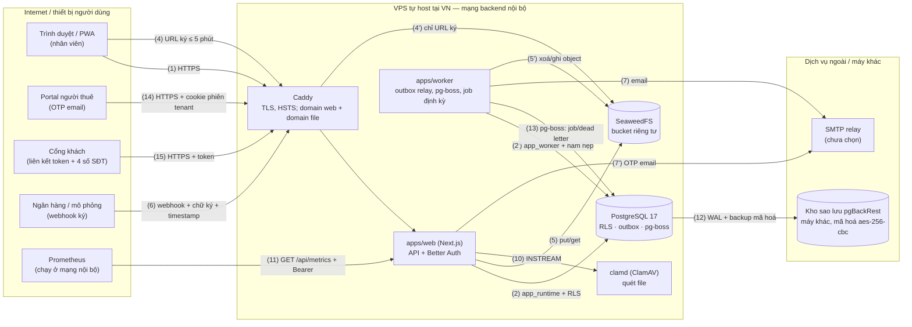

# THREAT-MODEL — Hotel Manager · phiên bản 2 · 2026-10-16

> Chủ: (chưa gán — Tech Lead) · Duyệt: chờ · Phạm vi: web/API, worker (pg-boss/outbox), PostgreSQL, SeaweedFS, Better Auth, Caddy, clamd, kho sao lưu pgBackRest khác máy, Prometheus/`/api/metrics`, SMTP relay, portal người thuê (OTP) và liên kết khách, webhook mô phỏng, import/export.
> Ngoài phạm vi V1: OTA, IoT/khoá, ngân hàng thật (chưa có hợp đồng). Các mục này phải có threat model riêng khi bật.
> Kế hoạch gốc §16 xác định ba rủi ro nghiêm trọng nhất: xem nhầm dữ liệu cơ sở khác, sửa tiền không dấu vết, lộ giấy tờ nhận dạng.
> Tiêu chuẩn: ASVS 5.0.0 L2 cho luồng tiền/quyền (`PROJECT.md` §5) · OWASP Top 10:2025 (bảng §4b). Bằng chứng ở dạng `đường dẫn` «tên test» — `scripts/ops-docs.test.mjs` kiểm file có thật và tên test còn nằm trong file đó.

## 1. Tài sản
| ID | Tài sản | Phân loại | Ảnh hưởng |
|---|---|---|---|
| A-01 | Giấy tờ nhận dạng: số và ảnh CCCD/hộ chiếu | nhạy cảm (NĐ 356/2025 — [T], chưa đối chiếu bản gốc) | pháp lý, thiệt hại cho khách |
| A-02 | Dữ liệu cá nhân cơ bản: tên, SĐT, email, địa chỉ của người thuê, khách, nhân viên | cá nhân | pháp lý, uy tín |
| A-03 | Sổ tiền: phiếu, thanh toán, phân bổ, cọc, bút toán | toàn vẹn | mất tiền, tranh chấp, gian lận |
| A-04 | Tồn phòng: allocation, booking, hợp đồng | toàn vẹn, sẵn sàng | bán trùng, khách không có phòng |
| A-05 | Ranh giới tenant (dữ liệu giữa các tổ chức) | bí mật | sự cố nghiêm trọng, chặn phát hành |
| A-06 | Secret: `BETTER_AUTH_SECRET`, khoá S3 SeaweedFS, khoá mã hoá pgBackRest, DB URL, khoá ký webhook, khoá email | bí mật | chiếm toàn hệ thống |
| A-07 | Tài khoản nhân viên có quyền tiền/quản trị | xác thực | gian lận, lộ dữ liệu hàng loạt |
| A-08 | Bản sao lưu, file xuất | bí mật | lộ dữ liệu hàng loạt |

## 2. Thành phần, luồng dữ liệu và ranh giới tin cậy

- Luồng cũ giữ số: (1) trình duyệt → web · (2) web → DB · (3) Better Auth (cùng tiến trình web, cùng Postgres) · (4) URL ký tới file · (5) object storage · (6) webhook · (7) email · (8) import file Excel/CSV (qua web) · (9) link tải file xuất có hạn.
- Luồng mới ở v2: (10) web → clamd · (11) Prometheus → `/api/metrics` · (12) Postgres → kho sao lưu khác máy · (13) pg-boss/dead letter · (14) portal người thuê · (15) cổng khách.
- Ranh giới: TB1 Internet ↔ Caddy/web · TB2 web/worker ↔ DB (role + RLS) · TB3 ↔ dịch vụ ngoài/máy khác (SMTP, kho sao lưu) · TB4 portal/cổng khách (xác thực bằng người thuê/token, không phải nhân viên) ↔ web · TB5 Prometheus ↔ `/api/metrics` (Bearer, chỉ nội bộ).

## 3. Kẻ tấn công giả định
| Ai | Năng lực | Mục tiêu |
|---|---|---|
| Người lạ trên Internet | request tuỳ ý, bot | dò tài khoản, spam booking engine, DoS |
| Nhân viên tổ chức A | phiên hợp lệ, đổi ID trong request | đọc/sửa dữ liệu tổ chức B hoặc cơ sở ngoài phạm vi |
| Nhân viên gian lận trong cùng tổ chức | quyền lễ tân/thu ngân | sửa/hoàn tiền không dấu vết, xoá chứng từ |
| Người thuê/khách | link portal | xem phiếu của người khác, kéo dài link |
| Người gửi webhook giả | biết endpoint | tạo "đã thu" giả |
| Kẻ chiếm thiết bị | điện thoại nhân viên bị mất | đọc cache, phiên còn sống |
| Hỗ trợ nền tảng lạm quyền | tài khoản support | xem dữ liệu khách hàng ngoài yêu cầu |

## 4. Mối đe doạ (STRIDE)
> **Trạng thái** (quyết định xử lý, AGENTS §5): `mitigate` = giảm bằng biện pháp đã làm có bằng chứng · `accept` = chấp nhận có điều kiện ghi rõ · `transfer` = chuyển cho bên khác/người. Cột "Còn lại" ghi phần chưa xong (chờ người/hạ tầng). Không còn mối đe doạ nào ở trạng thái "mở".

| ID | Luồng | STRIDE | Mối đe doạ | Mức | Trạng thái | Biện pháp | Bằng chứng nghiệm thu | Còn lại |
|---|---|---|---|---|---|---|---|---|
| TM-01 | 2 | I | Truy vấn hoặc job thiếu điều kiện tenant, IDOR qua đổi `property_id`/`id` | Cao | mitigate | INV-G1: FK ghép `organization_id`, RLS `app.org_id` (FORCE + WITH CHECK), role không BYPASSRLS, `authorize()` trên mọi command; 404 cho tài nguyên ngoài scope | IND-SAAS-002 · IND-SAAS-003 · `packages/app/src/tenancy/tenancy.db.test.ts` «ngữ cảnh A chỉ thấy hàng của A» · `packages/app/src/access/access.db.test.ts` «phủ mọi bảng có organization_id hiện có» · `packages/testkit/src/harness.db.test.ts` «không superuser, không BYPASSRLS» · `packages/app/src/http/command-route.db.test.ts` «tổ chức không phải thành viên → 404» | — |
| TM-02 | 1 | S | Chiếm tài khoản nhân viên (đoán mật khẩu, phiên bị lộ) | Cao | mitigate | MFA bắt buộc cho owner/manager/accountant/lễ tân có quyền tiền mặt, khoá tạm 5 lần sai/15 phút, rate limit IP, mật khẩu băm Argon2id (m=19 MiB, t=2, p=1; băm scrypt cũ tự nâng cấp khi đăng nhập; D-031), cookie HttpOnly/SameSite, thu hồi membership có hiệu lực ngay, đặt lại MFA chỉ do owner khác | `packages/app/src/access/auth.db.test.ts` «5 lần sai rồi đúng mật khẩu vẫn bị khoá» · «thu hồi membership → request kế tiếp mất quyền ngay» · «đăng nhập đúng → cookie phiên HttpOnly, SameSite=Lax» · «chủ chưa bật MFA → MFA_REQUIRED» · `packages/app/src/access/mfa-recovery.db.test.ts` «owner khác đặt lại MFA của quản lý» · `packages/app/src/auth/password-hash.db.test.ts` «cột password là Argon2id PHC» · «user băm scrypt mặc định cũ vẫn đăng nhập được» · «PHC tham số quá lớn/nhỏ bị từ chối nhanh» | Cờ `Secure` của cookie phụ thuộc HTTPS ở Caddy khi có VPS (kiểm lúc triển khai) |
| TM-03 | 1 | T/R | Sửa hoặc xoá chứng từ đã ghi sổ, hoàn tiền không duyệt | Cao | mitigate | INV-G4, INV-F1, INV-F5, INV-F6: trigger chặn UPDATE/DELETE/TRUNCATE, đảo một lần có lý do, hạn mức + duyệt khác người, audit append-only | IND-FIN-002 · SEC-LOG-007 · `packages/app/src/ledger/ledger.db.test.ts` «UPDATE/DELETE/TRUNCATE sổ bị chặn» · «đảo lần hai → INVALID_TRANSITION» · `packages/app/src/approvals/approvals.db.test.ts` «hoàn 6.000.000 > 5.000.000 → APPROVAL_LIMIT_EXCEEDED» · `packages/app/src/pipeline/command-pipeline.db.test.ts` «app_runtime không UPDATE/DELETE được audit_events» | — |
| TM-04 | 6 | S/T | Webhook giả hoặc phát lại tạo tiền | Cao | mitigate | Chữ ký HMAC + timestamp, kiểm tài khoản nhận và số tiền, inbox unique, INV-F3/F4; web runtime không ghi được thanh toán tự động | IND-FIN-004 · `packages/app/src/ledger/ledger.db.test.ts` «chữ ký webhook sim» · «100 lần cùng payload song song → 1 inbox, 1 bank_transaction» · `packages/app/src/reconciliation/reconciliation.db.test.ts` «chữ ký sai hoặc quá hạn → 401, không ghi inbox» · «trùng event id khác số tiền → 409 INBOX_HASH_MISMATCH» | Chỉ có adapter mô phỏng; webhook ngân hàng thật cần hợp đồng + threat model riêng (chờ người) |
| TM-05 | 1 | T | Race khi đặt phòng hoặc phân bổ tiền | Cao | mitigate | EXCLUDE gist (INV-I1), khoá hàng theo thứ tự (INV-F2), idempotency (INV-G5), SERIALIZABLE/khoá + retry 40001 | IND-FIN-013 · `packages/app/src/inventory/inventory.db.test.ts` «100 lệnh song song giữ cùng phòng cùng khoảng → đúng 1 thành công» · `packages/app/src/payments/payments.db.test.ts` «hai người cùng phân bổ một khoản 2.000.000» · `packages/app/src/pipeline/command-pipeline.db.test.ts` «100 request song song cùng key → đúng 1 hiệu lực» | — |
| TM-06 | 4 | I | Lộ ảnh/số CCCD qua URL đoán được, cache PWA, log, DB | Cao | mitigate | Bucket riêng tư, URL ký ≤ 5 phút, kiểm quyền mỗi lần cấp URL, SW không cache ảnh/API PII, số giấy tờ AES-256-GCM + blind index (D-004), che trong log/màn hình, tách quyền buồng phòng | `packages/app/src/files/files.db.test.ts` «bucket riêng tư: GET không ký → 403» · «buồng phòng xin URL → 404» · `apps/web/e2e/pwa.spec.ts` «Cache Storage chỉ chứa asset tĩnh có hash» · `packages/app/src/logging/logger.test.ts` «khoá nhạy cảm thành *** ở mọi độ sâu» · `packages/app/src/identity/identity.db.test.ts` «mọi cột của hàng, audit và kết quả command lưu lại không chứa số» · `packages/app/src/crypto/pii.test.ts` «ciphertext không chứa số rõ» | Quản lý khoá PII ngoài máy chủ khi chạy thật (RUNBOOK §5; `docs/ops/runbooks/secret-leak.md`) |
| TM-07 | 4,8,10 | T/E | Upload độc hại: file thực thi, ảnh chứa EXIF GPS, mã độc, file quá lớn | TB | mitigate | Allowlist MIME + magic bytes (chỉ JPEG/PNG/WebP), ≤ 10 MB, bỏ EXIF/metadata, quét clamd (fail closed), tên object ngẫu nhiên theo tiền tố tổ chức | `packages/app/src/files/files.db.test.ts` «file chứa mã độc (EICAR) → rejected» · «JPEG có EXIF/GPS → lưu bản đã bỏ EXIF» · «vượt 10 MB → 413 FILE_TOO_LARGE» · «FILE_TYPE_NOT_ALLOWED, không lưu gì» · `packages/app/src/files/clamd.test.ts` «EICAR → nhiễm» | — |
| TM-08 | 9 | I | Xuất dữ liệu vượt scope; CSV formula injection | TB | mitigate | Quyền xuất riêng, xác thực lại ≤ 5 phút, link ≤ 15 phút + audit, giới hạn 10 yêu cầu/giờ, escape `= + - @ \t \r`, XLSX ghi công thức dạng chuỗi | `packages/app/src/exports/exports.db.test.ts` «owner chưa xác thực lại gần đây → 401 REAUTH_REQUIRED» · «ô chữ bắt đầu = + - @ tab CR → thêm» · «kế toán chỉ HS1: file chỉ có HS1» · «XLSX: ô công thức ghi kiểu chuỗi» | — |
| TM-09 | 1 | T | XSS hoặc CSRF trên form tiền | TB | mitigate | React escape, CSP có nonce không `unsafe-inline`, kiểm `Origin` cho ghi (chỉ webhook ký được miễn), SameSite=Lax | `packages/app/src/http/security.test.ts` «isSameOriginWrite (TM-09)» · «có nonce, không 'unsafe-inline', chặn framing» · `apps/web/e2e/smoke.spec.ts` «khác origin 403» · `apps/web/e2e/pwa.spec.ts` «CSP không chặn script/SW» | — |
| TM-10 | — | I | Secret lọt vào client bundle, repo hoặc log | Cao | mitigate | Biến secret không có tiền tố `NEXT_PUBLIC_`, validate env lúc khởi động (thiếu → dừng, nêu tên không nêu giá trị), gitleaks CI + `.gitleaksignore` có kiểm soát, che log | BASE-SEC-002 · SEC-SECRET-001 · `packages/app/src/config/client-bundle.test.ts` «không file tĩnh nào nhắc tên biến bí mật» · `packages/app/src/config/schema.test.ts` «không biến bí mật nào mang tiền tố NEXT_PUBLIC_» · «env trống → ConfigError liệt kê TÊN biến thiếu, không lộ giá trị» · `.github/workflows/secret-scan.yml` | Quy trình khi lộ: `docs/ops/runbooks/secret-leak.md` |
| TM-11 | 14,15 | S/I | Liên kết khách bị đoán hoặc chia sẻ lại | TB | mitigate | Token 256 bit chỉ lưu SHA-256, hạn = giờ trả + 48 giờ, phạm vi một lượt ở, bước hai 4 số cuối SĐT (sai 5 lần khoá), thu hồi + audit, 10 lần sai/phút/IP → 429 | `packages/app/src/portal/guest-links.db.test.ts` «hết hạn → 410 LINK_EXPIRED; lượt ở khác → 404» · «sai 4 số cuối 5 lần → link bị khoá» · «cùng IP 10 token sai trong 1 phút» · «token chỉ lưu băm» | — |
| TM-12 | 1 | E/R | Hỗ trợ nền tảng truy cập dữ liệu khách tuỳ ý | TB | accept | Chấp nhận có điều kiện: pilot chưa có tính năng hỗ trợ truy cập (F-015, V1); vai trò `platform_support` không có quyền nghiệp vụ nào. Bật F-015 phải có quyền tạm thời theo ticket + audit trước khi dùng | `packages/domain/src/access/authorize.test.ts` «quyền theo vai trò» (platform_support bị FORBIDDEN) | Mở lại khi làm F-015 (V1): test quyền hết hạn → 403 |
| TM-13 | 1 | D | Spam đăng nhập, export nặng, dò token | TB | mitigate | Rate limit đăng nhập theo IP, giới hạn xuất/giờ, giới hạn liên kết khách theo IP, `statement_timeout`, báo cáo/xuất chạy qua job | `packages/app/src/access/auth.db.test.ts` «mặc định bật rate limit theo IP, đăng nhập tối đa 20 lần/phút/IP» · `packages/app/src/tenancy/tenancy.db.test.ts` «app_runtime có statement_timeout» · `packages/app/src/exports/exports.db.test.ts` «Giới hạn tần suất» · `packages/app/src/portal/guest-links.db.test.ts` «cùng IP 10 token sai trong 1 phút» | Rate limit tầng Caddy/mạng (DoS thể tích) thuộc hạ tầng — chờ VPS |
| TM-14 | 7,15 | I | Email chứa PII nhạy cảm hoặc gửi nhầm người | TB | mitigate | Mẫu chỉ đọc biến khai báo, che dạng CCCD/SĐT/số tài khoản, email nhắc không ghi số tiền, kiểm người nhận lúc gửi, log che email, chặn chèn header | `packages/app/src/notifications/templates.test.ts` «không CCCD/hộ chiếu/SĐT/số tài khoản/tên/nội dung hợp đồng dù có trong dữ liệu» · «che email trong log» · «ký tự xuống dòng bị loại khỏi tiêu đề» | SMTP relay chưa chọn (xem `docs/privacy/processors.md`) |
| TM-15 | 1 | I | Thiết bị mất còn phiên và cache | TB | mitigate | Phiên rảnh 12 giờ, thu hồi phiên từ xa khi đổi quyền, `Cache-Control: no-store` cho trang/API, Cache Storage chỉ asset tĩnh, đăng xuất/đổi tổ chức gọi `clearUserData` + `Clear-Site-Data` | `apps/web/e2e/pwa.spec.ts` «S-005 trang và API mang Cache-Control: no-store» · «Cache Storage chỉ chứa asset tĩnh có hash» · `apps/web/e2e/smoke.spec.ts` «trang đã đăng nhập mang Cache-Control: no-store» · `packages/app/src/access/auth.db.test.ts` «phiên rảnh 12 giờ» | Chưa có E2E đăng xuất → Cache Storage rỗng (`clearUserData` chỉ kiểm gián tiếp) |
| TM-16 | — | E/I/D | Máy chủ tự host bị xâm nhập hoặc mất (lộ cổng DB/S3, image chưa vá, đĩa hỏng) | Cao | transfer | Phần repo đã làm: mạng `backend` nội bộ (DB/S3 không publish cổng), chỉ Caddy ra 80/443, mọi image ghim digest sha256 (test chặn image không ghim), pgBackRest + kho khác máy, diễn tập PITR chạy ở CI. Phần còn lại là việc của người/vận hành, chuyển giao: thuê và cứng hoá VPS, tường lửa, vá OS/image, giám sát | `scripts/check-image-pins.test.mjs` «mọi image ghim digest sha256» · `deploy/compose.yaml` · `scripts/db-backup-restore-check.sh` (CI job `backup-restore`) | Chuyển cho người (sau khi có VPS): kiểm cổng mở trên staging (`ss -tlnp` chỉ 80/443/22), tường lửa, SSH bằng khoá, vá OS và image định kỳ, CIS/docker-bench (STD-SEC-007), kho sao lưu và khoá ngoài máy |
| TM-17 | 10 | D/T | clamd sập hoặc bị làm chậm khiến file bị coi là sạch, hoặc chặn mọi tải lên | TB | mitigate | Fail closed: máy quét lỗi/treo → 503, không lưu file; giới hạn kích thước trước khi gửi; `/api/ready` báo `scanner`; production bắt buộc `CLAMD_HOST` | `packages/app/src/files/files.db.test.ts` «clamd lỗi/không trả lời → 503 SERVICE_UNAVAILABLE» · `packages/app/src/files/clamd.test.ts` «clamd không trả lời → quá hạn → ScannerUnavailableError» · `packages/app/src/observability/metrics.test.ts` «máy quét treo → timeout» · `packages/app/src/config/schema.test.ts` «production thiếu CLAMD_HOST → lỗi khởi động» | Chữ ký lỗi thời xem TM-23; clamd chưa có trong `deploy/compose.yaml` (thêm khi triển khai) |
| TM-18 | 11 | I | `/api/metrics` hoặc token metrics bị lộ → lộ quy mô/hoạt động hệ thống | TB | mitigate | Bearer token HKDF từ bí mật phiên, so sánh thời gian hằng, 401 không nói thêm, chỉ số tổng hợp không nhãn tổ chức, không chứa PII | `packages/app/src/observability/metrics.test.ts` «Bearer đúng → true; sai/thiếu/khác bí mật → false» · «không token → 401, không chạm CSDL» · `packages/app/src/observability/observability.db.test.ts` «không nhãn tổ chức» · «sai token → 401» | Chặn thêm `/api/metrics` ở Caddy theo IP của Prometheus khi triển khai (chưa có trong `deploy/Caddyfile`) |
| TM-19 | 14 | S/E | Chiếm tài khoản người thuê qua OTP email, hoặc dùng OTP để lách MFA nhân viên | Cao | mitigate | OTP lưu băm, hạn ngắn, sai 3 lần mất hiệu lực, chỉ cho tài khoản thuần người thuê (nhân viên/email lạ bị từ chối như mã sai), RLS chặn người thuê đọc sổ cái/audit/dữ liệu người khác, gọi API nhân viên → 403 | `packages/app/src/portal/portal-access.db.test.ts` «OTP lưu băm; mã sai 3 lần thì mã đúng cũng hết hiệu lực» · «nhân viên / email lạ: không gửi mã» · «lệnh cấu hình của nhân viên → 403» · «RLS: người thuê không đọc dữ liệu nội bộ của tổ chức» | — |
| TM-20 | 12 | I/D | Bản sao lưu bị lộ hoặc mất (kho khác máy, khoá giải mã) | Cao | transfer | Phần repo đã làm: repo pgBackRest mã hoá aes-256-cbc (cấu hình mẫu), retention full 4, diễn tập PITR dữ liệu giả kiểm `cipher` và so dữ liệu sau khôi phục. Phần còn lại là việc của người, chuyển giao: chọn và trả tiền kho sao lưu ở máy/nhà cung cấp khác, giữ khoá `PGBACKREST_REPO_CIPHER_PASS` ngoài máy chủ, diễn tập trên hạ tầng thật | `scripts/db-backup-restore-check.sh` (assert cipher + so dữ liệu sau PITR) · `deploy/pgbackrest.conf.example` · CI job `backup-restore` · `docs/ops/runbooks/restore.md` | Chuyển cho người: chọn kho sao lưu thật, giữ khoá ngoài máy, diễn tập khôi phục bởi người khác tác giả (OPS-DR); diễn tập CI chỉ chứng minh quy trình trên dữ liệu giả |
| TM-21 | 2' | E/T | Worker/pg-boss chạy sai ngữ cảnh tenant hoặc leo quyền (job cũ chạy với quyền đã thu hồi) | TB | mitigate | Role `app_worker` không BYPASSRLS, chỉ gọi hàm SECURITY DEFINER phạm vi hẹp, job dựng lại quyền người yêu cầu lúc chạy, trạng thái job chỉ worker đổi, dead letter không mất dữ liệu | `packages/testkit/src/harness.db.test.ts` «không superuser, không BYPASSRLS» · `packages/app/src/exports/exports.db.test.ts` «bị đình chỉ trước khi job chạy → failed FORBIDDEN» · `packages/app/src/reconciliation/reconciliation.db.test.ts` «web runtime không ghi được thanh toán tự động» · `packages/app/src/import/import-retention.db.test.ts` «vai trò runtime không gọi được hàm hạn giữ» · `apps/worker/src/command-pipeline-relay.db.test.ts` | Tiến trình worker chạy thật (T-301) |
| TM-22 | 2,5' | I | File xuất, object file và dữ liệu nhập thô giữ quá hạn; dữ liệu đã xoá còn ở bản sao lưu | TB | mitigate | Job hạn giữ xoá object rồi mới đánh dấu `deleted`; làm rỗng `import_rows.raw/data` sau 30 ngày; link tải file xuất hết hạn 15 phút; sổ dữ liệu `docs/privacy/data-map.yaml` liệt kê cột có tên PII và cột tự do kèm hạn giữ đề xuất (rào theo tên cột + rà tay cột tự do, không phải bảo đảm tuyệt đối) | `packages/app/src/import/import-retention.db.test.ts` «hạn giữ (job)» · «xoá object lỗi → không đánh dấu deleted» · `packages/app/src/privacy/data-map.db.test.ts` «mọi cột có tên khớp mẫu PII» | Bản sao lưu giữ dữ liệu đã xoá tới hết retention (chấp nhận, ghi ở §5). Hạn giữ và job tự xoá cho `persons`/`identity_documents`: xem TM-24 |
| TM-23 | 10 | T | Chữ ký ClamAV lỗi thời nên file độc không bị phát hiện | TB | transfer | Chuyển cho vận hành: đặt `freshclam` cập nhật chữ ký định kỳ và cảnh báo khi chữ ký quá cũ; chưa có trong repo (clamd chưa nằm trong `deploy/compose.yaml`, chưa có metric tuổi chữ ký). Phần đã làm chỉ là fail closed khi máy quét lỗi (TM-17), không giảm thiểu rủi ro chữ ký cũ | `packages/app/src/files/clamd.test.ts` «clamd không trả lời → quá hạn → ScannerUnavailableError» · `deploy/compose.yaml` | Chưa giảm thiểu: người triển khai `freshclam`, giám sát tuổi chữ ký, thêm metric/rule cảnh báo sau khi có VPS |
| TM-24 | 2,5' | I | Dữ liệu người thuê/khách (`persons`) và giấy tờ (`identity_documents`) giữ vô thời hạn vì chưa có chính sách hạn giữ và job tự xoá | TB | transfer | Chuyển cho pháp lý + Tech Lead: chốt hạn giữ cùng DPIA rồi làm job xoá/ẩn danh. Hiện chỉ có cơ chế (`persons.anonymized_at`, `identity_documents.anonymized_at`, cột `identity_documents.retention_until` chưa có chính sách đặt giá trị); `docs/privacy/data-map.yaml` ghi rõ "chưa có job tự xoá". Chưa giảm thiểu | `packages/app/src/privacy/data-map.db.test.ts` «mọi cột có tên khớp mẫu PII» · `docs/privacy/data-map.yaml` (trường `retention`: "chưa có job tự xoá") | Việc còn lại: chốt hạn giữ (pháp lý, DPIA), job tự xoá/ẩn danh theo hạn + test, đặt `retention_until` (PLAN đợt sau); RK-019

## 4b. OWASP Top 10:2025 → biện pháp → bằng chứng
> Tên mục lấy từ https://top10.owasp.org/2025/ (owasp.org/Top10/2025 chuyển hướng về đây), truy cập 2026-10-16.

| Mục | Tên (OWASP 2025) | Biện pháp trong hệ thống | Mối đe doạ | Bằng chứng |
|---|---|---|---|---|
| A01:2025 | Broken Access Control | RLS FORCE theo tổ chức, `authorize()` theo vai trò/phạm vi cơ sở, 404 cho tài nguyên ngoài scope, người thuê chỉ thấy của mình | TM-01, TM-11, TM-12, TM-19 | `packages/app/src/tenancy/tenancy.db.test.ts` «ngữ cảnh A chỉ thấy hàng của A» · `packages/domain/src/access/authorize.test.ts` «quyền theo vai trò» · `packages/app/src/portal/portal-access.db.test.ts` «RLS: người thuê không đọc dữ liệu nội bộ của tổ chức» |
| A02:2025 | Security Misconfiguration | Env kiểm bằng schema lúc khởi động, `.env.example` khớp schema, CSP nonce, HSTS ở Caddy, mạng backend nội bộ, image ghim digest | TM-09, TM-10, TM-16 | `packages/app/src/config/schema.test.ts` «.env.example khớp schema» · `packages/app/src/http/security.test.ts` «có nonce, không 'unsafe-inline', chặn framing» · `scripts/check-image-pins.test.mjs` «có compose và Dockerfile để kiểm» · `deploy/Caddyfile` |
| A03:2025 | Software Supply Chain Failures | `pnpm install --frozen-lockfile`, action ghim SHA, quét lỗ hổng `pnpm audit` theo PR + lịch, kiểm giấy phép allowlist, độ tuổi tối thiểu gói mới (`minimumReleaseAge`) | TM-16 | SEC-SUPPLY-001 · SEC-SUPPLY-003 · SEC-SUPPLY-006 · `scripts/check-licenses.test.mjs` · `.github/workflows/dep-audit.yml` |
| A04:2025 | Cryptographic Failures | AES-256-GCM cho số giấy tờ (khoá xoay được, AAD gắn hàng), token liên kết chỉ lưu SHA-256, OTP lưu băm, HKDF cho token metrics/huỷ đăng ký, TLS tự động + HSTS, sao lưu mã hoá | TM-06, TM-11, TM-19, TM-20 | `packages/app/src/crypto/pii.test.ts` «ciphertext không chứa số rõ» · «xoay khoá: keyring mới vẫn đọc bản cũ theo key_id» · `scripts/db-backup-restore-check.sh` |
| A05:2025 | Injection | Kysely/SQL tham số hoá, Zod schema strict cho mọi command, escape công thức CSV/XLSX, mẫu email chỉ đọc biến khai báo, CSP | TM-08, TM-09, TM-14 | `packages/app/src/http/command-route.db.test.ts` «schema sai → 422 kèm errors[path, code]» · `packages/app/src/exports/exports.db.test.ts` «ô chữ bắt đầu = + - @ tab CR → thêm» · `packages/app/src/notifications/templates.test.ts` «ký tự xuống dòng bị loại khỏi tiêu đề» |
| A06:2025 | Insecure Design | Threat model này; bất biến tiền/tồn ở ràng buộc CSDL (EXCLUDE, trigger, CHECK), hạn mức + duyệt khác người, SPEC/ADR trước mã | TM-03, TM-05 | `packages/app/src/inventory/inventory.db.test.ts` «100 lệnh song song giữ cùng phòng cùng khoảng → đúng 1 thành công» · `packages/app/src/ledger/ledger.db.test.ts` «bút toán lệch bị CSDL từ chối lúc commit» · `packages/app/src/approvals/approvals.db.test.ts` «tự duyệt bị cấm kể cả owner» |
| A07:2025 | Authentication Failures | Email/mật khẩu + TOTP bắt buộc theo vai trò, khoá tạm theo tài khoản, rate limit IP, phiên rảnh 12 giờ, OTP người thuê có giới hạn thử | TM-02, TM-19 | `packages/app/src/access/auth.db.test.ts` «5 lần sai rồi đúng mật khẩu vẫn bị khoá» · «chủ chưa bật MFA → MFA_REQUIRED» · `packages/app/src/portal/portal-access.db.test.ts` «OTP lưu băm; mã sai 3 lần thì mã đúng cũng hết hiệu lực» |
| A08:2025 | Software or Data Integrity Failures | Sổ phụ append-only, idempotency, webhook có chữ ký + chống phát lại, SW chỉ precache asset có hash, lockfile đóng băng | TM-03, TM-04 | `packages/app/src/ledger/ledger.db.test.ts` «chữ ký webhook sim» · `packages/app/src/pipeline/command-pipeline.db.test.ts` «cùng key + khác payload → 422 IDEMPOTENCY_CONFLICT» · `apps/web/e2e/pwa.spec.ts` «Cache Storage chỉ chứa asset tĩnh có hash» |
| A09:2025 | Security Logging and Alerting Failures | Audit append-only trong cùng transaction, log JSON có `correlation_id` + che bí mật/PII + `category=security`, metric + rule cảnh báo có runbook | TM-03, TM-10, TM-18 | SEC-LOG-007 · `packages/app/src/logging/logger.test.ts` «sự kiện bảo mật có category=security» · `packages/app/src/pipeline/command-pipeline.db.test.ts` «audit che dữ liệu nhạy cảm trước khi ghi» · `deploy/prometheus/alerts.yml` |
| A10:2025 | Mishandling of Exceptional Conditions | Đóng an toàn: thiếu `app.org_id` → lỗi không trả hàng, máy quét lỗi → 503, lỗi không dự kiến → 500 không lộ chi tiết, `/api/ready` 503 khi thiếu phụ thuộc, lỗi dịch sang mã nghiệp vụ | TM-01, TM-17 | `packages/app/src/tenancy/tenancy.db.test.ts` «không đặt app.org_id → truy vấn lỗi (đóng an toàn), không trả hàng» · `packages/app/src/http/command-route.db.test.ts` «lỗi không dự kiến → 500 INTERNAL, không lộ chi tiết» · `packages/app/src/observability/metrics.test.ts` «không lộ thông điệp lỗi» |

## 5. Giả định và chấp nhận rủi ro
- **Tự host (ADR-0002): không còn nhà cung cấp lo lớp hạ tầng.** Đội chịu vá OS/image, tường lửa (chỉ mở 80/443 qua Caddy; DB, S3, clamd không ra Internet), SSH bằng khoá, giám sát và sao lưu ngoài máy (TM-16, TM-20).
- Better Auth: chỉ bật email/mật khẩu, twoFactor, quản lý phiên và email OTP cho người thuê (D-005, D-016); theo dõi advisory (nhiều lỗi High/Critical ở plugin năm 2026). Telemetry của Better Auth tắt (`telemetry.enabled=false`; `createAuth` từ chối khởi động nếu env `BETTER_AUTH_TELEMETRY` bật). Mật khẩu: Argon2id qua `crypto.argon2` của Node ≥ 24.7 (`packages/app/src/auth/password.ts`), trần tham số khi xác minh m ≤ 65536 KiB, t ≤ 10, p ≤ 4 để băm hỏng trong CSDL không gây DoS.
- **Chấp nhận (accept) — TM-12:** chưa có hỗ trợ truy cập tạm thời; chủ dự án chờ quyết lúc làm F-015.
- **Chấp nhận — dữ liệu đã xoá còn trong bản sao lưu** tới khi bản sao lưu hết hạn giữ (TM-22); hạn giữ chốt cùng DPIA (người). TM-24 (`persons`/`identity_documents` chưa có job tự xoá) là việc chuyển giao, chưa phải giảm thiểu.
- Pilot tiết kiệm chưa bật PITR → RPO DB tối đa 24 giờ. Chỉ chấp nhận khi chủ pilot đã hiểu giới hạn này và có nguồn đối chiếu (kế hoạch §17). Người chấp nhận: chủ dự án, chờ quyết. (Cấu hình đề xuất của repo đã bật PITR — `deploy/compose.yaml`.)

## 5b. Điểm fail-open (BASE-ERR-010)
Nguyên tắc: lỗi ở cổng bảo mật (xác thực, phân quyền, validate, chữ ký, quét mã độc) → **từ chối**, không fallback cho qua. **Không có điểm fail-open ở cổng bảo mật.** Bằng chứng: `packages/app/src/http/secure-defaults-fail-closed.test.ts` «backend xác thực (getSession) ném lỗi → không bao giờ 2xx» (500/401, không chạm CSDL) · `packages/app/src/files/files.db.test.ts` (clamd lỗi → 503).

Degrade có kiểm soát (KHÔNG phải cổng bảo mật, có log):
| Thành phần | Khi lỗi | Vì sao chấp nhận |
|---|---|---|
| Ghi sự kiện bảo mật ra log (`emitSecurity`) | request vẫn được xử lý theo kết quả quyền đã quyết | chỉ là bản ghi quan sát; quyết định cho/từ chối đã xong trước đó, audit nghiệp vụ nằm cùng transaction |
| Gửi email/thông báo | job retry theo lịch rồi `dead`, log lỗi | không ảnh hưởng quyền hay tiền |
| Đánh dấu job `failed` best-effort trước khi ném lại lỗi gốc | lỗi gốc vẫn tới worker/pg-boss | xem ngoại lệ có lý do ở `secure-defaults-swallow.test.ts` |

## 6. Hành động còn mở (chờ người hoặc hạ tầng)
| Mối đe doạ | Việc | Chủ |
|---|---|---|
| TM-04 | Webhook ngân hàng thật: hợp đồng + threat model riêng | chủ dự án |
| TM-12 | Quyền hỗ trợ tạm thời theo ticket + test hết hạn → 403 khi làm F-015 | Tech Lead (V1) |
| TM-13, TM-16, TM-18 | Rate limit/chặn `/api/metrics` ở Caddy, kiểm cổng mở trên staging, tường lửa, vá image, CIS/docker-bench | người, sau khi mua VPS |
| TM-17, TM-23 | Thêm clamd vào compose; cập nhật chữ ký ClamAV (`freshclam`) + giám sát tuổi chữ ký | người, sau khi có VPS |
| TM-24 | Chốt hạn giữ `persons`/`identity_documents` cùng DPIA; job tự xoá/ẩn danh + test | pháp lý + Tech Lead |
| TM-20 | Chọn kho sao lưu khác máy; diễn tập khôi phục bởi người khác tác giả | chủ dự án + vận hành |
| TM-21 | Worker chạy thật (T-301) | PLAN đợt 4 |
| Tất cả | DPIA + pháp lý duyệt trước dữ liệu thật (`docs/privacy/`) | pháp lý (ngoài vòng tự động) |
| TM-15 | E2E đăng xuất → Cache Storage rỗng | PLAN đợt sau |

## Lịch sử
| Phiên bản | Ngày | Thay đổi | Lý do |
|---|---|---|---|
| 1 | 2026-10-15 | tạo | G4 từ kế hoạch §16 |
| 1.1 | 2026-10-15 | tự host (TM-16), gán lại task theo PLAN mới, TM-04/09/13 có chủ | ADR-0002, review độc lập |
| 2 | 2026-10-16 | DFD Mermaid thêm clamd, worker/pg-boss, kho sao lưu khác máy, Prometheus, portal/cổng khách; TM-17…TM-24; cột Trạng thái (mitigate/accept/transfer) + bằng chứng trỏ test thật; bảng OWASP Top 10:2025 | T-308 (BASE-SEC-011, SEC-TM-001/003/005/006, STD-SEC-003) |
